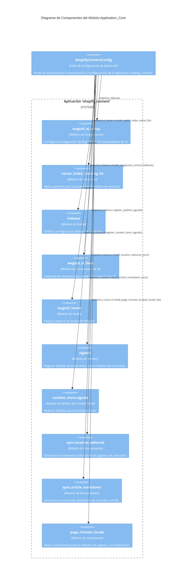

# Módulo Application_Core

El módulo `Application_Core` encapsula la configuración principal de la aplicación `shopify_content` dentro del sistema de gestión de contenido. Su función primordial es inicializar y configurar los diversos subsistemas y componentes de la aplicación durante el arranque de Django, asegurando la correcta integración con Wagtail, Shopify y otros servicios.

## Arquitectura y Componentes

El corazón de este módulo es la clase `ShopifyContentConfig`, que hereda de `django.apps.AppConfig`. Esta clase es responsable de la configuración de nivel de aplicación y de ejecutar lógica de inicialización a través de su método `ready()`.

### Clase `ShopifyContentConfig`

La configuración define el comportamiento de la aplicación `shopify_content` dentro del entorno Django.

*   `default_auto_field`: Especifica el tipo de campo automático predeterminado para modelos, configurado como `django.db.models.BigAutoField`.
*   `name`: El nombre de la aplicación Django, `shopify_content`.
*   `verbose_name`: Un nombre legible para humanos, 'Shopify Content', que se utiliza en la interfaz de administración de Django.

El método `ready()` es crucial, ya que se invoca una vez que Django ha cargado todas las aplicaciones. Contiene una serie de importaciones y llamadas a funciones que parchean o inicializan diversas funcionalidades:

1.  **Integración con Wagtail AI:**
    *   `shopify_content.wagtail_ai_setup`: Inicializa la configuración relacionada con la inteligencia artificial en Wagtail.
    *   `shopify_content.vector_index_tracking_fix.install_stable_index_name_fix()`: Aplica una corrección para el seguimiento de nombres de índices de vectores, fundamental para la estabilidad y consistencia de las búsquedas basadas en IA.
    *   `shopify_content.wagtail_ai_fixes.install_suggested_content_fallback()`: Implementa un mecanismo de reserva para el contenido sugerido por IA, mejorando la robustez del sistema.

2.  **Configuración de Índices:**
    *   `shopify_content.indexes`: Importa las definiciones y configuraciones de índices de contenido, esenciales para la búsqueda y organización.

3.  **Hooks y Señales de Wagtail:**
    *   `shopify_content.wagtail_hooks`: Carga los hooks de Wagtail, que permiten extender y personalizar el comportamiento del CMS.
    *   `shopify_content.signals.register_publish_signals()`: Registra manejadores de señales que se activan en eventos de publicación, asegurando la coherencia y actualizaciones en cascada.

4.  **Señales del Content Store:**
    *   `shopify_content.content_store.signals.register_content_store_signals()`: Registra señales específicas para el almacenamiento y gestión de contenido.

5.  **Sincronización de Contenido Editorial:**
    *   `shopify_content.sync.location_editorial.install_location_editorial_sync()`: Instala la lógica de sincronización para el contenido editorial de las páginas de ubicación (LocationPage), asegurando que los campos RichText se publiquen correctamente.
    *   `shopify_content.sync.article_markdown.install_article_markdown_sync()`: Modifica la superficie de importación de `ArticlePage.body` para que el contenido Markdown nativo se convierta a HTML renderizado antes de ser enviado a Shopify, manteniendo la compatibilidad con las API existentes.

6.  **Correcciones de Localización:**
    *   `shopify_content.page_chooser_locale.install_page_chooser_browse_locale_fix()`: Aplica una corrección para el selector de páginas que mejora el manejo de la localización.

### Diagrama de Componentes del Módulo Application_Core

## Relaciones con Otros Módulos

El `Application_Core` (`shopify_content/apps.py`) es el punto de orquestación central para la aplicación `shopify_content`. Se relaciona estrechamente con varios submódulos, como se detalla a continuación:

*   **Administración e Integración de la UI de Wagtail:** La inicialización de `wagtail_hooks` y las correcciones de Wagtail AI (`wagtail_ai_fixes`, `wagtail_ai_setup`) en este módulo, demuestran su interacción directa con el subsistema de administración de Wagtail. Para más detalles, consulte [Admin___Wagtail_UI_Integration.md](Admin___Wagtail_UI_Integration.md).
*   **Servicios de Sincronización de Contenido:** Las llamadas a `install_location_editorial_sync()` y `install_article_markdown_sync()` en el método `ready()` son fundamentales para la sincronización de contenido con plataformas externas, como Shopify. Puede encontrar más información en [Content_Synchronization_Services.md](../Content_Synchronization_Services.Pmd).
*   **Modelos de Contenido:** Aunque este módulo no define directamente modelos, las señales que registra (`register_publish_signals`, `register_content_store_signals`) y las correcciones de sincronización (`location_editorial_sync`, `article_markdown_sync`) afectan directamente a cómo se gestionan y persisten los diferentes tipos de contenido. Para detalles sobre los modelos, consulte:
    *   [Content_Base_Models___Mixins.md](Content_Base_Models___Mixins.md)
    *   [Blog_Content_Models.md](Blog_Content_Models.md)
    *   [Location_Content_Models.md](Location_Content_Models.md)
*   **Wagtail StreamField Blocks:** Las funcionalidades de sincronización de Markdown a HTML impactan en cómo el contenido creado con los bloques de Wagtail StreamField se materializa para su uso externo. Para más información, vea [Wagtail_StreamField_Blocks.md](Wagtail_StreamField_Blocks.md).
*   **Content Store - Lógica Editorial:** El registro de señales del `content_store` subraya la importancia de este módulo en la gestión del ciclo de vida del contenido editorial. Consulte [Content_Store___Editorial_Logic.md](Content_Store___Editorial_Logic.md) para más detalles.

El módulo `Application_Core` garantiza que todos estos componentes y servicios estén correctamente interconectados y configurados al iniciar la aplicación, formando la base para una gestión de contenido robusta y sincronizada.

