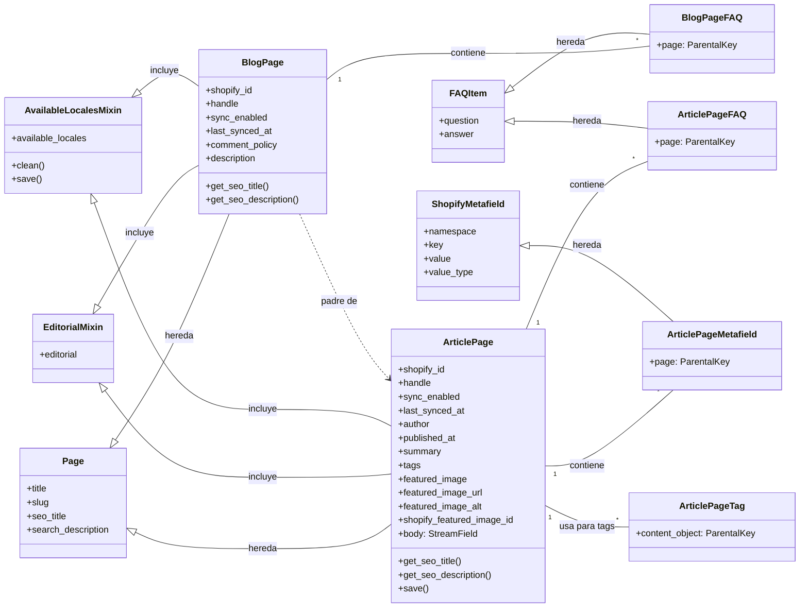

# Modelos de Contenido del Blog

Este módulo, `Blog_Content_Models`, es una parte fundamental del sistema de gestión de contenido de Wagtail para Shopify. Define los modelos de datos para la creación y administración de blogs y artículos, facilitando la sincronización de contenido enriquecido y metadatos entre Wagtail y Shopify.

## Propósito y Funcionalidad Principal

El propósito principal de este módulo es modelar la estructura de los blogs y los artículos que se publicarán en una tienda Shopify, utilizando el CMS Wagtail. Permite a los editores:

*   Crear y organizar blogs como contenedores de artículos.
*   Escribir y gestionar artículos individuales con contenido enriquecido (usando StreamField).
*   Configurar metadatos específicos de Shopify para blogs y artículos, como IDs de Shopify, handles, políticas de comentarios y fechas de publicación.
*   Definir los idiomas (`locales`) en los que el contenido está disponible en la tienda.
*   Gestionar preguntas frecuentes (FAQ) y campos personalizados (`metafields`) asociados a blogs y artículos.
*   Preparar el contenido para su exportación a Shopify, incluyendo la gestión de SEO a través de metafields.

## Arquitectura y Relaciones de Componentes

El módulo `Blog_Content_Models` se basa en las capacidades de Wagtail para la gestión de páginas y extiende estas funcionalidades para satisfacer las necesidades específicas de Shopify. Se compone de las siguientes clases principales y sus relaciones:

### Componentes Clave:

*   **`AvailableLocalesMixin`**: Este mixin abstracto se utiliza tanto en `BlogPage` como en `ArticlePage` para gestionar los `locales` (idiomas y regiones) en los que el contenido debe estar disponible en la tienda Shopify. La validación de los `locales` se realiza antes de guardar el modelo, asegurando que se ajusten a los códigos de idioma de Wagtail y al estado de sincronización.
*   **`BlogPage`**: Representa una página de blog en Wagtail que se sincroniza con un Blog de Shopify.
    *   Hereda de `Page` (Wagtail), `EditorialMixin` y `AvailableLocalesMixin`.
    *   Contiene campos para `shopify_id`, `handle`, `sync_enabled`, `last_synced_at`, `comment_policy` y `description`.
    *   Los campos `description`, `seo_title` y `search_description` se sincronizan con Shopify como metafields.
    *   Puede contener múltiples `BlogPageFAQ`.
*   **`BlogPageFAQ`**: Un modelo `Orderable` que extiende `FAQItem` y se enlaza a `BlogPage` para añadir preguntas frecuentes.
*   **`ArticlePage`**: Representa un artículo individual dentro de un `BlogPage`, sincronizándose con un Artículo de Shopify.
    *   Hereda de `Page` (Wagtail), `EditorialMixin` y `AvailableLocalesMixin`.
    *   Incluye campos para `shopify_id`, `handle`, `sync_enabled`, `last_synced_at`, `author`, `published_at`, `summary`, `tags`, `featured_image` (imagen de Wagtail), `featured_image_url` (URL de Shopify), `featured_image_alt` y `shopify_featured_image_id`.
    *   El cuerpo del artículo (`body`) se gestiona con un `StreamField`, permitiendo contenido enriquecido que se renderiza a HTML para Shopify.
    *   Los campos `seo_title` y `search_description` se sincronizan con Shopify como metafields.
    *   Puede contener múltiples `ArticlePageTag`, `ArticlePageFAQ` y `ArticlePageMetafield`.
*   **`ArticlePageTag`**: Un modelo utilizado por `ClusterTaggableManager` para asociar etiquetas a `ArticlePage`.
*   **`ArticlePageFAQ`**: Un modelo `Orderable` que extiende `FAQItem` y se enlaza a `ArticlePage` para añadir preguntas frecuentes.
*   **`ArticlePageMetafield`**: Un modelo `Orderable` que extiende `ShopifyMetafield` y se enlaza a `ArticlePage` para añadir metafields personalizados.

### Dependencias Externas al Módulo:

*   **[`Wagtail_Content_Management___API/Shopify_Content_Management/Content_Base_Models___Mixins.md`](Content_Base_Models___Mixins.md)**: Este módulo proporciona los mixins `FAQItem` y `ShopifyMetafield`, que son utilizados por `BlogPageFAQ`, `ArticlePageFAQ` y `ArticlePageMetafield`. También define `SHOPIFY_SYNC_PANELS` y `SHOPIFY_SEO_PANELS` que se usan para la interfaz de administración de Wagtail.
*   **[`Wagtail_Content_Management___API/Shopify_Content_Management/Wagtail_StreamField_Blocks.md`](Wagtail_StreamField_Blocks.md)**: El `StreamField` de `ArticlePage` utiliza `ARTICLE_BODY_BLOCKS` definidos en este módulo, lo que permite la creación de contenido flexible y estructurado.
*   **`shopify_content.content_store.domain.EditorialMixin`**: Utilizado por `BlogPage` y `ArticlePage` para la gestión de contenido editorial.
*   **`shopify_content.available_locales`**: Proporciona funciones para la validación y el establecimiento de `locales` disponibles.
*   **`shopify_content.forms.ArticlePageForm`, `BlogPageForm`**: Formularios personalizados para las páginas de blog y artículo, mejorando la experiencia de edición en Wagtail.

## Integración en el Sistema General

El módulo `Blog_Content_Models` se integra en la plataforma de la siguiente manera:

1.  **Wagtail CMS**: Define los tipos de página (`Page`) dentro de Wagtail, permitiendo a los editores crear y gestionar contenido de blogs y artículos de manera intuitiva a través de la interfaz de administración de Wagtail. Los `content_panels`, `promote_panels` y `edit_handler` configuran la UI para la entrada de datos.
2.  **Sincronización con Shopify**: Los campos específicos de Shopify (`shopify_id`, `handle`, `sync_enabled`, `last_synced_at`, etc.) y los metafields asociados permiten que un proceso de sincronización (probablemente gestionado por otros módulos como [`Wagtail_Content_Management___API/Shopify_Content_Management/Content_Synchronization_Services.md`](Content_Synchronization_Services.md)) transfiera el contenido de Wagtail a Shopify y viceversa. Esto asegura que la tienda Shopify refleje el contenido gestionado en Wagtail.
3.  **API de Contenido (Wagtail Content API)**: Los modelos definidos en este módulo son la base para la serialización y exposición del contenido de blogs y artículos a través de la API, permitiendo que otras aplicaciones o frontends consuman este contenido. Los esquemas en [`Wagtail_Content_Management___API/Shopify_Content_API.md`](../Shopify_Content_API.md) como `api/schemas/blog.py::BlogIn`, `api/schemas/blog.py::BlogOut`, `api/schemas/article.py::ArticleIn`, `api/schemas/article.py::ArticleOut` se basan directamente en la estructura de estos modelos.
4.  **Gestión de SEO**: Los campos de SEO en `BlogPage` y `ArticlePage` se mapean a metafields de Shopify (`global.title_tag`, `global.description_tag`), lo que permite un control granular sobre cómo aparece el contenido en los resultados de búsqueda para la tienda Shopify.
5.  **Internacionalización (i18n)**: El `AvailableLocalesMixin` permite la gestión de contenido multilingüe, indicando en qué `locales` está disponible cada blog o artículo, lo cual es crucial para tiendas Shopify con presencia global.
