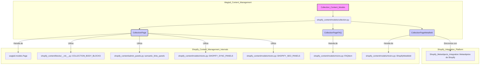

# Modelos de Contenido de Colección

El módulo `Collection_Content_Models` es parte integral del sistema de gestión de contenido de Wagtail, diseñado específicamente para interactuar con las colecciones de Shopify. Este módulo define los modelos de datos que representan las colecciones de Shopify dentro del entorno de Wagtail, facilitando la sincronización y la gestión del contenido de las colecciones.

## Propósito y Funcionalidad Principal

El objetivo principal de `Collection_Content_Models` es proporcionar una representación estructurada de las colecciones de Shopify en Wagtail. Esto permite a los administradores de contenido crear, editar y gestionar colecciones utilizando la interfaz de Wagtail, y luego sincronizar estos cambios con Shopify. El módulo se encarga de mapear los campos de las colecciones de Shopify a los campos de Wagtail, incluyendo detalles como el título, el handle, la descripción, el orden de clasificación, el SEO y los metacampos.

## Arquitectura y Relaciones de Componentes

El módulo `Collection_Content_Models` se compone principalmente de los siguientes modelos de Django/Wagtail definidos en `shopify_content/models/collection.py`:

*   **`CollectionPage`**: El modelo principal que representa una página de colección de Shopify en Wagtail.
*   **`CollectionPage.Meta`**: La clase de metadatos asociada a `CollectionPage` para configuraciones de modelo.
*   **`CollectionPageFAQ`**: Un modelo para gestionar preguntas frecuentes asociadas a una `CollectionPage`.
*   **`CollectionPageMetafield`**: Un modelo para gestionar metacampos asociados a una `CollectionPage`.

### `CollectionPage`

El modelo `CollectionPage` hereda de `wagtail.models.Page` y extiende sus funcionalidades para incluir campos específicos de las colecciones de Shopify.

**Campos Clave:**

*   `shopify_id`: Identificador GID de Shopify para la colección.
*   `handle`: El handle de la colección, utilizado para URLs y referencias internas.
*   `sync_enabled`: Un booleano que indica si la sincronización con Shopify está activa.
*   `last_synced_at`: Fecha y hora de la última sincronización.
*   `theme_config`: Un campo JSON para configuraciones de tema específicas.
*   `sort_order`: Define el orden de clasificación de los productos en la colección (ej., alfabético, por precio, etc.).
*   `description`: Un `StreamField` de Wagtail que permite una descripción rica en contenido para la colección, que se renderiza a HTML para `descriptionHtml` de Shopify.
*   `image_url`, `image_alt_text`, `shopify_image_id`: Campos relacionados con la imagen principal de la colección.
*   `template`: La plantilla HTML utilizada para renderizar la página en el frontend de Wagtail.
*   `parent_page_types`, `subpage_types`: Restricciones sobre dónde se puede crear esta página en la jerarquía de Wagtail.
*   `search_fields`: Campos utilizados para la búsqueda en Wagtail.

**Paneles de Administración ( `edit_handler`):**

El `CollectionPage` utiliza un `TabbedInterface` en el panel de administración de Wagtail para organizar los campos en pestañas lógicas:

*   **Contenido**: Incluye `sort_order`, `description`, paneles de enlaces semánticos, `image_url`, `image_alt_text`, `faqs` y `metafields`.
*   **SEO / Promoción**: Contiene los paneles de SEO de Shopify (definidos en `SHOPIFY_SEO_PANELS`) y el `slug` interno de Wagtail.
*   **Shopify**: Alberga los paneles de sincronización de Shopify (definidos en `SHOPIFY_SYNC_PANELS`) y el `theme_config`.
*   **Configuración**: Hereda los paneles de configuración de la clase `Page` base de Wagtail.

### `CollectionPageFAQ` y `CollectionPageMetafield`

Estos modelos son `InlinePanel`s anidados dentro de `CollectionPage`, lo que permite a los editores gestionar preguntas frecuentes y metacampos directamente desde la página de colección.

*   `CollectionPageFAQ` hereda de `FAQItem`, un mixin que probablemente define campos comunes para preguntas frecuentes (ver `mixins.py`).
*   `CollectionPageMetafield` hereda de `ShopifyMetafield`, un mixin que gestiona la estructura y el comportamiento de los metacampos de Shopify (ver `mixins.py`).

### Relaciones con Otros Módulos

*   **`shopify_content.blocks`**: El campo `description` de `CollectionPage` utiliza `COLLECTION_BODY_BLOCKS`, que son definidos en `shopify_content/blocks/__init__.py`. Esto vincula directamente el contenido de la descripción de la colección con los bloques de StreamField predefinidos en Wagtail.
*   **`shopify_content.admin_panels`**: Utiliza `semantic_links_panels()` para la gestión de enlaces semánticos y `SHOPIFY_SYNC_PANELS`, `SHOPIFY_SEO_PANELS` de `mixins.py` para la organización de la interfaz de administración.
*   **`shopify_content.models.mixins`**: `CollectionPageFAQ` y `CollectionPageMetafield` heredan de `FAQItem` y `ShopifyMetafield` respectivamente, lo que establece una relación de herencia y reutilización de código para elementos comunes del contenido de Shopify.
*   **`Application_Core___Shopify_Integration_Platform/Shopify_Metaobjects_Integration.md`**: Es probable que los `metafields` gestionados por `CollectionPageMetafield` se sincronicen con los metaobjetos de Shopify, cuya lógica es gestionada por el módulo `Shopify_Metaobjects_Integration`.



## Flujo de Datos

1.  **Entrada de Datos:**
    *   Los administradores de contenido interactúan con la `CollectionPage` a través de la interfaz de administración de Wagtail, introduciendo títulos, descripciones, orden de clasificación, imágenes, FAQs y metacampos.
    *   Los datos de colecciones de Shopify pueden ser importados al sistema Wagtail, poblando los campos de `CollectionPage`. El comando `shopify_content/management/commands/import_shopify_collections.py::Command` es el encargado de realizar esta importación (ver [Comandos de Importación y Materialización de Contenido](Content_Import___Materialization_Commands.md)).

2.  **Procesamiento y Almacenamiento:**
    *   Los datos introducidos en la `CollectionPage` son validados y almacenados en la base de datos de Django.
    *   El campo `description` (`StreamField`) se serializa a JSON antes de su almacenamiento.

3.  **Sincronización con Shopify:**
    *   Cuando una `CollectionPage` se guarda o se publica, o mediante un proceso de sincronización programado, los datos de la página se transforman al formato compatible con la API de Shopify.
    *   Los `metafields` definidos en `CollectionPageMetafield` se envían a Shopify como metacampos de la colección.
    *   La `description` de `StreamField` se renderiza a HTML para el campo `descriptionHtml` de Shopify.
    *   La configuración del tema (`theme_config`) se serializa y se envía como metacampos a Shopify.

4.  **Salida de Datos:**
    *   El contenido de la `CollectionPage` se utiliza para renderizar la página de colección en el frontend de Wagtail utilizando la plantilla `shopify_content/collection_page.html`.
    *   Los datos de la `CollectionPage` pueden ser consultados a través de la API, donde los esquemas definidos en `api/schemas/collection.py` (`CollectionIn`, `CollectionOut`, `CollectionPatch`) se encargarán de la serialización y deserialización de los datos (ver [API de Contenido de Shopify](../Shopify_Content_API.md)).

```mermaid
graph LR
    subgraph Wagtail_Admin_UI
        A[Editor de Contenido Wagtail] --> B{CollectionPageForm};
        B --> C[Colección Wagtail<br>(CollectionPage)];
    end

    subgraph Shopify_Content_Management
        C --> D[Guardar/Publicar];
        D --> E[Sincronizador de Shopify];
        E -- API de Shopify --> F[Colección en Shopify];
        G[Comando Importar Colecciones<br>(import_shopify_collections.py)] --> H[API de Shopify];
        H -- Datos de Colección --> C;
    end

    subgraph Frontend
        C -- Renderizado de Plantilla --> I[Página Web de Colección];
    end

    subgraph API
        J[Solicitud API] -- `api/schemas/collection.py` --> C;
        C -- `api/schemas/collection.py` --> K[Respuesta API];
    end

    style C fill:#ccf,stroke:#333,stroke-width:2px
    style F fill:#9cf,stroke:#333,stroke-width:2px
```

## Cómo encaja en el Sistema General

El módulo `Collection_Content_Models` es un pilar fundamental dentro de la [Gestión de Contenido de Shopify](../Shopify_Content_Management.md). Proporciona el modelo de datos para las colecciones, lo que permite que el sistema de Wagtail actúe como una fuente de verdad para el contenido de las colecciones de Shopify.

*   **Integración con Shopify:** Es el puente entre el contenido de colección gestionado en Wagtail y la plataforma de Shopify, asegurando que los datos de la colección estén sincronizados y sean coherentes en ambos sistemas.
*   **Base para la API:** Las definiciones de modelos en este módulo son la base para los esquemas de API relacionados con colecciones, permitiendo que las colecciones sean accesibles y manipulables programáticamente a través de la [API de Contenido de Shopify](../Shopify_Content_API.md).
*   **Extensibilidad:** Al utilizar `StreamField`, mixins y paneles en línea, el modelo `CollectionPage` es altamente extensible, permitiendo la adición de nuevos tipos de contenido y metadatos sin alterar el modelo base.
*   **Gestión de Contenido Unificada:** Permite que los editores gestionen las colecciones junto con otros tipos de contenido (como artículos, productos y páginas de inicio) dentro de un único entorno de administración de Wagtail, lo que simplifica el flujo de trabajo editorial.

En resumen, `Collection_Content_Models` es esencial para la funcionalidad de gestión de colecciones dentro de la integración de Wagtail con Shopify, proporcionando los modelos de datos y la lógica necesaria para una gestión de contenido robusta y sincronizada.
