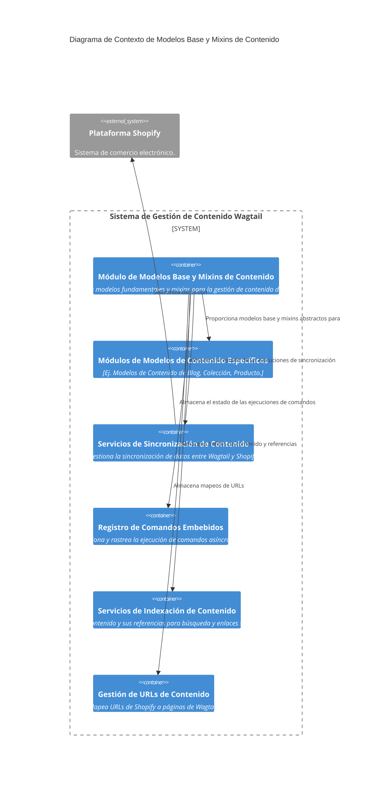

# Modelos Base y Mixins de Contenido

Este módulo define los modelos base y mixins fundamentales utilizados en la gestión de contenido de Shopify dentro de Wagtail. Proporciona las estructuras de datos esenciales para representar páginas raíz, elementos de FAQ, metacampos, y el seguimiento de operaciones de sincronización y comandos embebidos. Estos componentes son la base para construir tipos de página de contenido más específicos y para integrar la funcionalidad de Wagtail con la plataforma Shopify.

## Arquitectura General

El módulo `Content_Base_Models___Mixins` se encuentra dentro del `Shopify_Content_Management` y establece los cimientos para la estructura de contenido. Se relaciona con otros módulos al proporcionar modelos abstractos y concretos que son extendidos o referenciados por páginas de contenido más específicas, como artículos, colecciones o productos. También interactúa con los servicios de sincronización y comandos embebidos para gestionar el flujo de datos entre Wagtail y Shopify.

## Funcionalidad de Sub-módulos

Este módulo se descompone en los siguientes sub-módulos, cada uno con responsabilidades específicas:

- [Página Raíz de Shopify](Content_Base_Models___Mixins/Content_Base_Models___Mixins_ShopifyRootPage_Modelo.md): Define la página raíz para el contenido de Shopify, sirviendo como un contenedor para todos los tipos de páginas de contenido de Shopify.
- [Modelos de Indexación de Contenido](Content_Base_Models___Mixins/Content_Base_Models___Mixins_ModelosIndexacionContenido.md): Proporciona modelos para indexar el contenido editorial y sus referencias.
- [Modelo de Índice de URL de Contenido](Content_Base_Models___Mixins/Content_Base_Models___Mixins_ModeloIndiceURLContenido.md): Mapea rutas de URL de Shopify a páginas de Wagtail para correlacionar el tráfico y el contenido del CMS.
- [Modelos de Enlaces Semánticos](Content_Base_Models___Mixins/Content_Base_Models___Mixins_ModelosEnlacesSemanticos.md): Define modelos para enlaces internos tipados entre páginas de Wagtail.
- [Modelo de Ejecución de Comandos Embebidos](Content_Base_Models___Mixins/Content_Base_Models___Mixins_ModeloEjecucionComandoEmbebido.md): Rastrea la ejecución de trabajos de comandos de gestión asíncronos enviados desde la aplicación Shopify.
- [Modelo de Ejecución de Sincronización de Shopify](Content_Base_Models___Mixins/Content_Base_Models___Mixins_ModeloEjecucionSincronizacionShopify.md): Rastrea los trabajos de sincronización asíncronos de Shopify (entrada/salida) enviados a través de Celery.
- [Mixins Base](Content_Base_Models___Mixins/Content_Base_Models___Mixins_MixinsBase.md): Define mixins reutilizables como elementos FAQ y metacampos de Shopify para diferentes tipos de páginas.
