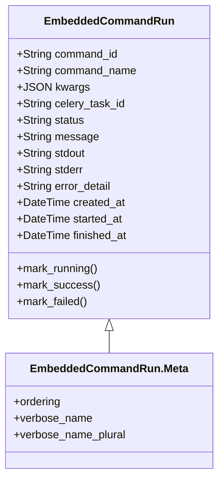
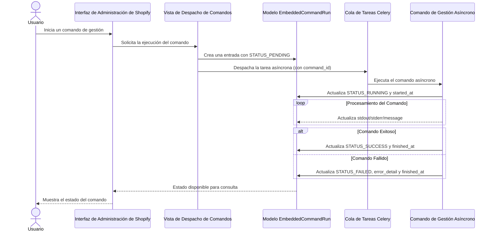

# Modelo EmbeddedCommandRun

El módulo `Content_Base_Models___Mixins_ModeloEjecucionComandoEmbebido` define el modelo `EmbeddedCommandRun`, que se encarga de rastrear la ejecución de comandos de gestión asíncronos despachados desde la aplicación Shopify incrustada.

## Propósito y Funcionalidad

El modelo `EmbeddedCommandRun` es fundamental para monitorizar el estado y los resultados de las tareas de larga duración o asíncronas iniciadas desde la interfaz de administración de Shopify. Permite a los administradores y desarrolladores seguir el progreso de estos comandos, revisar sus salidas y diagnosticar posibles errores. Esto es crucial para operaciones como la sincronización de contenido, la importación masiva de datos o cualquier otra tarea que no pueda completarse instantáneamente.

## Arquitectura y Relaciones

### Diagrama de Clases

### Componentes del Módulo

*   **`EmbeddedCommandRun`**: El modelo principal de Django que almacena la información detallada de cada ejecución de comando. Incluye campos para el ID del comando, nombre, argumentos, ID de la tarea de Celery, estado, mensajes, salida estándar, errores y marcas de tiempo.
*   **`EmbeddedCommandRun.Meta`**: Clase interna que define metadatos para el modelo `EmbeddedCommandRun`, como el ordenamiento por defecto (`-created_at`) y los nombres legibles para la administración (`verbose_name`, `verbose_name_plural`).

### Relaciones con Otros Módulos

Este modelo se relaciona estrechamente con:

*   **`Application_Core___Shopify_Embedded_App`**: El módulo principal de la aplicación incrustada de Shopify, desde donde se despachan los comandos asíncronos. Específicamente, las vistas dentro de este módulo (como `EmbeddedCommandDispatchView` en `Application_Core___Shopify_Integration_Platform/Core_Application___Shopify_Embedded_App/Core_Application___Shopify_Embedded_App_vistas_autenticacion.md`) interactúan con este modelo para registrar y actualizar el estado de las ejecuciones de comandos.
*   **`Admin___Wagtail_UI_Integration`**: El panel de administración de Wagtail (`EmbeddedCommandRunAdmin` en [Admin___Wagtail_UI_Integration/Admin___Wagtail_UI_Integration_administracion_modelos.md](../Admin___Wagtail_UI_Integration/Admin___Wagtail_UI_Integration_administracion_modelos.md)) utiliza este modelo para mostrar y gestionar las ejecuciones de comandos a través de la interfaz de administración.
*   **`Embedded_Commands_Registry`**: El registro de comandos embebidos (`EmbeddedCommandSpec` en [Embedded_Commands_Registry.md](../Embedded_Commands_Registry.md)) define los comandos que pueden ser ejecutados y sus especificaciones, que luego son instanciados y ejecutados, resultando en entradas en `EmbeddedCommandRun`.
*   **Celery**: Aunque no se especifica directamente en este módulo, el campo `celery_task_id` indica una dependencia y una integración con el sistema de colas de tareas Celery para la ejecución asíncrona de los comandos de gestión.

## Flujo de Datos y Proceso

### Diagrama de Flujo de Ejecución de Comandos Embebidos

### Descripción del Flujo

1.  **Inicio del Comando**: Un usuario inicia un comando de gestión desde la interfaz de administración de Shopify. Esta acción es interceptada por una vista de despacho de comandos (`EmbeddedCommandDispatchView`).
2.  **Registro Inicial**: La vista de despacho crea una nueva instancia de `EmbeddedCommandRun` con un estado `pending` y registra los detalles del comando.
3.  **Despacho Asíncrono**: La vista despacha la ejecución real del comando a un sistema de cola de tareas asíncronas como Celery, pasando el `command_id` para su seguimiento.
4.  **Ejecución del Comando**: Celery recoge la tarea y ejecuta el comando de gestión asíncrono. Antes de la ejecución, el comando marca su estado como `running` en el modelo `EmbeddedCommandRun`.
5.  **Actualizaciones de Estado**: Durante su ejecución, el comando puede actualizar periódicamente la entrada en `EmbeddedCommandRun` con mensajes de progreso, salida estándar (`stdout`) o errores estándar (`stderr`).
6.  **Finalización del Comando**: Una vez que el comando finaliza, ya sea con éxito o con un fallo, actualiza el estado final (`success` o `failed`), los mensajes relevantes y la marca de tiempo `finished_at` en el modelo `EmbeddedCommandRun`.
7.  **Monitorización**: La interfaz de Shopify o un administrador puede consultar el estado de la ejecución del comando a través del modelo `EmbeddedCommandRun` para obtener información sobre su progreso y resultado.

## Configuración

No hay configuraciones específicas directamente en este módulo. Sin embargo, su funcionalidad depende de la configuración de Django para la base de datos y la integración con Celery, si se utiliza para el procesamiento asíncrono. Los comandos específicos que pueden ser ejecutados son definidos y registrados en el módulo [Embedded_Commands_Registry.md](../Embedded_Commands_Registry.md).
