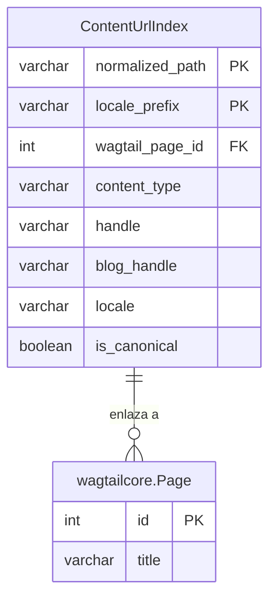
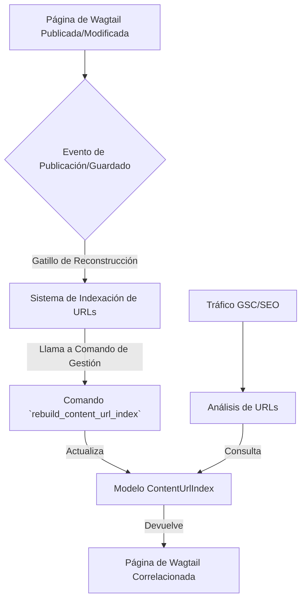

# Modelo IndiceURLContenido

Este módulo (`Content_Base_Models___Mixins_ModeloIndiceURLContenido`) define el modelo `ContentUrlIndex`, esencial para mapear las rutas URL de las tiendas Shopify a las páginas de contenido gestionadas en Wagtail. Este mapeo es fundamental para la correlación de datos de tráfico (por ejemplo, de Google Search Console) con el contenido específico del CMS, facilitando el análisis de SEO y la gestión del contenido.

## Propósito y Funcionalidad Principal

El `ContentUrlIndex` actúa como un índice materializado que permite una búsqueda eficiente de páginas de Wagtail basándose en sus rutas URL normalizadas y prefijos de localización (locale prefixes) de Shopify Markets. Cada entrada en este índice representa una relación directa entre una URL accesible en el storefront de Shopify y una página de Wagtail que la gestiona.

Sus funcionalidades clave incluyen:
*   **Correlación de URLs:** Permite asociar URLs de tráfico externas con sus respectivas páginas en el CMS.
*   **Soporte a Shopify Markets:** Maneja diferentes prefijos de localización para URLs, lo que es vital para tiendas que operan en múltiples mercados e idiomas.
*   **Identificación Canónica:** Indica si una URL es la variante canónica, lo que es importante para el SEO.
*   **Indexación para Búsqueda:** Proporciona índices de base de datos para búsquedas rápidas por tipo de contenido, handle, y handle de blog.

## Arquitectura y Relaciones entre Componentes

El módulo se compone principalmente del modelo `ContentUrlIndex` y su clase `Meta` anidada, que define la estructura y el comportamiento del modelo en la base de datos.

### `ContentUrlIndex`

Este modelo de Django representa una entrada única en el índice de URLs de contenido.

```python
class ContentUrlIndex(models.Model):
    normalized_path = models.CharField(...)
    wagtail_page = models.ForeignKey(...)
    content_type = models.CharField(...)
    handle = models.CharField(...)
    blog_handle = models.CharField(...)
    locale = models.CharField(...)
    locale_prefix = models.CharField(...)
    is_canonical = models.BooleanField(...)

    class Meta:
        # ... constraints and indexes
```

#### Campos del Modelo

*   **`normalized_path`**: Un `CharField` que almacena la ruta de la URL del storefront sin el dominio ni el prefijo de localización (ej. `/pages/glossary/alpha`). Es un campo indexado (`db_index=True`) para búsquedas rápidas.
*   **`wagtail_page`**: Una `ForeignKey` que enlaza a la página de Wagtail correspondiente (`wagtailcore.Page`). Cuando la página de Wagtail se elimina, la entrada del índice asociada también se elimina (`on_delete=models.CASCADE`). El `related_name` `content_url_index_entries` permite acceder a las entradas del índice desde una página de Wagtail.
*   **`content_type`**: Un `CharField` que especifica el tipo de contenido (ej. `product`, `collection`, `blog`, `article`, `glossary_term`, `location`, `home`, `index`, `root`). Es un campo indexado para clasificar y buscar contenido por tipo.
*   **`handle`**: Un `CharField` para el identificador único del contenido (handle), también indexado.
*   **`blog_handle`**: Un `CharField` opcional para el handle del blog padre, relevante solo para páginas de artículos.
*   **`locale`**: Un `CharField` opcional que almacena el código de localización de Wagtail (ej. `en-US`).
*   **`locale_prefix`**: Un `CharField` opcional para el prefijo de URL de Shopify Markets (ej. `es-us`). Es vacío para la versión canónica.
*   **`is_canonical`**: Un `BooleanField` que indica si esta entrada de URL es la variante canónica (sin prefijo de localización de Markets).

#### Clase `Meta`

La clase `Meta` define metadatos para el modelo `ContentUrlIndex`:
*   **`verbose_name` y `verbose_name_plural`**: Nombres legibles para el modelo en el panel de administración.
*   **`constraints`**: Incluye un `UniqueConstraint` para asegurar que la combinación de `normalized_path` y `locale_prefix` sea única, evitando duplicados en el índice.
*   **`indexes`**: Define dos índices adicionales para optimizar las consultas:
    *   `content_url_type_handle_idx`: Un índice sobre `content_type` y `handle`.
    *   `content_url_article_idx`: Un índice sobre `content_type`, `blog_handle` y `handle`, útil para búsquedas relacionadas con artículos.

### Diagrama de Entidad-Relación



## Integración en el Sistema General

El `ContentUrlIndex` juega un papel crítico en varios aspectos del sistema de gestión de contenido y la integración con Shopify:

### Flujo de Datos y Reconstrucción

El índice se construye y mantiene para reflejar el estado actual de las URLs de contenido.



El índice se reconstruye automáticamente cuando se publican o modifican páginas de Wagtail. Además, existe un comando de gestión (`rebuild_content_url_index`) que permite una reconstrucción manual o programada del índice completo. Este comando forma parte del módulo de [Content_Indexing___Semantic_Link_Commands](../Content_Indexing___Semantic_Link_Commands.md), el cual es responsable de la gestión y mantenimiento de los índices de contenido.

### Relación con otros módulos

*   **[Wagtail_Content_Management___API/Shopify_Content_Management/Content_Indexing___Semantic_Link_Commands.md](../Content_Indexing___Semantic_Link_Commands.md)**: Este módulo contiene el comando `rebuild_content_url_index`, que es el encargado de generar y actualizar las entradas en `ContentUrlIndex`.
*   **[Wagtail_Content_Management___API/Shopify_Content_Management/Content_URL___Link_Management.md](../Content_URL___Link_Management.md)**: Provee funcionalidades para la resolución y gestión de URLs de contenido, haciendo uso del `ContentUrlIndex` para mapear y correlacionar URLs.
*   **`wagtailcore.Page`**: El modelo `ContentUrlIndex` tiene una relación de clave externa con las páginas base de Wagtail, lo que permite enlazar directamente las URLs del storefront con el contenido del CMS.

Este módulo es un componente vital para la estrategia de SEO y la capacidad de análisis del CMS, asegurando que las URLs de Shopify se puedan rastrear y correlacionar eficazmente con el contenido de Wagtail.
