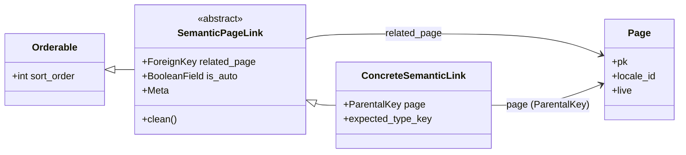

# Modelos de Enlaces Semánticos

Este módulo, `shopify_content/models/semantic_links.py`, es fundamental para la gestión de relaciones semánticas internas entre diversas páginas de contenido de Wagtail dentro del sistema de gestión de contenido de Shopify. Proporciona un mecanismo flexible y extensible para definir y almacenar enlaces tipados entre diferentes tipos de contenido, como artículos, productos, colecciones y términos de glosario.

## Propósito y Funcionalidad Principal

El objetivo principal de este módulo es permitir la creación y administración de enlaces internos entre páginas de contenido, lo que es crucial para la navegación del sitio, la optimización para motores de búsqueda (SEO) y la contextualización del contenido. La funcionalidad central incluye:

1.  **Definición de Enlaces Abstractos**: Proporciona la clase base `SemanticPageLink` que define la estructura común para todos los enlaces semánticos, incluyendo una referencia a la página relacionada y un indicador de si el enlace fue generado automáticamente.
2.  **Generación Dinámica de Modelos**: Utiliza un enfoque dinámico para crear modelos de enlaces concretos en tiempo de ejecución. Esto significa que no se requiere definir un nuevo modelo de Django para cada posible combinación de tipo de página padre y tipo de relación (por ejemplo, "productos relacionados" para una página de Artículo o Colección). Esta flexibilidad reduce la redundancia y facilita la adición de nuevos tipos de enlaces.
3.  **Validación de Tipo de Página**: Asegura que los enlaces creados apunten a páginas del tipo esperado a través de una lógica de validación robusta en el método `clean` de cada modelo de enlace.
4.  **Gestión de Enlaces Automáticos vs. Manuales**: Distingue entre enlaces generados automáticamente (por ejemplo, a través de procesos de sincronización o sugerencias) y enlaces curados manualmente por editores, lo que permite una gestión diferenciada.
5.  **Utilidades para la Interacción con Enlaces**: Ofrece una serie de funciones para consultar, contar, eliminar y obtener enlaces semánticos asociados a una página, facilitando la integración con otras partes del sistema.

## Arquitectura y Relaciones de Componentes

### `SemanticPageLink`

La clase `SemanticPageLink` es un modelo abstracto que sirve como plantilla para todos los modelos de enlaces semánticos. Hereda de `wagtail.models.Orderable`, lo que permite ordenar los enlaces relacionados dentro de una página.

*   `related_page`: Una clave foránea a `wagtailcore.Page`, que apunta a la página de destino del enlace.
*   `is_auto`: Un campo booleano que indica si el enlace fue generado automáticamente (`True`) o curado manualmente (`False`).
*   `clean()`: Método de validación que verifica que el `related_page` sea del `expected_type_key` definido para el modelo de enlace concreto.

### Generación Dinámica de Modelos

La función `_make_typed_link_model` es el corazón de la flexibilidad del módulo. Genera clases de modelos de Django concretas en tiempo de ejecución. Estos modelos generados heredan de `SemanticPageLink` y tienen un `ParentalKey` que los vincula a su página padre específica (por ejemplo, `ArticlePage`, `CollectionPage`, `HomePage`, etc.).

Los parámetros clave para la generación de modelos provienen de constantes definidas en `shopify_content.semantic_links.constants`, como `PARENT_PAGE_CONFIG` y `RELATION_CONFIG`, que especifican los tipos de páginas padre y las relaciones semánticas permitidas (por ejemplo, `related_products`, `related_articles`).

### Diagrama de Modelo de Datos de Enlaces Semánticos

Este diagrama ilustra la estructura fundamental de los modelos de enlaces semánticos y cómo se relacionan entre sí.


*Modelo de datos que muestra la relación entre `SemanticPageLink` (abstracto) y sus implementaciones concretas, así como su dependencia de `wagtailcore.Page`.*

### Diagrama de Generación Dinámica de Modelos

Este diagrama detalla el proceso mediante el cual se crean los modelos de enlaces semánticos de forma dinámica.

```mermaid
graph TD
    A[shopify_content/semantic_links/constants] --> B{PARENT_PAGE_CONFIG, RELATION_CONFIG, SEMANTIC_LINK_RELATION_NAMES}
    B --> C[Función _make_typed_link_model]
    C -- Itera sobre --> D[Combinaciones de Página Padre y Relación]
    D --> E[Genera Clase de Modelo de Enlace Concreta]
    E -- Hereda de --> F[SemanticPageLink]
    E -- Vincula con ParentalKey a --> G[Página Padre Específica (e.g., ArticlePage)]
    E --> H[TYPED_SEMANTIC_LINK_MODELS (diccionario)]
    E --> I[ALL_TYPED_SEMANTIC_LINK_MODELS (lista)]
    H & I --> J[Uso en tiempo de ejecución]
```
*Flujo que describe cómo las configuraciones y constantes impulsan la creación dinámica de modelos de enlaces semánticos.*

### Diagrama de Flujo de Validación de Enlaces Semánticos

Este diagrama muestra cómo se valida el tipo de página relacionada cuando se guarda un `SemanticPageLink`.

```mermaid
graph TD
    A[Guardar/Validar SemanticPageLink] --> B{Llama a clean()}
    B --> C{expected_type_key definido?}
    C -- Sí --> D[Obtener tipo real de related_page usando page_type_key_for()]
    D --> E{Tipo real == expected_type_key?}
    E -- Sí --> F[Validación exitosa]
    E -- No --> G[Lanza ValidationError: Tipo de página inesperado]
    C -- No --> F
```
*Proceso de validación para asegurar que la página relacionada en un enlace semántico sea del tipo correcto.*

## Cómo encaja en el sistema general

El módulo de modelos de enlaces semánticos es un componente clave dentro del subsistema de [Wagtail Content Management](../../Shopify_Content_Management.md). Facilita la creación de una red de contenido interconectado, lo que es esencial para experiencias de usuario ricas y para la optimización de motores de búsqueda.

*   **Integración con Modelos de Contenido**: Los modelos generados dinámicamente (`ArticleRelatedProductLink`, `CollectionRelatedArticleLink`, etc.) se integran directamente con los modelos de páginas de contenido (por ejemplo, [Blog Content Models](../Blog_Content_Models.md), [Collection Content Models](../Collection_Content_Models.md), [Product Content Models](../Product_Content_Models.md)) a través de `ParentalKey` y campos `related_name`.
*   **API de Enlaces Semánticos**: La funcionalidad de este módulo se expone a través de la [Shopify Content API](../../Shopify_Content_API.md), específicamente mediante esquemas definidos en `api/schemas/semantic_links.py`, lo que permite que otros servicios o frontends interactúen con los enlaces semánticos.
*   **Herramientas de Sincronización y Gestión**: Los comandos de gestión de Django, como `shopify_content/management/commands/refresh_semantic_links_batch.py` y `shopify_content/management/commands/sync_semantic_links_revisions.py`, utilizan las utilidades de este módulo para mantener y actualizar los enlaces semánticos, especialmente los auto-generados.
*   **Gestión de URLs y SEO**: La información de los enlaces semánticos puede ser utilizada por el [Content URL & Link Management](../Content_URL___Link_Management.md) para construir estructuras de URL amigables y mejorar la visibilidad del contenido.

Este enfoque modular y dinámico asegura que el sistema pueda adaptarse fácilmente a nuevos tipos de contenido y relaciones a medida que evoluciona el ecosistema de Shopify.
