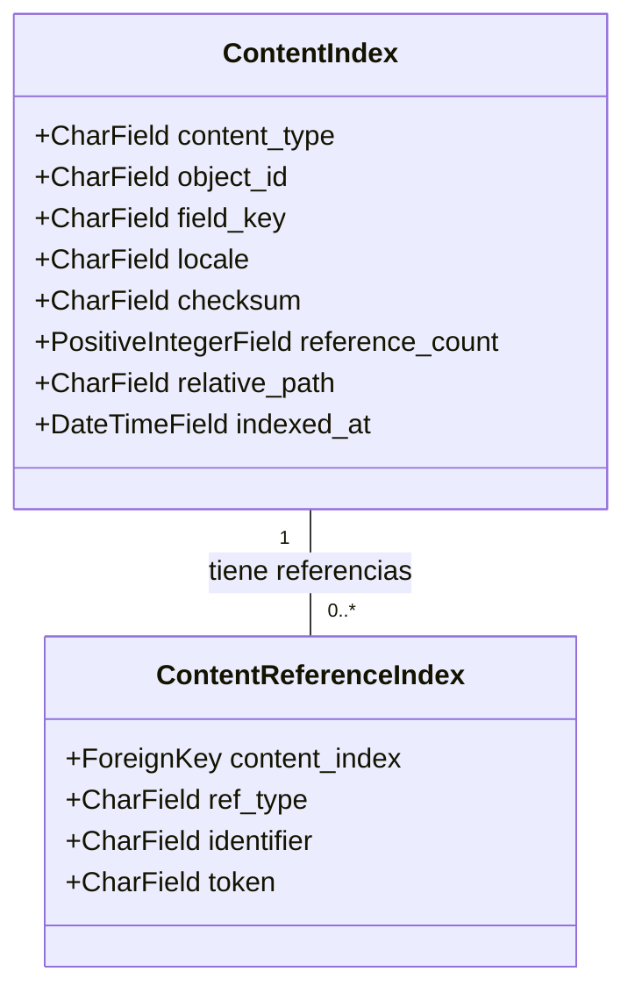

# Modelos de Indexación de Contenido

Este módulo (`Content_Base_Models___Mixins_ModelosIndexacionContenido`) define los modelos de base para la indexación de contenido editorial en el sistema. Su propósito principal es rastrear y gestionar metadatos y referencias dentro del contenido, facilitando la búsqueda, la validación y la gestión de enlaces. Estos modelos son fundamentales para construir índices de contenido reconstruibles y mantener la integridad de las referencias a través de la plataforma.

## Funcionalidad Principal

El módulo se centra en dos modelos clave que trabajan juntos para indexar el contenido:

*   **`ContentIndex`**: Almacena metadatos sobre cada unidad de contenido editorial desplegado, proporcionando un punto de referencia único para cada pieza indexada.
*   **`ContentReferenceIndex`**: Registra las referencias específicas (por ejemplo, enlaces a otros productos, artículos, glosarios) que se encuentran dentro del cuerpo de un `ContentIndex`.

## Arquitectura

### Diagrama de Clases

El siguiente diagrama ilustra la relación entre los modelos `ContentIndex` y `ContentReferenceIndex`.

### Componentes y Relaciones

#### `ContentIndex`

El modelo `ContentIndex` representa un registro único para cada referencia de contenido (`ContentRef`) descubierta en el árbol de contenido. Proporciona una vista indexada del contenido editorial, incluyendo metadatos importantes para la gestión y la resolución.

*   **`content_type`**: El tipo de contenido (ej., `blog`, `product`, `glossary`).
*   **`object_id`**: El identificador único del objeto de contenido.
*   **`field_key`**: Una clave que identifica un campo específico dentro del objeto de contenido que ha sido indexado.
*   **`locale`**: El idioma o la configuración regional del contenido.
*   **`checksum`**: Un valor de suma de verificación para detectar cambios en el contenido.
*   **`reference_count`**: El número de referencias salientes encontradas en este contenido.
*   **`relative_path`**: La ruta relativa del contenido en el sistema de archivos o repositorio.
*   **`indexed_at`**: La fecha y hora de la última indexación.

Se aplica una restricción única (`uniq_content_index_ref`) para asegurar la singularidad de las combinaciones de `content_type`, `object_id`, `field_key` y `locale`.

#### `ContentReferenceIndex`

El modelo `ContentReferenceIndex` almacena los detalles de las referencias específicas que se extraen de los cuerpos de los documentos indexados por `ContentIndex`. Esto permite rastrear los enlaces internos y externos y otras dependencias dentro del contenido.

*   **`content_index`**: Una clave foránea al `ContentIndex` al que pertenece esta referencia. Se configura con `on_delete=models.CASCADE` para asegurar que las referencias se eliminen si el `ContentIndex` principal es borrado.
*   **`ref_type`**: El tipo de referencia (ej., `product_handle`, `article_slug`, `glossary_term`).
*   **`identifier`**: El identificador de la referencia (ej., el handle de un producto, el slug de un artículo).
*   **`token`**: El fragmento de texto original o token que contenía la referencia en el cuerpo del contenido.

Este modelo incluye un índice (`content_ref_type_ident_idx`) en los campos `ref_type` e `identifier` para optimizar las consultas de búsqueda de referencias.

## Cómo el Módulo Encaja en el Sistema General

Este módulo es una parte esencial del sistema de gestión de contenido de Wagtail y la integración con Shopify.

*   **Generación de Índices**: Los modelos `ContentIndex` y `ContentReferenceIndex` son poblados y mantenidos por los comandos de gestión de contenido. Por ejemplo, los comandos definidos en [Content_Indexing___Semantic_Link_Commands](../Content_Indexing___Semantic_Link_Commands.md) son responsables de reconstruir estos índices.
*   **Resolución de URLs y Enlaces**: Los datos almacenados en estos índices son utilizados por el sistema para resolver URLs de contenido y gestionar enlaces semánticos, lo que es crucial para la navegación del storefront y la optimización SEO. El módulo [Content_URL___Link_Management](../Content_URL___Link_Management.md) probablemente hace uso extensivo de estos índices.
*   **Validación de Contenido**: Al rastrear todas las referencias, el sistema puede identificar enlaces rotos o inconsistencias de contenido, lo que es vital para la calidad del contenido.
*   **Integración con Contenido Editorial**: Estos modelos sirven como la base para que el módulo [Content_Store___Editorial_Logic](../Content_Store___Editorial_Logic.md) acceda y manipule el contenido indexado.
*   **Soporte a Comandos Embebidos**: Aunque no directamente, la indexación del contenido puede influir en la ejecución de comandos embebidos, ya que estos pueden depender de la estructura y referencias del contenido. El modelo [ModeloEjecucionComandoEmbebido](Content_Base_Models___Mixins_ModeloEjecucionComandoEmbebido.md) podría registrar información relacionada con la interacción con el contenido indexado.
