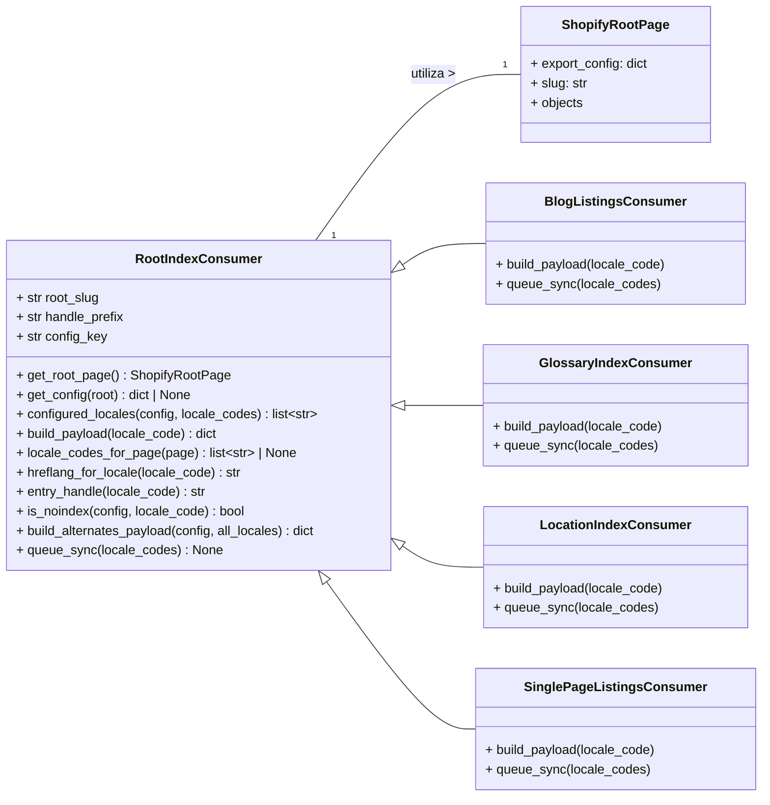

# Consumidor Base de Configuración de Exportación de Contenido

El módulo `Content_Export_Configuration_BaseConsumer` define los tipos base para los consumidores de índices de configuración de exportación, específicamente la clase `RootIndexConsumer`. Esta clase es fundamental para la construcción de cargas útiles de índice precalculadas y la gestión de contratos `hreflang`/`noindex` para las familias de páginas `ShopifyRootPage`, como glosarios y ubicaciones.

## Propósito y Funcionalidad Principal

La clase `RootIndexConsumer` es un componente abstracto que proporciona la base para los consumidores de configuración de exportación. Su función principal es:

*   **Construir cargas útiles de índice**: Genera los datos estructurados que representan un índice de contenido para una `ShopifyRootPage` y sus elementos relacionados (por ejemplo, términos de glosario, ubicaciones).
*   **Gestionar `hreflang` y `noindex`**: Define la lógica para determinar los atributos `hreflang` (para internacionalización y SEO) y las directivas `noindex` (para control de indexación por motores de búsqueda) asociadas a cada entrada de índice por locale.
*   **Abstracción para configuraciones específicas**: Sirve como una clase base que las subclases específicas (como `BlogListingsConsumer`, `GlossaryIndexConsumer`, `LocationIndexConsumer`, `SinglePageListingsConsumer`) extienden para implementar la lógica de construcción de carga útil (`build_payload`) y de encolamiento de sincronización (`queue_sync`) para tipos de contenido particulares.

Es importante destacar que `RootIndexConsumer` no interactúa directamente con Shopify. En cambio, se basa en un escritor externo, `shopify_content.sync.outbound.sync_root_index_locales`, para manejar la comunicación con la plataforma Shopify.

### Constantes Clave

*   `METAFIELD_NAMESPACE`: Espacio de nombres para los metafields de Shopify (`'custom'`).
*   `LISTINGS_KEY`: Clave de metafield (anteriormente utilizada para la arquitectura de índice multi-página, aún utilizada por `SinglePageListingsConsumer` para blogs).
*   `ALTERNATES_KEY`: Clave de metafield deprecada para las alternativas de índice.
*   `NOINDEX_KEY`: Clave de metafield deprecada para la directiva noindex.

## Arquitectura y Relaciones de Componentes

La `RootIndexConsumer` es una clase abstracta que establece un contrato para la construcción de configuraciones de exportación de índices.

### Clase `RootIndexConsumer`

```python
class RootIndexConsumer:
    root_slug: str
    handle_prefix: str
    config_key: str

    def get_root_page(self): ...
    def get_config(self, root=None) -> dict | None: ...
    def configured_locales(self, config: dict, locale_codes: list[str] | None) -> list[str]: ...
    def build_payload(self, locale_code: str) -> dict: ...
    def locale_codes_for_page(self, page) -> list[str] | None: ...
    def hreflang_for_locale(self, locale_code: str) -> str: ...
    def entry_handle(self, locale_code: str) -> str: ...
    def is_noindex(self, config: dict, locale_code: str) -> bool: ...
    def build_alternates_payload(self, config: dict, all_locales: list[str]) -> dict: ...
    def queue_sync(self, *, locale_codes: list[str] | None = None) -> None: ...
```

**Atributos Clave**:

*   `root_slug`: Identificador único para la página raíz de Shopify (por ejemplo, 'glossary', 'locations').
*   `handle_prefix`: Prefijo utilizado para generar los `handles` de los metaobjetos de la página raíz de Shopify.
*   `config_key`: Clave dentro de la configuración de exportación de `ShopifyRootPage` para acceder a la configuración específica de este consumidor.

**Métodos Clave**:

*   `get_root_page()`: Recupera la instancia de `ShopifyRootPage` correspondiente al `root_slug` configurado.
*   `get_config(root=None)`: Extrae y valida la configuración de exportación específica para este consumidor de la `ShopifyRootPage`.
*   `configured_locales(config: dict, locale_codes: list[str] | None)`: Filtra los códigos de locale disponibles basándose en la configuración y los locales solicitados.
*   `build_payload(locale_code: str)`: **Método abstracto** que debe ser implementado por las subclases para construir la carga útil de datos para un locale específico.
*   `locale_codes_for_page(page)`: Puede ser sobrescrito para obtener los locales asociados a una página específica.
*   `hreflang_for_locale(locale_code: str)`: Mapea un código de locale interno a un valor `hreflang` estándar.
*   `entry_handle(locale_code: str)`: Genera un `handle` de metaobjeto determinista para la página raíz y el locale.
*   `is_noindex(config: dict, locale_code: str)`: Determina si una entrada de índice para un locale dado debe tener la directiva `noindex`.
*   `build_alternates_payload(config: dict, all_locales: list[str])`: Construye la carga útil JSON compartida por todas las entradas `root_page` hermanas, incluyendo `hreflang` y `x-default`.
*   `queue_sync(*, locale_codes: list[str] | None = None)`: **Método abstracto** para encolar la sincronización de los índices.

### Diagrama de Clases



## Flujo de Configuración y Exportación

El módulo `Content_Export_Configuration_BaseConsumer` se integra en el flujo general de gestión de contenido de Wagtail/Shopify para definir cómo se configuran y preparan los datos para la exportación.

```mermaid
graph TD
    A[Página Raíz de Shopify (ShopifyRootPage)] -->|Contiene configuración de exportación| B(RootIndexConsumer.get_config())
    B --> C{Configuración de Exportación Habilitada?}
    C -- No --> D(Finalizar)
    C -- Sí --> E[Obtener Locales Configurados]
    E --> F{Para cada Locale}
    F --> G(RootIndexConsumer.build_payload(locale))
    F --> H(RootIndexConsumer.is_noindex(config, locale))
    F --> I(RootIndexConsumer.entry_handle(locale))
    F --> J(RootIndexConsumer.hreflang_for_locale(locale))
    E --> K(RootIndexConsumer.build_alternates_payload(config, all_locales))
    G & H & I & J & K --> L[Carga Útil del Índice Preparada]
    L --> M(RootIndexConsumer.queue_sync())
    M --> N[Encolar Sincronización a Shopify]
```

## Integración en el Sistema General

`RootIndexConsumer` es una parte fundamental de la estrategia de exportación de contenido de Wagtail a Shopify. Forma la base para configurar cómo se recopilan y estructuran los datos de contenido (como glosarios y ubicaciones) antes de ser enviados a Shopify como metaobjetos de páginas raíz.

*   **Configuración de Exportación**: La configuración para la exportación de índices se almacena directamente en el modelo [ShopifyRootPage](../Content_Base_Models___Mixins/Content_Base_Models___Mixins_ShopifyRootPage_Modelo.md), lo que permite a los administradores de contenido controlar qué índices se exportan y cómo.
*   **Consumidores Específicos**: Las subclases de `RootIndexConsumer` (como [Content_Export_Configuration_BlogListings.md](Content_Export_Configuration_BlogListings.md), [Content_Export_Configuration_GlossaryIndex.md](Content_Export_Configuration_GlossaryIndex.md), [Content_Export_Configuration_LocationIndex.md](Content_Export_Configuration_LocationIndex.md) y [Content_Export_Configuration_SinglePageListings.md](Content_Export_Configuration_SinglePageListings.md)) son responsables de la lógica específica para cada tipo de contenido, pero se basan en la estructura y los métodos definidos en `RootIndexConsumer`.
*   **Sincronización con Shopify**: Una vez que las cargas útiles se construyen utilizando la lógica del consumidor, un servicio de sincronización externo (`shopify_content.sync.outbound.sync_root_index_locales`, que no forma parte de este módulo) se encarga de enviar estos datos a Shopify, actualizando los metaobjetos correspondientes.

Este enfoque modular garantiza que la lógica de preparación del contenido para la exportación esté centralizada y sea reutilizable, mientras que las especificidades de cada tipo de contenido se manejan en implementaciones concretas.
