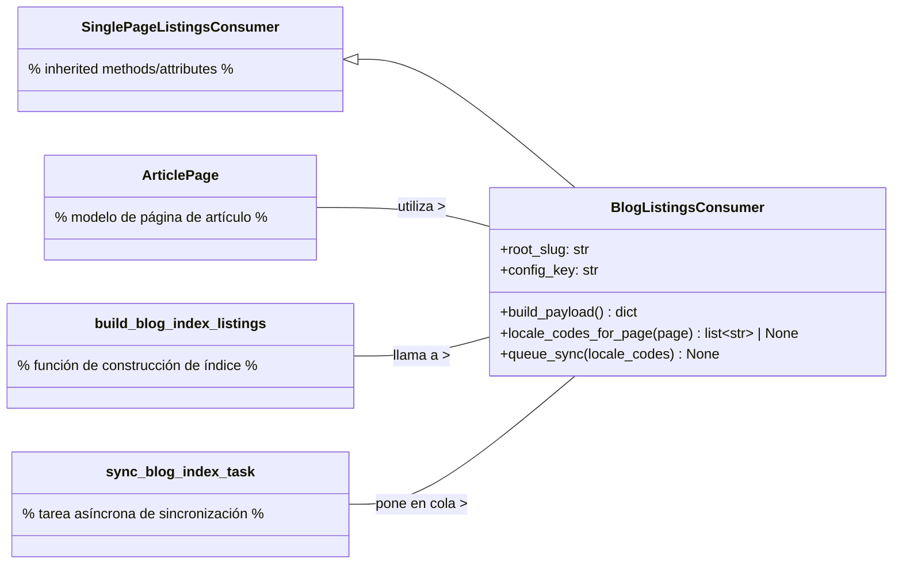
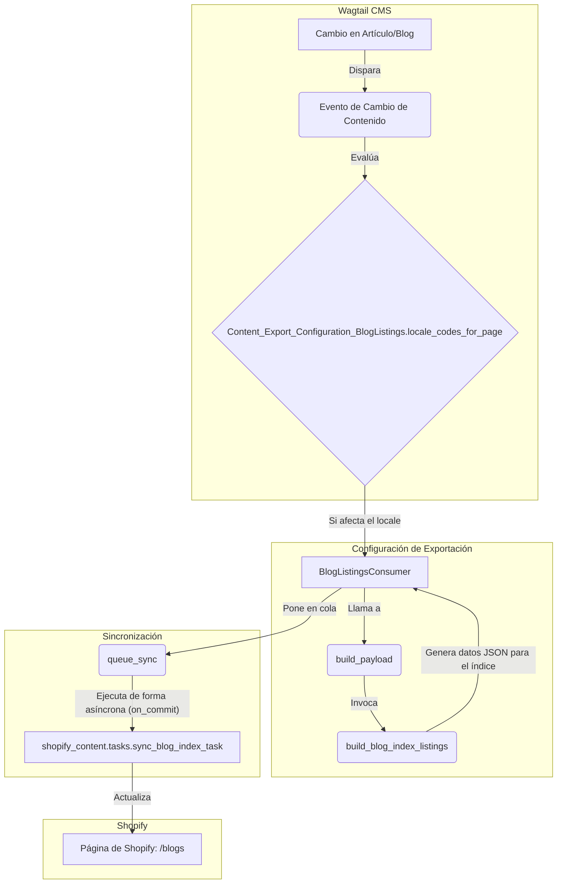

# Configuración de Exportación de Contenido: Listados de Blog

El módulo `Content_Export_Configuration_BlogListings` es responsable de la configuración y ejecución de la exportación de listados de blogs desde el sistema de gestión de contenido Wagtail hacia la plataforma Shopify. Utiliza el consumidor `BlogListingsConsumer` para orquestar la preparación y sincronización de los datos de los blogs.

## Propósito y Funcionalidad Principal

El componente central de este módulo es `BlogListingsConsumer`, una clase diseñada para gestionar la exportación de los listados de índices de blogs a una página específica en Shopify (identificada por el *handle* 'blogs').

### `BlogListingsConsumer`

-   **Propósito:** Publicar la configuración `custom.index_listings` en una única Página de Shopify (`handle` blogs).
-   **Ubicación:** `shopify_content/export_config/blog.py`

#### Atributos Clave:

-   `root_slug = 'blogs'`: Define el slug raíz para la página de Shopify donde se exportarán los listados de blogs.
-   `config_key = 'blog_index'`: Identifica la clave de configuración utilizada para este tipo de exportación.

#### Métodos Principales:

-   `build_payload() -> dict`:
    -   **Función:** Este método se encarga de construir la carga útil (payload) de datos que se enviará a Shopify. Para ello, invoca a la función `build_blog_index_listings()`, que presumiblemente recopila y estructura todos los datos necesarios para representar los listados de blogs.
    -   **Dependencia:** `shopify_content.blogs.index.build_blog_index_listings`

-   `locale_codes_for_page(self, page) -> list[str] | None`:
    -   **Función:** Determina los códigos de idioma (`locale codes`) que deben reconstruirse cuando el contenido de una página cambia. Si la página es una instancia de `ArticlePage` y tiene un `locale_id` definido, devuelve el código de idioma asociado a ese locale. Esto es crucial para la reindexación y sincronización localizada del contenido.
    -   **Dependencia:** `shopify_content.models.ArticlePage`

-   `queue_sync(self, *, locale_codes: list[str] | None = None) -> None`:
    -   **Función:** Pone en cola una tarea de sincronización para los listados de blogs. Utiliza `transaction.on_commit` para asegurar que la tarea `sync_blog_index_task` se dispare solo después de que la transacción de la base de datos se haya completado exitosamente, garantizando la consistencia de los datos. Esta tarea se ejecuta de forma asíncrona.
    -   **Dependencia:** `shopify_content.tasks.sync_blog_index_task`

## Arquitectura y Relaciones de Componentes

El `BlogListingsConsumer` extiende la funcionalidad de `SinglePageListingsConsumer`, lo que implica que hereda la lógica base para la exportación de contenido a una única página de Shopify, pero la especializa para el manejo de blogs.

### Diagrama de Clases

### Flujo de Datos para la Exportación de Listados de Blog

## Encaje en el Sistema General

El módulo `Content_Export_Configuration_BlogListings` es un componente vital dentro de la arquitectura de gestión de contenido y API de Shopify. Se encuentra bajo la sección de [Configuración de Exportación de Contenido](../Content_Export_Configuration.md) del sistema de [Gestión de Contenido de Shopify](../../Shopify_Content_Management.md).

Su función principal es tender un puente entre el contenido de blog editado en Wagtail (específicamente a través de modelos como `ArticlePage` y `BlogPage` en [Modelos de Contenido de Blog](../Blog_Content_Models.md)) y su representación en la tienda Shopify. Al heredar de `SinglePageListingsConsumer`, se alinea con una estrategia común de exportación de contenido a Shopify, donde ciertos tipos de contenido se consolidan en páginas específicas.

La integración con `shopify_content.tasks.sync_blog_index_task` (`sync_blog_index_task`) y el uso de `transaction.on_commit` demuestran su dependencia de un sistema de procesamiento de tareas asíncronas (como Celery) para garantizar que las actualizaciones de contenido se reflejen en Shopify de manera eficiente y robusta, minimizando el impacto en el rendimiento de la aplicación principal durante las operaciones de escritura en la base de datos.