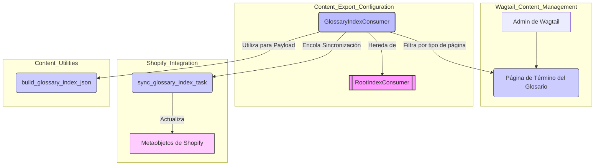
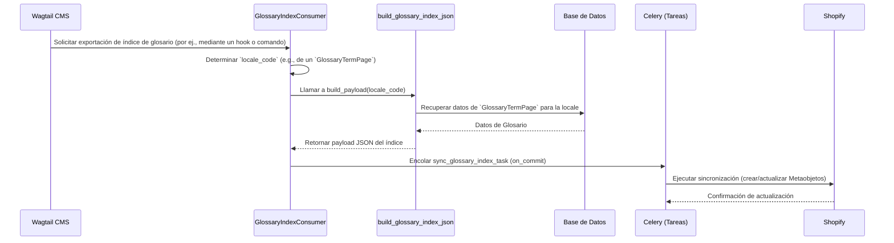

# Módulo Content_Export_Configuration_GlossaryIndex

Este documento describe el módulo `Content_Export_Configuration_GlossaryIndex`, que forma parte de la configuración de exportación de contenido dentro del sistema de gestión de contenido de Wagtail integrado con Shopify. Este módulo es responsable de la configuración específica y la lógica para exportar los índices del glosario a Shopify como metaobjetos por cada configuración regional (locale).

## Propósito y Funcionalidad Principal

El componente principal de este módulo es `GlossaryIndexConsumer`, una clase que extiende `RootIndexConsumer`. Su función primordial es gestionar la construcción y la cola de sincronización de los índices del glosario para diferentes configuraciones regionales, asegurando que el contenido del glosario esté disponible y actualizado en Shopify.

### GlossaryIndexConsumer

La clase `GlossaryIndexConsumer` (`shopify_content/export_config/glossary.py::GlossaryIndexConsumer`) centraliza la lógica para el glosario. Implementa los siguientes puntos clave:

*   **Configuración de Identificación**: Define `root_slug` como "glossary", `handle_prefix` como "glossary" y `config_key` como "glossary_index", lo que facilita la identificación y gestión del contenido del glosario en el sistema de exportación.
*   **Construcción de Carga Útil (`build_payload`)**: Este método es responsable de generar la representación JSON del índice del glosario para una `locale_code` específica, utilizando la función `build_glossary_index_json`.
*   **Determinación de Códigos de Localización (`locale_codes_for_page`)**: Identifica los códigos de localización asociados con una página dada, específicamente para instancias de `GlossaryTermPage`. Esto asegura que solo el contenido del glosario sea procesado correctamente para su localización.
*   **Cola de Sincronización (`queue_sync`)**: Programa una tarea asíncrona (`sync_glossary_index_task`) para sincronizar el índice del glosario. Esta operación se ejecuta transaccionalmente, garantizando la consistencia de los datos.

## Arquitectura y Relaciones entre Componentes

El módulo `Content_Export_Configuration_GlossaryIndex` se integra con varios otros componentes clave del sistema para cumplir su función. A continuación, se detalla su arquitectura y las relaciones con otros módulos:

**Descripción de las relaciones:**

*   **Herencia**: `GlossaryIndexConsumer` extiende `RootIndexConsumer` ([Content_Export_Configuration_BaseConsumer.md](Content_Export_Configuration_BaseConsumer.md)), lo que significa que hereda la funcionalidad base para el consumo de índices de contenido.
*   **Interacción con Páginas de Glosario**: El método `locale_codes_for_page` interactúa directamente con el modelo `GlossaryTermPage` ([Glossary_Content_Models.md](../Glossary_Content_Models.md)) para determinar la relevancia de una página específica para la exportación del glosario.
*   **Generación de Carga Útil**: `GlossaryIndexConsumer` se apoya en `build_glossary_index_json` para construir el contenido que se exportará. Esta función se encarga de la lógica de negocio para formatear los datos del glosario.
*   **Sincronización Asíncrona**: La clase encola la tarea `sync_glossary_index_task` para realizar la sincronización real con Shopify, lo que permite que la operación de exportación se realice en segundo plano sin bloquear el hilo principal de la aplicación.

## Flujo de Datos y Proceso

El siguiente diagrama ilustra el flujo de datos y el proceso que sigue el `GlossaryIndexConsumer` para exportar el índice del glosario a Shopify.

**Descripción del flujo:**

1.  Una acción en el CMS de Wagtail (por ejemplo, guardar una `GlossaryTermPage`, o un comando de sincronización) inicia el proceso de exportación del índice del glosario.
2.  `GlossaryIndexConsumer` se activa y, para cada `locale_code` relevante, invoca el método `build_payload`.
3.  El método `build_payload` delega en `build_glossary_index_json` para construir la estructura de datos JSON del índice del glosario, extrayendo la información necesaria de la base de datos de Wagtail, específicamente de las páginas de términos del glosario.
4.  Una vez que se construye la carga útil JSON, `GlossaryIndexConsumer` encola de forma asíncrona la tarea `sync_glossary_index_task` en Celery. Esta tarea se ejecuta después de que la transacción de la base de datos se haya completado con éxito, garantizando que los datos estén persistidos antes de intentar la sincronización.
5.  La tarea de Celery se encarga de comunicarse con la API de Shopify para crear o actualizar los metaobjetos correspondientes al índice del glosario en la plataforma de Shopify.

## Integración en el Sistema General

El `GlossaryIndexConsumer` es un componente vital dentro del sistema de gestión de contenido y la integración con Shopify. Su función específica es asegurar que los términos del glosario, definidos y gestionados en Wagtail, se exporten correctamente a Shopify. Esto permite que el contenido del glosario sea utilizado por los temas de Shopify, las aplicaciones de storefront u otras integraciones que consuman datos de metaobjetos. Es una pieza fundamental para mantener la coherencia y disponibilidad del contenido localizado en ambas plataformas. Forma parte del subsistema de [Content_Export_Configuration](../Content_Export_Configuration.md) que define cómo diferentes tipos de contenido se publican en Shopify. 

Para obtener más detalles sobre la gestión de modelos de glosario, consulte la documentación del módulo [Glossary_Content_Models.md](../Glossary_Content_Models.md). Para información general sobre la configuración de exportación, vea [Content_Export_Configuration_BaseConsumer.md](Content_Export_Configuration_BaseConsumer.md).