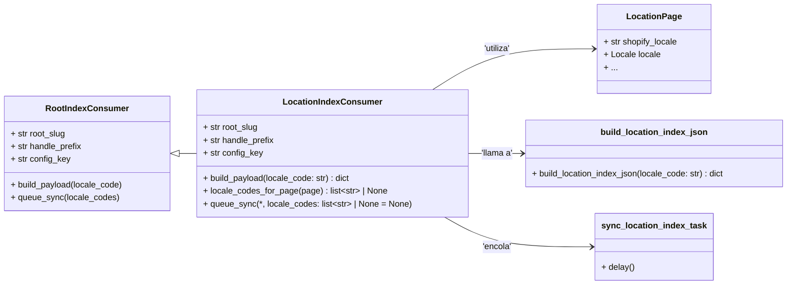

# Consumidor de Índice de Ubicaciones (LocationIndexConsumer)

El módulo `Content_Export_Configuration_LocationIndexConsumer` define un consumidor específico para la configuración de exportación de contenido, enfocado en la indexación y sincronización de páginas de ubicación de Wagtail con Shopify. Su propósito principal es generar un metaobjeto de página raíz por cada código de idioma (locale) configurado, que contiene un índice de todas las ubicaciones relevantes.

Este consumidor es una pieza clave en la estrategia de gestión de contenido multilingüe y de múltiples ubicaciones, asegurando que la información estructurada de las páginas de ubicación esté disponible y actualizada en la plataforma Shopify.

## Arquitectura y Componentes Principales

El `LocationIndexConsumer` se basa en la clase base `RootIndexConsumer`, lo que le permite heredar la funcionalidad común para el manejo de índices de contenido. Extiende esta funcionalidad con lógica específica para las páginas de ubicación (`LocationPage`) y su sincronización.

### `LocationIndexConsumer`

*   **Ubicación:** `shopify_content/export_config/location.py`
*   **Descripción:** Implementa la lógica para construir y encolar la sincronización del índice de ubicaciones. Define cómo se identifica una página de ubicación, cómo se construye su carga útil (payload) para la exportación y cómo se dispara el proceso de sincronización.
*   **Atributos Clave:**
    *   `root_slug = 'local-us'`: El slug raíz utilizado para identificar este índice de ubicaciones en Shopify.
    *   `handle_prefix = 'locations'`: Prefijo para los identificadores (handles) de los metaobjetos de ubicación en Shopify.
    *   `config_key = 'location_index'`: Clave de configuración para este consumidor.
*   **Métodos Clave:**
    *   `build_payload(self, locale_code: str) -> dict`: Construye el diccionario de datos que representa el índice de ubicaciones para un código de idioma específico. Internamente, delega la construcción del JSON a la función `build_location_index_json`.
    *   `locale_codes_for_page(self, page) -> list[str] | None`: Determina los códigos de idioma relevantes para una instancia de `LocationPage`. Si la página tiene un `shopify_locale` explícito, lo usa; de lo contrario, utiliza el `language_code` del objeto `locale` asociado.
    *   `queue_sync(self, *, locale_codes: list[str] | None = None) -> None`: Encola una tarea asíncrona (`sync_location_index_task`) para sincronizar el índice de ubicaciones. La tarea se despacha en una transacción de base de datos (`transaction.on_commit`).

### Relaciones con Otros Componentes

El `LocationIndexConsumer` interactúa con varios otros módulos y componentes dentro del sistema:

*   **[Consumidor de Índice Raíz (RootIndexConsumer)](Content_Export_Configuration_BaseConsumer.md):** `LocationIndexConsumer` hereda de esta clase base, proporcionando una estructura común para los consumidores de índices de exportación.
*   **`shopify_content.locations.index::build_location_index_json`:** Esta función es responsable de la lógica de negocio para agregar los datos de todas las `LocationPage` para un `locale_code` dado en el formato JSON requerido para el índice.
*   **[Páginas de Ubicación (LocationPage)](../Location_Content_Models.md):** El consumidor depende directamente del modelo `LocationPage` de Wagtail para obtener los datos de ubicación y sus respectivos códigos de idioma.
*   **`shopify_content.tasks::sync_location_index_task`:** Una tarea asíncrona (probablemente una tarea Celery) que es encolada por `queue_sync` para realizar la operación de sincronización real del índice de ubicaciones con Shopify.
*   **Módulo de transacciones de Django (`django.db.transaction`):** Utilizado para asegurar que la tarea de sincronización se encola solo después de que la transacción de la base de datos se haya completado con éxito.

## Diagramas

### Diagrama de Clases



### Flujo de Datos para la Sincronización del Índice de Ubicaciones

Este diagrama ilustra el proceso de alto nivel cuando se solicita una sincronización del índice de ubicaciones.

```mermaid
graph TD
    A[Cambio en LocationPage o Comando Manual] --> B{LocationIndexConsumer.queue_sync()};
    B -- on_commit --> C(transaction.on_commit);
    C --> D[sync_location_index_task.delay()];
    D --> E[Tarea Celery: sync_location_index_task];
    E --> F[LocationIndexConsumer.build_payload(locale_code)];
    F --> G[build_location_index_json(locale_code)];
    G --> H[Consulta modelos LocationPage];
    H --> I{Datos de Índice de Ubicaciones JSON};
    I --> J[Envío de Metaobjeto a Shopify];
```

## Integración con el Sistema General

El `LocationIndexConsumer` se inserta en el sistema de gestión de contenido Wagtail-Shopify como un componente especializado para la exportación de datos de ubicación.

*   **Gestión de Contenido (Wagtail):** Trabaja en conjunto con el modelo `LocationPage` ([Modelos de Contenido de Ubicación](../Location_Content_Models.md)) para extraer la información editorial relevante.
*   **Exportación de Contenido (Shopify):** Genera la estructura de datos necesaria para ser consumida por Shopify, probablemente como un metaobjeto global o de página raíz, que luego es utilizado por la tienda en línea.
*   **Tareas Asíncronas (Celery):** Utiliza un sistema de tareas en segundo plano para manejar la sincronización con Shopify, evitando bloquear la interfaz de usuario de Wagtail o los procesos principales de la aplicación.
*   **API de Shopify:** Los datos generados se envían a Shopify a través de sus APIs de administración, actualizando los metaobjetos correspondientes.

Este módulo es fundamental para mantener la consistencia entre el contenido de ubicación gestionado en Wagtail y lo que se muestra en la tienda Shopify, especialmente en configuraciones con múltiples ubicaciones o regiones geográficas.
