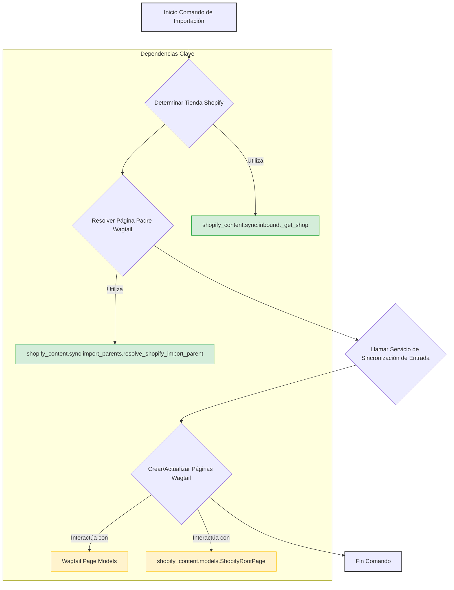

# Comandos de Importación de Contenido

Este módulo contiene comandos de gestión de Django para importar diversos tipos de contenido desde Shopify a Wagtail, materializando estos datos en las páginas y modelos de contenido correspondientes dentro del CMS. Estos comandos son esenciales para mantener sincronizado el contenido entre la plataforma de comercio electrónico y el sistema de gestión de contenido.

## Arquitectura y Componentes

Los comandos de importación se basan en la funcionalidad de sincronización de entrada (`shopify_content.sync.inbound`) y en la resolución de padres de importación (`shopify_content.sync.import_parents`). Cada comando es una subclase de `django.core.management.base.BaseCommand` y define su propia lógica para un tipo específico de contenido (blogs, colecciones, productos, términos de glosario).

### Diagrama de Flujo de Importación General

### Componentes de Comandos de Importación

Aquí se detallan los comandos de importación específicos:

### `Command` (shopify_content/management/commands/import_shopify_blogs.py)

Este comando se encarga de importar todos los blogs y artículos de Shopify a Wagtail. Crea o actualiza instancias de `BlogPage` y `ArticlePage` dentro de Wagtail, asegurando que la estructura de contenido se refleje correctamente en el CMS.

#### Flujo de Proceso:

1.  Obtiene la tienda Shopify (`_get_shop`).
2.  Resuelve la página padre en Wagtail. Por defecto, busca o crea una `ShopifyRootPage` con el slug "blogs". Si se especifica un `parent-page-id`, valida que sea una página existente y, si no es una `ShopifyRootPage`, lanza un error.
3.  Llama a `import_blogs_and_articles` del servicio de sincronización de entrada para realizar la importación.
4.  Imprime estadísticas de creación, actualización y errores para blogs y artículos.

#### Argumentos:

*   `--parent-page-id`: ID de la página Wagtail que se utilizará como padre. Por defecto, es una `ShopifyRootPage` con el slug "blogs".

#### Relaciones Clave:

*   [Blog Content Models](../Blog_Content_Models.md)
*   [Content Synchronization Services](../Content_Synchronization_Services.md)
*   [Content Base Models & Mixins](../Content_Base_Models___Mixins.md)

### `Command` (shopify_content/management/commands/import_shopify_collections.py)

Este comando importa todas las colecciones de Shopify y las materializa como instancias de `CollectionPage` en Wagtail.

#### Flujo de Proceso:

1.  Obtiene la tienda Shopify (`_get_shop`).
2.  Resuelve la página padre en Wagtail. Por defecto, busca o crea una `ShopifyRootPage` con el slug "collections".
3.  Llama a `import_collections` del servicio de sincronización de entrada.
4.  Imprime estadísticas de creación, actualización y errores.

#### Argumentos:

*   `--parent-page-id`: ID de la página Wagtail que se utilizará como padre. Por defecto, es una `ShopifyRootPage` con el slug "collections".

#### Relaciones Clave:

*   [Collection Content Models](../Collection_Content_Models.md)
*   [Content Synchronization Services](../Content_Synchronization_Services.md)
*   [Content Base Models & Mixins](../Content_Base_Models___Mixins.md)

### `Command` (shopify_content/management/commands/import_shopify_glossary.py)

Este comando importa los metaobjetos `glossary_term` de Shopify y los convierte en instancias de `GlossaryTermPage` en Wagtail.

#### Flujo de Proceso:

1.  Obtiene la tienda Shopify (`_get_shop`).
2.  Resuelve la página padre en Wagtail. Por defecto, busca o crea una `ShopifyRootPage` con el slug "glossary".
3.  Llama a `import_glossary_terms` del servicio de sincronización de entrada.
4.  Imprime estadísticas de creación, actualización, omitidos y errores.

#### Argumentos:

*   `--parent-page-id`: ID de la página Wagtail que se utilizará como padre. Por defecto, es una `ShopifyRootPage` con el slug "glossary".
*   `--new-only`: Si se especifica, solo se crearán nuevos términos; se omitirán las actualizaciones de términos existentes.

#### Relaciones Clave:

*   [Glossary Content Models](../Glossary_Content_Models.md)
*   [Content Synchronization Services](../Content_Synchronization_Services.md)
*   [Content Base Models & Mixins](../Content_Base_Models___Mixins.md)

### `Command` (shopify_content/management/commands/import_shopify_products.py)

Este comando importa todos los productos de Shopify y los materializa como instancias de `ProductPage` en Wagtail.

#### Flujo de Proceso:

1.  Obtiene la tienda Shopify (`_get_shop`).
2.  Resuelve la página padre en Wagtail. Por defecto, busca o crea una `ShopifyRootPage` con el slug "products".
3.  Llama a `import_products` del servicio de sincronización de entrada.
4.  Imprime estadísticas de creación, actualización y errores.

#### Argumentos:

*   `--parent-page-id`: ID de la página Wagtail que se utilizará como padre. Por defecto, es una `ShopifyRootPage` con el slug "products".

#### Relaciones Clave:

*   [Product Content Models](../Product_Content_Models.md)
*   [Content Synchronization Services](../Content_Synchronization_Services.md)
*   [Content Base Models & Mixins](../Content_Base_Models___Mixins.md)
