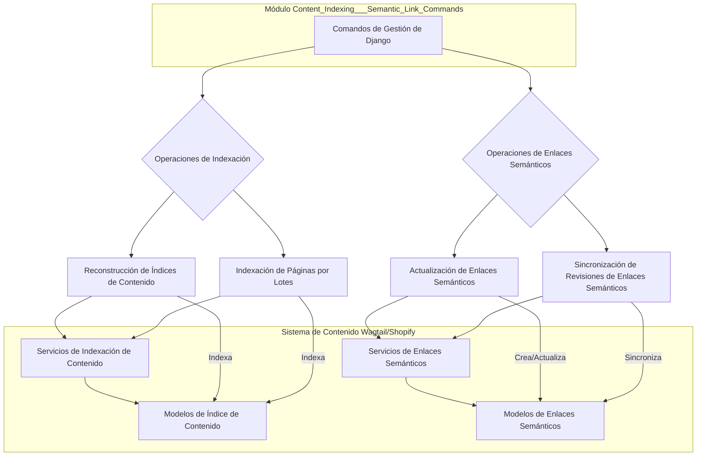

# Gestión de Comandos de Indexación y Enlaces Semánticos de Contenido

Este módulo agrupa los comandos de gestión de Django responsables de la indexación de contenido y la administración de enlaces semánticos dentro del sistema de gestión de contenido Wagtail, en el contexto de su integración con Shopify. Proporciona herramientas para reconstruir diversos índices de contenido, realizar indexaciones por lotes para optimizar el rendimiento y gestionar la creación y sincronización de enlaces semánticos internos.

## Arquitectura

La arquitectura de este módulo se centra en un conjunto de comandos de gestión que interactúan con los modelos de contenido de Wagtail y los servicios de indexación. Estos comandos están diseñados para ser ejecutados manualmente o a través de tareas programadas para mantener la coherencia y la actualidad de los índices de contenido y los enlaces semánticos.

*Diagrama 1: Arquitectura General de los Comandos de Indexación y Enlaces Semánticos.*

## Sub-módulos

Este módulo se descompone en los siguientes sub-módulos, cada uno con un enfoque específico en la gestión de índices o enlaces semánticos:

*   **[Comandos de Reconstrucción de Índices](Content_Indexing___Semantic_Link_Commands/Content_Indexing___Semantic_Link_Commands_reconstruccion_indices.md)**: Incluye los comandos para reconstruir varios tipos de índices de contenido, como el índice general de contenido, índices de blogs, URLs de contenido, glosarios y ubicaciones.
*   **[Comandos de Indexación por Lotes](Content_Indexing___Semantic_Link_Commands/Content_Indexing___Semantic_Link_Commands_Content_Indexing___Semantic_Link_Commands_indexacion_por_lotes.md)**: Contiene el comando para indexar páginas de Wagtail en lotes, lo que ayuda a evitar picos de memoria.
*   **[Comandos de Gestión de Enlaces Semánticos](Content_Indexing___Semantic_Link_Commands/Content_Indexing___Semantic_Link_Commands_gestion_enlaces_semanticos.md)**: Comprende los comandos para refrescar y sincronizar enlaces semánticos internos automáticos en las páginas de Wagtail.
