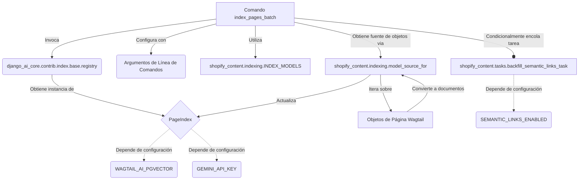

# Comando `index_pages_batch` para la Indexación por Lotes

Este documento describe el módulo `Content_Indexing___Semantic_Link_Commands_indexacion_por_lotes`, que proporciona una herramienta de gestión de Django para indexar páginas de Wagtail en el `PageIndex` de manera eficiente, utilizando procesamiento por lotes para evitar picos de memoria.

## Propósito y Funcionalidad Principal

El comando `index_pages_batch` (`shopify_content/management/commands/index_pages_batch.py::Command`) es una utilidad de línea de comandos de Django diseñada para actualizar el índice de páginas (`PageIndex`) de forma segura en cuanto a memoria. A diferencia de las operaciones de reconstrucción de índices que pueden consumir mucha memoria, este comando procesa las páginas en lotes más pequeños. Es esencial para mantener actualizado el índice de contenido, que a su vez es utilizado por funcionalidades de búsqueda y enlaces semánticos.

Las características principales incluyen:

*   **Indexación por Lotes:** Procesa las páginas en segmentos configurables para optimizar el uso de la memoria.
*   **Reanudación de la Indexación:** Permite reanudar la indexación desde un `pk` específico en caso de interrupción.
*   **Tipos de Página Flexibles:** Soporta la indexación de tipos específicos de páginas (artículos, productos, colecciones, glosario) o todos ellos.
*   **Configuración de Pausa:** Permite establecer un tiempo de pausa entre lotes para controlar la carga del sistema.
*   **Integración con Enlaces Semánticos:** Opcionalmente, encola una tarea de relleno de enlaces semánticos después de que la indexación se completa.

## Arquitectura y Relaciones de Componentes

El comando `index_pages_batch` interactúa con varios componentes clave del sistema para realizar su función de indexación.

### Componentes Clave:

*   **`Command` (`shopify_content/management/commands/index_pages_batch.py`)**: Es el punto de entrada principal para la operación de indexación por lotes. Define los argumentos de línea de comandos y orquesta el proceso de indexación.
*   **`registry` (`django_ai_core.contrib.index.base.registry`)**: Este registro es utilizado para acceder a instancias del `PageIndex`, que es el índice donde se almacenan los documentos de las páginas de Wagtail. Requiere que `PageIndex` esté registrado, lo que normalmente se habilita mediante configuraciones como `WAGTAIL_AI_PGVECTOR` y `GEMINI_API_KEY`. Para más detalles, consulte la documentación del módulo [Application Core](/docs/Application_Core___Shopify_Integration_Platform.md) o del componente específico del índice si existe.
*   **`INDEX_MODELS` y `model_source_for` (`shopify_content/indexing`)**: Estos componentes (definidos en `shopify_content/indexing`) son responsables de determinar qué modelos de página de Wagtail deben ser indexados y cómo se extraen y transforman sus datos en documentos indexables.
*   **`PageIndex`**: Representa el índice real donde se almacenan los datos de las páginas para su posterior recuperación (e.g., búsqueda, enlaces semánticos).
*   **`backfill_semantic_links_task` (`shopify_content/tasks`)**: Una tarea asíncrona (probablemente ejecutada por Celery) que se encola opcionalmente al finalizar la indexación. Su propósito es rellenar o actualizar los enlaces semánticos basados en el contenido recién indexado. Esta funcionalidad depende de que `SEMANTIC_LINKS_ENABLED` esté habilitado en la configuración. Para más información sobre la gestión de enlaces semánticos, consulte [Content_Indexing___Semantic_Link_Commands_gestion_enlaces_semanticos](Content_Indexing___Semantic_Link_Commands_gestion_enlaces_semanticos.md).

### Flujo de Datos y Proceso:

1.  El usuario ejecuta el comando `index_pages_batch` con los argumentos deseados (modelo, tamaño de lote, etc.).
2.  El comando valida la configuración del sistema (e.g., `PageIndex` registrado).
3.  Para cada tipo de página objetivo, el comando:
    *   Obtiene una fuente de objetos (`model_source_for`) que itera sobre las páginas de Wagtail en la base de datos.
    *   Procesa estas páginas en lotes definidos por `batch_size`.
    *   Cada lote de objetos se convierte en documentos indexables (`source.objects_to_documents`).
    *   Estos documentos se utilizan para actualizar el `PageIndex`.
    *   Se realiza una pausa (`time.sleep`) y recolección de basura (`gc.collect()`) entre lotes para gestionar los recursos.
4.  Una vez que todos los tipos de páginas han sido indexados, si los enlaces semánticos están habilitados y no se ha solicitado omitirlos, se encola una tarea asíncrona para actualizar los enlaces semánticos.

## Cómo Encaja en el Sistema General

El comando `index_pages_batch` es un componente vital dentro del ecosistema de gestión de contenido de Wagtail y Shopify. Forma parte del subsistema de [Wagtail_Content_Management___API/Shopify_Content_Management/Content_Indexing___Semantic_Link_Commands](../Content_Indexing___Semantic_Link_Commands.md), asegurando que el contenido editorial, los productos, las colecciones y los términos del glosario estén disponibles y sean buscables a través del `PageIndex`.

Su diseño por lotes lo hace adecuado para entornos de producción con grandes volúmenes de datos, donde la indexación completa puede ser intensiva en recursos. Al proporcionar opciones para la reanudación y la pausa, ofrece robustez y control sobre el proceso de indexación.

La integración con las tareas de enlaces semánticos refuerza la capacidad del sistema para crear relaciones inteligentes entre el contenido, mejorando la experiencia del usuario y la capacidad de descubrimiento.
