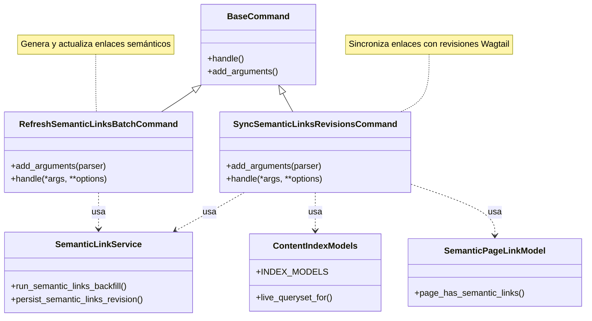

# Gestión de Enlaces Semánticos

El módulo `Content_Indexing___Semantic_Link_Commands_gestion_enlaces_semanticos` es responsable de la administración y sincronización de enlaces semánticos internos en las páginas de contenido de Wagtail. Esto incluye la generación automática de enlaces basados en el contenido y la actualización de las revisiones de Wagtail para asegurar la visibilidad en la interfaz de administración.

## Propósito y Funcionalidad Principal

Este módulo contiene comandos de gestión de Django que facilitan la creación y el mantenimiento de enlaces semánticos. Estos enlaces son cruciales para mejorar la navegabilidad y la interconexión del contenido dentro de la plataforma, especialmente en la integración con Shopify para la gestión de contenido. Sus funcionalidades principales son:

*   **Generación de Enlaces Semánticos**: Permite generar automáticamente enlaces internos semánticos para distintos tipos de páginas (artículos, productos, colecciones, glosarios).
*   **Sincronización de Revisiones de Wagtail**: Asegura que los enlaces semánticos persistidos en la base de datos se reflejen correctamente en las revisiones de Wagtail, haciéndolos visibles y editables en la interfaz de administración.

## Arquitectura y Relaciones de Componentes

El módulo se compone de dos comandos principales de Django:

*   `refresh_semantic_links_batch.py::Command`: Encargado de la generación inicial y la actualización de los enlaces semánticos.
*   `sync_semantic_links_revisions.py::Command`: Responsable de sincronizar los enlaces semánticos existentes en la base de datos con las revisiones de Wagtail.

Estos comandos interactúan con el servicio de enlaces semánticos (`shopify_content.semantic_links.service`) y con los modelos de contenido de Wagtail para manipular y persistir los datos de los enlaces.

### Diagrama de Clases



### Diagrama de Flujo de Datos

```mermaid
flowchart TD
    A[Inicio Comando refresh_semantic_links_batch] --> B{Parámetros del Comando}
    B --> C[Llama a run_semantic_links_backfill]
    C --> D[Modelos de Contenido (Artículos, Productos, etc.)]
    D --> E{Procesamiento de Páginas}
    E -- crea/actualiza --> F[Enlaces Semánticos en DB]
    F -- opcionalmente persiste --> G[Revisiones de Wagtail]
    G -- si no se salta --> H[Reporte de Totales]
    H --> I[Fin Comando refresh_semantic_links_batch]

    J[Inicio Comando sync_semantic_links_revisions] --> K{Parámetros del Comando (tipo de modelo)}
    K --> L[Obtiene páginas vivas del modelo seleccionado]
    L --> M{Itera sobre páginas}
    M -- tiene enlaces semánticos? --> N{Sí}
    N --> O[Llama a persist_semantic_links_revision]
    O --> G
    M -- no --> P[Página Siguiente]
    P --> M
    G --> Q[Reporte de Sincronización]
    Q --> R[Fin Comando sync_semantic_links_revisions]
```

## Integración en el Sistema General

Este módulo se integra dentro del componente de [Gestión de Contenido de Shopify (Wagtail_Content_Management___API/Shopify_Content_Management.md)](../../Shopify_Content_Management.md) y específicamente en el subcomponente de [Comandos de Indexación de Contenido y Enlaces Semánticos (Content_Indexing___Semantic_Link_Commands.md)](../Content_Indexing___Semantic_Link_Commands.md).

Los comandos proporcionados son herramientas administrativas esenciales para:

*   **SEO y Descubribilidad**: Mejoran la interconexión del contenido, lo que puede tener un impacto positivo en el SEO.
*   **Experiencia del Usuario**: Facilitan a los usuarios descubrir contenido relacionado, mejorando la navegación en la tienda.
*   **Consistencia del Contenido**: Aseguran que los enlaces internos se mantengan actualizados y consistentes con los cambios en el contenido.

Depende del servicio `shopify_content.semantic_links.service` para la lógica central de la gestión de enlaces y de los modelos de Wagtail definidos en [Modelos de Enlaces Semánticos (Content_Base_Models___Mixins_ModelosEnlacesSemanticos.md)](../Content_Base_Models___Mixins/Content_Base_Models___Mixins_ModelosEnlacesSemanticos.md) para la persistencia de los datos. También utiliza la infraestructura de comandos de Django para su ejecución.

Los comandos de este módulo son típicamente ejecutados como parte de tareas programadas o manualmente por administradores para mantener la integridad y la riqueza de los enlaces semánticos en el contenido editorial impulsado por Wagtail y Shopify.
