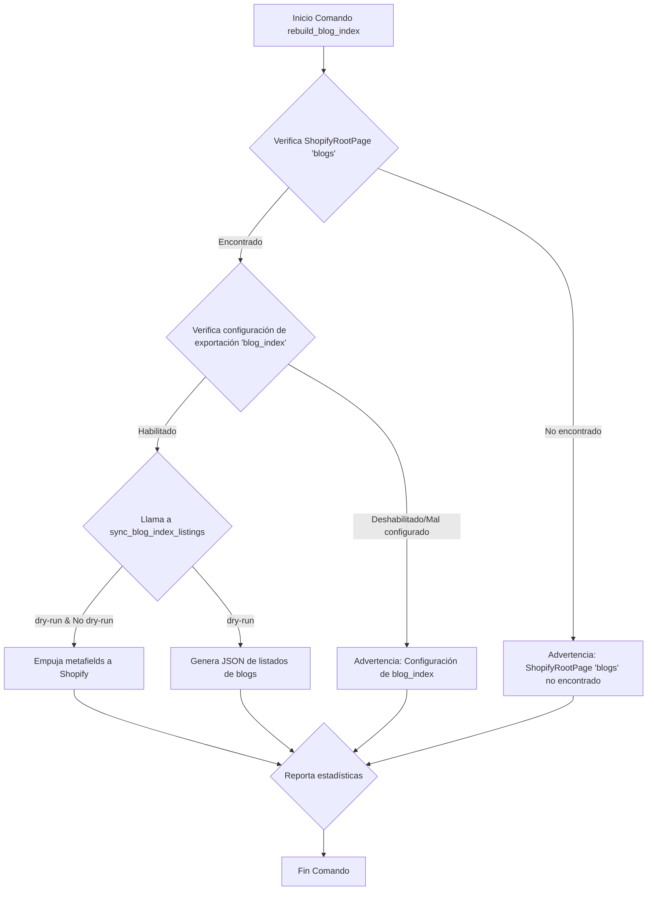

# Reconstrucción de Índices y Enlaces Semánticos

Este módulo `Content_Indexing___Semantic_Link_Commands_reconstruccion_indices` es una parte fundamental del sistema de gestión de contenido, encargado de mantener la coherencia y la accesibilidad de la información mediante la reconstrucción y actualización de diversos índices de contenido. Asegura que los datos en el CMS Wagtail se sincronicen y estén correctamente indexados para su uso tanto interno como para la integración con Shopify.

## Propósito y Funcionalidad Principal

El módulo provee una serie de comandos de gestión de Django diseñados para reconstruir diferentes tipos de índices de contenido. Estos índices son cruciales para la navegación, búsqueda y presentación de contenido en la plataforma. Las funcionalidades principales incluyen:
-   **Reconstrucción del Índice de Contenido General**: Mantiene un mapeo actualizado de los documentos y referencias de contenido.
-   **Reconstrucción de Índices Específicos**: Actualiza índices para categorías de contenido como blogs, glosarios y páginas de localización.
-   **Mapeo de URLs de Contenido**: Asegura que las URLs de las páginas de Wagtail se indexen correctamente para su uso en Shopify.

Este módulo es vital para la integridad de los datos, la optimización del rendimiento de búsqueda y la correcta exportación de contenido a la plataforma Shopify.

## Arquitectura y Relaciones entre Componentes

Los componentes clave en este módulo son comandos de Django que interactúan con servicios y modelos de datos en otros módulos. La siguiente sección detalla cada comando y sus relaciones.

### `content_index_rebuild.py::Command`

Este comando se encarga de reconstruir las tablas derivadas `ContentIndex` y `ContentReferenceIndex` a partir del árbol de contenido desplegado. Es la base para la indexación de todo el contenido editorial.

#### Diagrama de Flujo de Datos

```mermaid
graph TD
    A[Inicio Comando content_index_rebuild] --> B{Lee CONTENT_STORE_ROOT};
    B -- Configurado --> C[Llama a rebuild_content_index(root)];
    B -- No Configurado --> D[Error: CONTENT_STORE_ROOT no configurado];
    C --> E[Actualiza ContentIndex];
    C --> F[Actualiza ContentReferenceIndex];
    E --> G{Reporta estadísticas};
    F --> G;
    G --> H[Fin Comando];
```

#### Dependencias Clave
-   **`django.conf.settings`**: Para obtener la ruta raíz del almacén de contenido (`CONTENT_STORE_ROOT`).
-   **`shopify_content.content_store.content_index_service.rebuild_content_index`**: La lógica central para realizar la reconstrucción del índice.
-   **[Content_Base_Models___Mixins_ModelosIndexacionContenido.md](../Content_Base_Models___Mixins/Content_Base_Models___Mixins_ModelosIndexacionContenido.md)**: Provee los modelos `ContentIndex` y `ContentReferenceIndex` que son actualizados.

### `rebuild_blog_index.py::Command`

Este comando reconstruye y sincroniza los listados de índices de blogs como metafields en las páginas de Shopify correspondientes al handle 'blogs'.

#### Diagrama de Flujo de Datos



#### Dependencias Clave
-   **`shopify_content.sync.blog_index.sync_blog_index_listings`**: Servicio que orquesta la sincronización del índice de blogs con Shopify.
-   **`shopify_content.blogs.index.build_blog_index_listings`**: Lógica para construir el JSON del índice de blogs.
-   **[Blog_Content_Models.md](../Blog_Content_Models.md)**: Contiene los modelos de páginas de blog y artículos.
-   **[Content_Synchronization_Services_Shopify_Import_Orchestration.md](../Content_Synchronization_Services/Content_Synchronization_Services_Shopify_Import_Orchestration.md)**: Posiblemente interactúa con este servicio para la lógica de importación y sincronización general con Shopify.
-   **[Content_Base_Models___Mixins_ShopifyRootPage_Modelo.md](../Content_Base_Models___Mixins/Content_Base_Models___Mixins_ShopifyRootPage_Modelo.md)**: El modelo `ShopifyRootPage` es utilizado para verificar la configuración del índice de blogs.

### `rebuild_content_url_index.py::Command`

Este comando reconstruye el `ContentUrlIndex`, que mapea las URLs de las páginas de Wagtail en vivo con sus IDs de Shopify. Puede reconstruir el índice completo o para una página específica.

#### Diagrama de Flujo de Datos

```mermaid
graph TD
    A[Inicio Comando rebuild_content_url_index] --> B{Parámetro --page-id?};
    B -- Sí --> C[Obtiene página por ID];
    C -- Página no encontrada --> D[Error: Página no encontrada];
    C -- Página encontrada --> E[Llama a rebuild_index_for_page(page)];
    B -- No --> F[Llama a rebuild_full_index()];
    E --> G{Reporta URLs indexadas};
    F --> H{Reporta filas creadas/páginas saltadas};
    D --> I[Fin Comando];
    G --> I;
    H --> I;
```

#### Dependencias Clave
-   **`shopify_content.content_url_index.rebuild_full_index`**: Reconstruye el índice completo de URLs de contenido.
-   **`shopify_content.content_url_index.rebuild_index_for_page`**: Reconstruye el índice de URLs para una página específica.
-   **`wagtail.models.Page`**: Para interactuar con las páginas de Wagtail.
-   **[Content_Base_Models___Mixins_ModeloIndiceURLContenido.md](../Content_Base_Models___Mixins/Content_Base_Models___Mixins_ModeloIndiceURLContenido.md)**: Provee el modelo `ContentUrlIndex` que es gestionado por este comando.
-   **[Content_URL___Link_Management.md](../Content_URL___Link_Management.md)**: Módulo que contiene la lógica para la resolución y gestión de URLs de contenido.

### `rebuild_glossary_index.py::Command`

Este comando reconstruye y sincroniza las entradas del índice del glosario como metaobjetos en la página raíz del glosario (una por cada locale configurado).

#### Diagrama de Flujo de Datos

```mermaid
graph TD
    A[Inicio Comando rebuild_glossary_index] --> B{Parámetro --locales?};
    B -- Sí --> C[Llama a sync_glossary_index_pages(locales, dry_run)];
    B -- No --> D[Llama a sync_glossary_index_pages(None, dry_run)];
    C --> E{Verifica ShopifyRootPage 'glossary'};
    D --> E;
    E -- No encontrado --> F[Advertencia: ShopifyRootPage 'glossary' no encontrado];
    E -- Encontrado --> G{Verifica configuración de exportación 'glossary_index'};
    G -- Deshabilitado/Mal configurado --> H[Advertencia: Configuración de glossary_index];
    G -- Habilitado --> I{Lógica dry-run / push};
    I -- dry-run --> J[Genera JSON de índice de glosario por locale];
    I -- No dry-run --> K[Empuja metaobjetos a Shopify];
    K --> L{Reporta estadísticas};
    J --> L;
    H --> L;
    F --> L;
    L --> M[Fin Comando];
```

#### Dependencias Clave
-   **`shopify_content.glossary.index.build_glossary_index_json`**: Lógica para construir el JSON del índice del glosario.
-   **`shopify_content.sync.glossary_index.sync_glossary_index_pages`**: Servicio que orquesta la sincronización del índice del glosario con Shopify.
-   **[Glossary_Content_Models.md](../Glossary_Content_Models.md)**: Contiene los modelos relacionados con los términos del glosario.
-   **[Content_Base_Models___Mixins_ShopifyRootPage_Modelo.md](../Content_Base_Models___Mixins/Content_Base_Models___Mixins_ShopifyRootPage_Modelo.md)**: El modelo `ShopifyRootPage` es utilizado para verificar la configuración del índice del glosario.
-   **[Content_Export_Configuration.md](../Content_Export_Configuration.md)**: Módulo que define cómo se exportan los datos a Shopify, incluyendo la configuración de `glossary_index`.

### `rebuild_location_index.py::Command`

Este comando reconstruye y sincroniza las entradas del índice de localización como metaobjetos en la página raíz de localización (una por cada locale configurado).

#### Diagrama de Flujo de Datos

```mermaid
graph TD
    A[Inicio Comando rebuild_location_index] --> B{Parámetro --locales?};
    B -- Sí --> C[Llama a sync_location_index_pages(locales, dry_run)];
    B -- No --> D[Llama a sync_location_index_pages(None, dry_run)];
    C --> E{Verifica ShopifyRootPage 'local-us'};
    D --> E;
    E -- No encontrado --> F[Advertencia: ShopifyRootPage 'local-us' no encontrado];
    E -- Encontrado --> G{Verifica configuración de exportación 'location_index'};
    G -- Deshabilitado/Mal configurado --> H[Advertencia: Configuración de location_index];
    G -- Habilitado --> I{Lógica dry-run / push};
    I -- dry-run --> J[Genera JSON de índice de localización por locale];
    I -- No dry-run --> K[Empuja metaobjetos a Shopify];
    K --> L{Reporta estadísticas};
    J --> L;
    H --> L;
    F --> L;
    L --> M[Fin Comando];
```

#### Dependencias Clave
-   **`shopify_content.locations.index.build_location_index_json`**: Lógica para construir el JSON del índice de localización.
-   **`shopify_content.sync.location_index.sync_location_index_pages`**: Servicio que orquesta la sincronización del índice de localización con Shopify.
-   **[Location_Content_Models.md](../Location_Content_Models.md)**: Contiene los modelos relacionados con las páginas de localización.
-   **[Content_Base_Models___Mixins_ShopifyRootPage_Modelo.md](../Content_Base_Models___Mixins/Content_Base_Models___Mixins_ShopifyRootPage_Modelo.md)**: El modelo `ShopifyRootPage` es utilizado para verificar la configuración del índice de localización.
-   **[Content_Export_Configuration.md](../Content_Export_Configuration.md)**: Módulo que define cómo se exportan los datos a Shopify, incluyendo la configuración de `location_index`.

## Integración con el Sistema General

Este módulo se integra con el sistema general de las siguientes maneras:
-   **Wagtail CMS**: Los comandos operan directamente sobre el contenido gestionado en Wagtail, asegurando que la estructura y los datos se reflejen correctamente en los índices.
-   **Shopify Integration**: Al reconstruir y sincronizar metafields y metaobjetos en Shopify, este módulo es crucial para la integración de contenido entre el CMS y la plataforma de e-commerce. Esto permite que el contenido editorial enriquecido en Wagtail sea visible y utilizable en Shopify.
-   **Flujos de CI/CD**: Es probable que estos comandos se ejecuten como parte de flujos de integración continua y despliegue continuo (CI/CD) para asegurar que los índices estén siempre actualizados tras los cambios de contenido o despliegues de código.
-   **Mantenimiento de Datos**: Permite a los administradores y desarrolladores mantener la calidad y la actualidad de los índices de contenido, lo cual es esencial para la experiencia del usuario final en el sitio web.

En resumen, los comandos de reconstrucción de índices son esenciales para la operación fluida y eficiente de la plataforma de contenido, sirviendo como puente entre el contenido editorial y su presentación final en la tienda Shopify.
