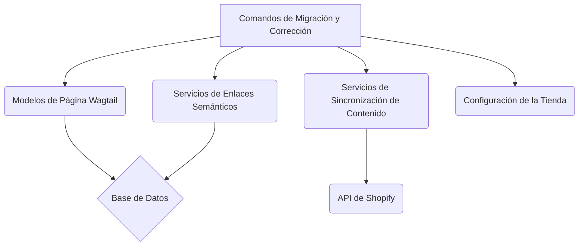

# Comandos de Migración y Corrección de Contenido

Este módulo (`Content_Migration___Fix_Commands`) agrupa una serie de comandos de gestión de Django diseñados para facilitar la migración, actualización y corrección de datos de contenido dentro del sistema de gestión de contenido Wagtail, específicamente en su integración con Shopify. Estos comandos son cruciales para mantener la integridad y consistencia de los datos de contenido a medida que el sistema evoluciona o cuando se identifican inconsistencias.

## Arquitectura General

El módulo se integra directamente con el subsistema de gestión de contenido de Shopify en Wagtail, operando sobre los modelos de página y los mecanismos de sincronización de contenido. Los comandos interactúan con:

*   **Modelos de Página de Wagtail:** Acceden y modifican instancias de `ArticlePage`, `GlossaryTermPage`, `HomePage`, `LocationPage`, `ProductPage` y `ShopifyRootPage` para aplicar cambios en la estructura o el contenido.
*   **Servicios de Enlaces Semánticos:** Utilizan la lógica de enlaces semánticos para gestionar referencias y relaciones entre diferentes tipos de contenido.
*   **Servicios de Sincronización:** En algunos casos, los comandos desencadenan sincronizaciones salientes hacia Shopify para asegurar que los cambios realizados en Wagtail se reflejen en la plataforma de comercio electrónico.
*   **Configuración de la Tienda (`ShopConfig`):** Acceden a la configuración global para determinar cómo deben aplicarse ciertas migraciones o configuraciones de exportación.

El flujo de trabajo típico de un comando en este módulo implica:
1.  Identificar el contenido afectado (por tipo de página, ID, u otros filtros).
2.  Realizar una operación de transformación o corrección en los datos del contenido.
3.  Opcionalmente, guardar los cambios en la base de datos de Wagtail.
4.  Opcionalmente, iniciar una sincronización de contenido saliente hacia Shopify.

### Diagrama de Componentes de Alto Nivel

## Sub-módulos

Este módulo se compone de los siguientes sub-módulos, cada uno enfocado en un tipo específico de migración o corrección:

*   [Comandos de Backfill y Referencias Nativas Shopify](Content_Migration___Fix_Commands/Content_Migration___Fix_Commands_Backfill_Referencias_Nativas_Shopify.md)
*   [Comandos de Corrección de Contenido](Content_Migration___Fix_Commands/Content_Migration___Fix_Commands_Comandos_Correccion.md)
*   [Comandos de Migración de Contenido](Content_Migration___Fix_Commands/Content_Migration___Fix_Commands_Comandos_Migracion.md)
