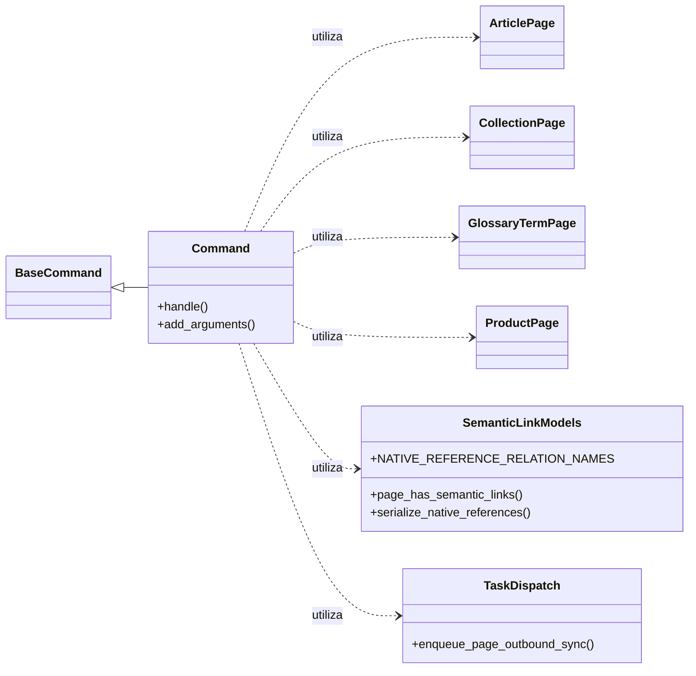

# Comando `backfill_shopify_native_references`

Este documento detalla el comando de gestión `backfill_shopify_native_references`, su propósito, funcionalidad y cómo se integra dentro del sistema de gestión de contenido y la plataforma de integración con Shopify.

## 1. Propósito y Funcionalidad del Módulo

El comando `backfill_shopify_native_references` es una herramienta de gestión de Django diseñada para rellenar (backfill) los metafields de referencia nativos de Shopify en las páginas de contenido de Wagtail que tienen enlaces semánticos. Su función principal es asegurar que las referencias a productos, colecciones y artículos de Shopify, que están modeladas como relaciones de clave externa (FK) en Wagtail, se serialicen y sincronicen como metafields de referencia nativos de Shopify (es decir, `list.*_reference`) en la plataforma de Shopify.

Esto es crucial para mantener la coherencia de los datos y permitir que Shopify consuma estas referencias directamente para la renderización del storefront o para otras automatizaciones.

### Core Component: `Command`

La clase `Command` en `shopify_content/management/commands/backfill_shopify_native_references.py` es la implementación principal de este comando de gestión de Django.

**Argumentos:**
*   `--model`: Permite especificar el tipo de página de Wagtail a procesar. Las opciones son: `product`, `collection`, `article`, `glossary`, o `all` (predeterminado).
*   `--dry-run`: Si se activa, el comando informará sobre la cobertura de páginas y los enlaces resueltos sin encolar ninguna tarea de sincronización saliente a Shopify.

**Funcionamiento General:**
1.  Itera sobre las páginas "live" (publicadas) de los modelos de contenido especificados (`ProductPage`, `CollectionPage`, `ArticlePage`, `GlossaryTermPage`).
2.  Para cada página, verifica si tiene enlaces semánticos definidos.
3.  Serializa las referencias nativas de Shopify a partir de estos enlaces semánticos.
4.  Calcula cuántas referencias fueron resueltas y cuántas no (omitted_targets).
5.  Si no es una "dry run" y la página cumple con los requisitos de sincronización (e.g., `sync_enabled` es verdadero y tiene un `shopify_id` si no es una `GlossaryTermPage`), encola una tarea de sincronización saliente para esa página.

## 2. Arquitectura y Relaciones de Componentes

El comando `backfill_shopify_native_references` interactúa con varios componentes clave dentro del ecosistema de Wagtail y Shopify.

### Dependencias Principales:

*   **Modelos de Contenido Wagtail**: Depende directamente de los modelos `ArticlePage`, `CollectionPage`, `GlossaryTermPage` y `ProductPage` definidos en `[Content_Base_Models___Mixins.md](../Content_Base_Models___Mixins.md)`, `[Blog_Content_Models.md](../Blog_Content_Models.md)`, `[Collection_Content_Models.md](../Collection_Content_Models.md)`, `[Glossary_Content_Models.md](../Glossary_Content_Models.md)` y `[Product_Content_Models.md](../Product_Content_Models.md)`.
*   **Módulo `semantic_links`**: Utiliza `page_has_semantic_links` para determinar si una página tiene enlaces semánticos, `NATIVE_REFERENCE_RELATION_NAMES` para identificar las relaciones de referencia nativas, y `serialize_native_references` para transformar las relaciones de FK en referencias GID de Shopify. Para más detalles, consulte la documentación sobre la [Gestión de Enlaces Semánticos](../Content_URL___Link_Management.md).
*   **Módulo `sync.task_dispatch`**: Emplea `enqueue_page_outbound_sync` para añadir páginas a la cola de sincronización saliente, lo que finalmente resulta en la actualización de los metafields en Shopify. Más información en [Content_Synchronization_Services_Shopify_Import_Orchestration](../Content_Synchronization_Services/Content_Synchronization_Services_Shopify_Import_Orchestration.md).

### Diagrama de Clases (Simplificado)



### Diagrama de Flujo del Comando `handle`

```mermaid
graph TD
    A[Inicio Comando] --> B{Obtener argumentos --model y --dry-run};
    B --> C{Determinar modelos a procesar};
    C --> D{Para cada modelo};
    D --> E{Para cada página "live" del modelo};
    E{Para cada página "live" del modelo} --> F{La página tiene enlaces semánticos?};
    F -- No --> G[Continuar con la siguiente página];
    F -- Sí --> H{Incrementar pages_with_links};
    H --> I{Serializar referencias nativas (serialize_native_references)};
    I --> J{Las referencias tienen GIDs?};
    J -- Sí --> K{Incrementar pages_with_gids};
    J -- No --> L{Incrementar pages_without_gids};
    K --> M{Calcular omitted_targets};
    L --> M{Calcular omitted_targets};
    M --> N{Es dry-run?};
    N -- Sí --> G;
    N -- No --> O{Página sync_enabled y shopify_id (si aplica)?};
    O -- No --> G;
    O -- Sí --> P{Encolar sincronización saliente (enqueue_page_outbound_sync)};
    P --> Q{Incrementar enqueued};
    Q --> G;
    D --> R[Fin procesamiento modelos];
    R --> S[Reportar estadísticas y fin comando];
```

## 3. Cómo el Módulo Encaja en el Sistema General

Este comando es una pieza fundamental en el flujo de trabajo de sincronización de contenido entre Wagtail y Shopify, específicamente para la gestión de referencias de productos, colecciones y artículos.

Se enmarca dentro de la categoría de comandos de migración y corrección (`Content_Migration___Fix_Commands`) ya que su objetivo es asegurar la correcta representación de las relaciones de contenido en Shopify, solucionando potenciales desajustes o realizando un "backfill" inicial de datos.

*   **Integración con Wagtail**: Opera directamente sobre las páginas de Wagtail, accediendo a sus atributos y relaciones definidas en el ORM de Django.
*   **Integración con Shopify**: Su salida final es la encolación de tareas que resultarán en llamadas a la API de Shopify para actualizar los metafields correspondientes, utilizando el módulo `[Shopify_API_Client.md](../../../Application_Core___Shopify_Integration_Platform/Shopify_API_Client.md)`.
*   **Ciclo de vida del Contenido**: Este comando contribuye a la fase de "sincronización saliente" del contenido editorial, asegurando que los datos estructurados en Wagtail se reflejen fielmente en Shopify para su uso en el storefront o en otros sistemas de Shopify.

En resumen, `backfill_shopify_native_references` actúa como un puente para garantizar que las referencias internas del CMS (Wagtail) se traduzcan correctamente a las referencias nativas esperadas por Shopify, facilitando una integración robusta y consistente.