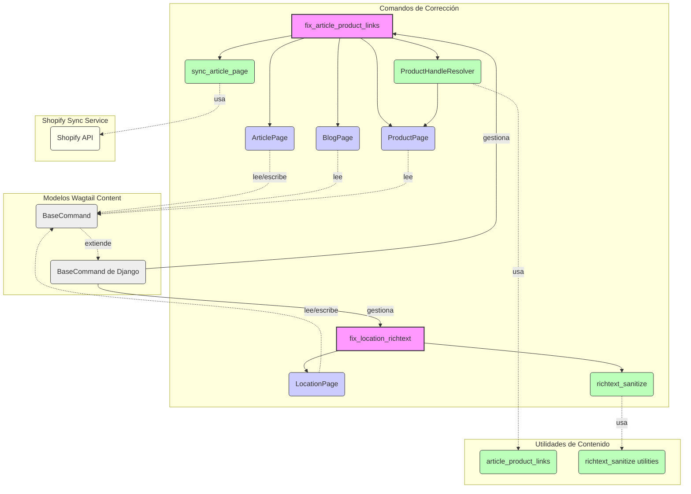

# Comandos de Corrección de Contenido

Este módulo agrupa comandos de gestión de Django diseñados para corregir y mantener la integridad del contenido en el sistema de gestión de contenido Wagtail, específicamente en relación con la integración de Shopify. Estos comandos abordan problemas comunes como enlaces de productos rotos y HTML malformado en campos de texto enriquecido.

## Propósito y Funcionalidad Principal

Este módulo contiene los siguientes comandos de corrección:

### `fix_article_product_links`

El comando `fix_article_product_links` está diseñado para escanear y reescribir enlaces internos en el cuerpo de las páginas de artículos (ArticlePage) que apuntan a productos de Shopify. Su objetivo es asegurar que los enlaces a `/products/{handle}` sean válidos y apunten a los `ProductPage` correspondientes en el sistema, utilizando los handles de productos en vivo. Por defecto, los enlaces que no pueden mapearse se desenlazan (se eliminan las etiquetas `<a>`).

**Uso:**

```bash
python manage.py fix_article_product_links [--dry-run] [--blog-handle <handle>] [--page-id <id>] [--map-file <path>] [--push] [--no-unwrap-missing] [--include-drafts]
```

**Parámetros:**

*   `--dry-run`: Informa sobre los cambios sin guardarlos ni sincronizarlos con Shopify.
*   `--blog-handle <handle>`: Limita la operación a artículos bajo un `BlogPage` específico (ej. `example-cluster`).
*   `--page-id <id>`: Limita la operación a una `ArticlePage` específica por ID (puede repetirse).
*   `--map-file <path>`: Proporciona un archivo JSON para mapear manualmente `legacy_handle` a `live_handle` para casos ambiguos.
*   `--push`: Sincroniza cada artículo modificado con Shopify después de guardarlo (solo si no es `--dry-run`).
*   `--no-unwrap-missing`: Deja los enlaces de productos no mapeados sin cambios en lugar de eliminar las etiquetas `<a>`.
*   `--include-drafts`: Incluye artículos no publicados (por defecto, solo artículos en vivo).

### `fix_location_richtext`

El comando `fix_location_richtext` se encarga de reparar el HTML malformado en los campos `RichTextField` de los registros `LocationPage`. Utiliza un proceso de sanitización para corregir problemas estructurales o de formato en el contenido HTML, asegurando que el contenido sea válido y esté correctamente renderizado.

**Uso:**

```bash
python manage.py fix_location_richtext [--page-id <id>] [--dry-run]
```

**Parámetros:**

*   `--page-id <id>`: Limita la operación a una `LocationPage` específica por ID (puede repetirse).
*   `--dry-run`: Informa sobre los cambios sin guardarlos.

## Arquitectura y Relaciones entre Componentes

Los comandos de corrección interactúan estrechamente con los modelos de contenido de Wagtail y con servicios auxiliares para la resolución de enlaces y la sanitización de HTML. Forman parte del módulo padre [Shopify_Content_Management](../../Shopify_Content_Management.md), que gestiona todo el contenido relacionado con Shopify dentro de Wagtail.



**Descripción de las relaciones:**

*   **`fix_article_product_links`**: Este comando depende de `ProductHandleResolver` para identificar y resolver los handles de productos. Interactúa con los modelos `ArticlePage`, `BlogPage` y `ProductPage` para obtener y actualizar datos de contenido. Para la sincronización externa, utiliza `sync_article_page` del servicio de sincronización de Shopify.
*   **`fix_location_richtext`**: Este comando opera directamente sobre el modelo `LocationPage` y utiliza las utilidades de `richtext_sanitize` para la validación y limpieza del HTML.
*   **`BaseCommand` de Django**: Ambos comandos extienden la clase `BaseCommand` de Django, lo que les permite ser ejecutados como comandos de gestión.
*   **Utilidades de Contenido**: Las funciones de `article_product_links` (como `rewrite_streamfield_raw` y `load_manual_map`) y `richtext_sanitize` encapsulan la lógica de negocio para la manipulación del contenido.

## Flujo de Proceso

### Flujo de `fix_article_product_links`

Este diagrama ilustra los pasos clave que el comando `fix_article_product_links` sigue para corregir los enlaces de productos.

```mermaid
flowchart TD
    A[Inicio Comando] --> B{Cargar mapa manual?}
    B -- Sí --> C[Cargar desde --map-file]
    B -- No --> D[No cargar mapa]
    C --> E[Inicializar ProductHandleResolver con ProductPage.objects.live() y mapa manual]
    D --> E
    E --> F{Filtros de Artículo?}
    F -- Sí --> G[Aplicar filtros: --blog-handle, --page-id, --include-drafts]
    F -- No --> H[Seleccionar todos los ArticlePage]
    G --> I[Iterar sobre ArticlePage]
    H --> I
    I --> J[Obtener StreamField raw_data]
    J --> K[Llamar a rewrite_streamfield_raw]
    K --> L{Cambios detectados?}
    L -- Sí --> M[Reportar cambios]
    M --> N{Dry Run?}
    N -- No --> O[Guardar revisión de ArticlePage]
    O --> P{ArticlePage en vivo?}
    P -- Sí --> Q[Publicar revisión]
    Q --> R{Push activado?}
    R -- Sí --> S[Sincronizar ArticlePage con Shopify]
    S -- Éxito --> T[Incrementar pushed_ok]
    S -- Fallo --> U[Incrementar pushed_fail]
    R -- No --> V[No sincronizar]
    N -- Sí --> W[Continuar (Dry Run)]
    L -- No --> X[Continuar (Sin cambios)]
    T --> I
    U --> I
    V --> I
    W --> I
    X --> I
    I --> Y[Fin Iteración]
    Y --> Z[Reportar resumen de la operación]
    Z --> AA[Mostrar handles ambiguos si existen]
    AA --> B_End[Fin]

    style A fill:#ACE,stroke:#333,stroke-width:2px
    style B_End fill:#ACE,stroke:#333,stroke-width:2px
    style M fill:#ccf,stroke:#333,stroke-width:1px
    style N fill:#cfc,stroke:#333,stroke-width:1px
    style P fill:#cfc,stroke:#333,stroke-width:1px
    style R fill:#cfc,stroke:#333,stroke-width:1px
    style L fill:#cfc,stroke:#333,stroke-width:1px
    style J fill:#fff,stroke:#333,stroke-width:1px
    style K fill:#fff,stroke:#333,stroke-width:1px
    style O fill:#fff,stroke:#333,stroke-width:1px
    style S fill:#fff,stroke:#333,stroke-width:1px
    style T fill:#9C9,stroke:#333,stroke-width:1px
    style U fill:#F99,stroke:#333,stroke-width:1px
    style Q fill:#fff,stroke:#333,stroke-width:1px

```

### Flujo de `fix_location_richtext`

Este diagrama describe el proceso que sigue el comando `fix_location_richtext` para sanear el HTML en los campos de `RichTextField`.

```mermaid
flowchart TD
    A[Inicio Comando] --> B{Filtro por --page-id?}
    B -- Sí --> C[Filtrar LocationPage por ID]
    B -- No --> D[Seleccionar todos los LocationPage]
    C --> E[Iterar sobre LocationPage]
    D --> E
    E --> F[Inicializar page_changed = False]
    F --> G[Iterar sobre LOCATION_RICHTEXT_FIELDS]
    G --> H[Obtener HTML raw del campo]
    H --> I{HTML vacío?}
    I -- Sí --> G
    I -- No --> J{HTML ya válido?}
    J -- Sí --> G
    J -- No --> K[Sanitizar HTML]
    K --> L{Sanitizado igual al original o aún inválido?}
    L -- Sí --> M[Reportar: no se pudo auto-reparar]
    L -- No --> N[Reportar: reparado]
    N --> O{Dry Run?}
    O -- No --> P[Actualizar campo con HTML sanitizado]
    P --> Q[Establecer page_changed = True]
    Q --> G
    O -- Sí --> R[Continuar (Dry Run)]
    R --> G
    M --> G
    G --> S[Fin Iteración de campos]
    S --> T{page_changed y no Dry Run?}
    T -- Sí --> U[Guardar LocationPage]
    U --> V[Incrementar fixed_pages]
    V --> W[Fin Iteración de páginas]
    T -- No --> X[Continuar (sin guardar o Dry Run)]
    X --> W
    W --> Y[Reportar resumen de la operación]
    Y --> Z[Fin]

    style A fill:#ACE,stroke:#333,stroke-width:2px
    style Z fill:#ACE,stroke:#333,stroke-width:2px
    style M fill:#F99,stroke:#333,stroke-width:1px
    style N fill:#9C9,stroke:#333,stroke-width:1px
    style O fill:#cfc,stroke:#333,stroke-width:1px
    style J fill:#cfc,stroke:#333,stroke-width:1px
    style L fill:#cfc,stroke:#333,stroke-width:1px
    style T fill:#cfc,stroke:#333,stroke-width:1px
    style U fill:#fff,stroke:#333,stroke-width:1px
    style P fill:#fff,stroke:#333,stroke-width:1px
    style Q fill:#fff,stroke:#333,stroke-width:1px

```

## Integración con el Sistema General

Los comandos de corrección de contenido son herramientas esenciales para el mantenimiento y la calidad de los datos dentro del sistema de gestión de contenido de Wagtail, que sirve como la fuente de verdad editorial para la plataforma de Shopify. Al asegurar la corrección de los enlaces de productos y la validez del HTML, estos comandos garantizan que el contenido editorial se presente correctamente en el storefront de Shopify y que la navegación del usuario sea fluida y precisa. Contribuyen directamente a la experiencia del usuario y a la coherencia del contenido.

Estos comandos complementan a otros procesos de [Sincronización de Contenido](../Content_Synchronization_Services.md) y [Migración de Contenido](Content_Migration___Fix_Commands_Comandos_Migracion.md) al proporcionar los medios para rectificar errores post-migración o post-edición, manteniendo la salud general del sistema de contenido.

## Referencias

*   [Gestión de Contenido de Shopify](../../Shopify_Content_Management.md)
*   [Modelos Base de Contenido y Mixins](../Content_Base_Models___Mixins.md)
*   [Modelos de Contenido de Artículos (Blog)](../Blog_Content_Models.md)
*   [Modelos de Contenido de Productos](../Product_Content_Models.md)
*   [Modelos de Contenido de Ubicaciones](../Location_Content_Models.md)
*   [Comandos de Migración de Contenido](Wagtail_Content_Management___API/Shopify_Content_Management/Content_Migration___Fix_Commands/Content_Migration___Fix_Fix_Commands_Comandos_Migracion.md)
