# Comandos de Migración de Contenido

Este módulo agrupa comandos de gestión de Django diseñados para facilitar la migración y actualización de varios aspectos del contenido de Wagtail, especialmente aquellos relacionados con la integración de Shopify. Estos comandos son herramientas esenciales para la evolución de la estructura de datos y la coherencia del contenido a lo largo del tiempo.

## Arquitectura y Componentes

Los comandos de migración de contenido son utilidades de línea de comandos de Django que interactúan directamente con la base de datos de Wagtail y los modelos de contenido de la aplicación `shopify_content`. Su función principal es transformar o actualizar datos existentes para adaptarse a nuevas estructuras o lógicas de negocio, asegurando la integridad y la compatibilidad del sistema.

### Relación con el Sistema General

Estos comandos forman parte del proceso de gestión del contenido en el sistema, trabajando en conjunto con:

*   **Modelos de Contenido de Wagtail**: Modifican instancias de modelos como `GlossaryTermPage`, `HomePage`, y `ShopifyRootPage` ([Content_Base_Models___Mixins.md](../Content_Base_Models___Mixins.md), [Glossary_Content_Models.md](../Glossary_Content_Models.md), [Home_Page_Models.md](../Home_Page_Models.md)).
*   **Utilidades de Sincronización y Vinculación**: Utilizan servicios para persistir cambios y resolver referencias, como se describe en [Content_Synchronization_Services.md](../Content_Synchronization_Services.md) y `shopify_content.semantic_links.service`.
*   **Configuración de la Tienda**: Pueden leer y modificar la configuración global de la tienda a través de `ShopConfig`.

A continuación, se describen los comandos específicos incluidos en este módulo.

## Comandos Detallados

### `migrate_glossary_links_to_fk`

*   **Propósito**: Migra las entradas JSON de `related_links` existentes en las páginas `GlossaryTermPage` a filas de claves foráneas (FK) tipadas, representando enlaces semánticos manuales. Esto transforma datos menos estructurados en relaciones de base de datos más robustas.
*   **Funcionalidad**:
    *   Itera sobre todas las instancias de `GlossaryTermPage`.
    *   Para cada `GlossaryTermPage` con `related_links` en formato JSON, intenta resolver el destino del enlace a una página Wagtail.
    *   Determina el tipo de página de destino y el nombre de la relación FK correspondiente.
    *   Si el enlace FK no existe, lo crea con `is_auto=False` y un `sort_order` adecuado.
    *   Después de la migración (si no es una ejecución de prueba), persiste una revisión de los enlaces semánticos para las páginas actualizadas.
*   **Argumentos**:
    *   `--dry-run`: Informa los cambios planificados sin modificar la base de datos.
*   **Dependencias Clave**:
    *   `shopify_content.models.GlossaryTermPage`: El modelo de página de glosario que se está migrando.
    *   `shopify_content.models.semantic_links.relation_for_page_type`: Ayuda a determinar la relación FK correcta basada en el tipo de página.
    *   `shopify_content.semantic_links.manual_links.resolve_related_link_target`: Resuelve los destinos de los enlaces desde el JSON.
    *   `shopify_content.semantic_links.service.page_type_key_for`, `shopify_content.semantic_links.service.persist_semantic_links_revision`: Utilidades para manejar enlaces semánticos.

### `migrate_glossary_locales`

*   **Propósito**: Asigna objetos `Wagtail Locale` a las filas de `GlossaryTermPage` basándose en el código de locale existente (`locale_code`), realizando conversiones como `en` a `en-US`.
*   **Funcionalidad**:
    *   Recorre todas las páginas `GlossaryTermPage`.
    *   Determina el código de locale de Wagtail (`target_code`) a partir del `locale_code` de la página del glosario.
    *   Obtiene o crea el objeto `Locale` correspondiente en Wagtail.
    *   Si el `locale` de la página del glosario no coincide con el `target_locale`, actualiza la página.
*   **Argumentos**:
    *   `--dry-run`: Informa los cambios planificados sin guardar en la base de datos.
*   **Dependencias Clave**:
    *   `shopify_content.models.GlossaryTermPage`: El modelo de página de glosario.
    *   `wagtail.models.Locale`: El modelo de locale de Wagtail.
    *   `shopify_content.glossary_locale_utils.wagtail_locale_code_for_glossary`: Utilidad para obtener el código de locale de Wagtail.

### `migrate_home_pages`

*   **Propósito**: Crea copias `HomePage` a partir de filas `wagtailcore.Page` heredadas (con slugs `home` o `home-*`) y las asocia con la raíz `cms-home`. Las páginas heredadas se dejan intactas para revisión manual.
*   **Funcionalidad**:
    *   Localiza o crea la `ShopifyRootPage` para "home".
    *   Consulta páginas `wagtailcore.Page` con slugs que comienzan con `home` y que aún no son `HomePage` ni `ShopifyRootPage`.
    *   Para cada página heredada, crea una nueva instancia de `HomePage`, copiando propiedades como `title`, `locale`, `seo_title` y `search_description`.
    *   Normaliza y serializa el contenido de la sección para el nuevo `HomePage`.
    *   Añade la nueva `HomePage` como hijo de la `ShopifyRootPage` "home".
*   **Argumentos**:
    *   `--dry-run`: Informa los cambios planificados sin crear páginas.
*   **Dependencias Clave**:
    *   `wagtail.models.Page`: El modelo de página base de Wagtail.
    *   `shopify_content.models.HomePage`, `shopify_content.models.ShopifyRootPage`: Modelos de página de inicio y raíz de Shopify.
    *   `shopify_content.home_sections_normalization.normalize_sections_json`: Normaliza la estructura JSON de las secciones.
    *   `shopify_content.home_serialization.sections_json_to_stream_data`: Convierte el JSON de secciones a datos `StreamField`.
    *   `shopify_content.sync.import_parents.resolve_shopify_import_parent`: Resuelve la página padre de importación.

### `migrate_index_export_config`

*   **Propósito**: Migra la configuración de exportación de glosario/ubicación desde el formato heredado `pages{}/page_gid` al nuevo formato `locales[]`, que se utiliza en la arquitectura de metaobjetos de `root_page`.
*   **Funcionalidad**:
    *   Recupera la configuración de la tienda (`ShopConfig`).
    *   Itera sobre las configuraciones de exportación de glosario y ubicación.
    *   Para cada sección de configuración, determina los locales a partir de la configuración heredada (si existe).
    *   Construye la nueva configuración de sección utilizando los locales derivados.
    *   Almacena las configuraciones heredadas como `_legacy_pages` y `_legacy_page_gid` para referencia.
    *   Actualiza la configuración de exportación de la `ShopifyRootPage` correspondiente con la nueva estructura basada en locales.
*   **Argumentos**:
    *   `--apply`: Escribe la configuración de exportación actualizada a las raíces de Wagtail.
    *   `--dry-run`: Imprime los cambios planificados sin escribir en la base de datos.
*   **Dependencias Clave**:
    *   `core.models.ShopConfig`: Configuración global de la tienda.
    *   `shopify_content.models.ShopifyRootPage`: El modelo de página raíz de Shopify.
    *   `shopify_content.sync.index_pages_bootstrap.build_glossary_export_config`, `shopify_content.sync.index_pages_bootstrap.build_location_export_config`: Utilidades para construir la nueva configuración de exportación.
    *   `shopify_content.available_locales.ALLOWED_LOCALE_CODE_LIST`: Lista de códigos de locale permitidos.

## Diagrama de Flujo de Datos y Componentes

```mermaid
graph TD
    subgraph Comandos de Migración
        A[migrate_glossary_links_to_fk] --> B(GlossaryTermPage.related_links JSON)
        A --> C(SemanticPageLink FKs)
        D[migrate_glossary_locales] --> E(GlossaryTermPage.locale_code)
        D --> F(Wagtail Locale Objeto)
        G[migrate_home_pages] --> H(wagtailcore.Page heredadas)
        G --> I(HomePage Nuevas)
        J[migrate_index_export_config] --> K(ShopifyRootPage.export_config JSON heredado)
        J --> L(ShopifyRootPage.export_config JSON actualizado)
    end

    subgraph Modelos de Contenido
        B -- Lee --> M[shopify_content/models/glossary.py::GlossaryTermPage]
        C -- Escribe --> M
        E -- Lee/Escribe --> M
        F -- Lee/Escribe --> P[wagtail.models.Locale]
        H -- Lee --> Q[wagtail.models.Page]
        I -- Escribe --> R[shopify_content/models/home_page.py::HomePage]
        K -- Lee --> S[shopify_content/models/root.py::ShopifyRootPage]
        L -- Escribe --> S
    end

    subgraph Utilidades y Servicios
        A -- Utiliza --> U[shopify_content.semantic_links.service]
        A -- Utiliza --> V[shopify_content.semantic_links.manual_links]
        D -- Utiliza --> W[shopify_content.glossary_locale_utils]
        G -- Utiliza --> X[shopify_content.home_sections_normalization]
        G -- Utiliza --> Y[shopify_content.home_serialization]
        G -- Utiliza --> Z[shopify_content.sync.import_parents]
        J -- Utiliza --> AA[shopify_content.sync.index_pages_bootstrap]
        J -- Utiliza --> BB[shopify_content.available_locales]
        J -- Utiliza --> CC[core.models.ShopConfig]
    end

    M <--> U
    M <--> V
    M <--> W
    Q <--> Z
    R <--> X
    R <--> Y
    S <--> AA
    S <--> BB
    S <--> CC

    style M fill:#f9f,stroke:#333,stroke-width:2px
    style P fill:#f9f,stroke:#333,stroke-width:2px
    style Q fill:#f9f,stroke:#333,stroke-width:2px
    style R fill:#f9f,stroke:#333,stroke-width:2px
    style S fill:#f9f,stroke:#333,stroke-width:2px

    linkStyle 0 stroke:#000,stroke-width:1px,fill:none;
    linkStyle 1 stroke:#000,stroke-width:1px,fill:none;
    linkStyle 2 stroke:#000,stroke-width:1px,fill:none;
    linkStyle 3 stroke:#000,stroke-width:1px,fill:none;
    linkStyle 4 stroke:#000,stroke-width:1px,fill:none;
    linkStyle 5 stroke:#000,stroke-width:1px,fill:none;
    linkStyle 6 stroke:#000,stroke-width:1px,fill:none;
    linkStyle 7 stroke:#000,stroke-width:1px,fill:none;
    linkStyle 8 stroke:#000,stroke-width:1px,fill:none;
    linkStyle 9 stroke:#000,stroke-width:1px,fill:none;
    linkStyle 10 stroke:#000,stroke-width:1px,fill:none;
    linkStyle 11 stroke:#000,stroke-width:1px,fill:none;
    linkStyle 12 stroke:#000,stroke-width:1px,fill:none;
    linkStyle 13 stroke:#000,stroke-width:1px,fill:none;
    linkStyle 14 stroke:#000,stroke-width:1px,fill:none;
    linkStyle 15 stroke:#000,stroke-width:1px,fill:none;
    linkStyle 16 stroke:#000,stroke-width:1px,fill:none;
    linkStyle 17 stroke:#000,stroke-width:1px,fill:none;
    linkStyle 18 stroke:#000,stroke-width:1px,fill:none;
    linkStyle 19 stroke:#000,stroke-width:1px,fill:none;
    linkStyle 20 stroke:#000,stroke-width:1px,fill:none;
    linkStyle 21 stroke:#000,stroke-width:1px,fill:none;
    linkStyle 22 stroke:#000,stroke-width:1px,fill:none;
    linkStyle 23 stroke:#000,stroke-width:1px,fill:none;
    linkStyle 24 stroke:#000,stroke-width:1px,fill:none;
```

