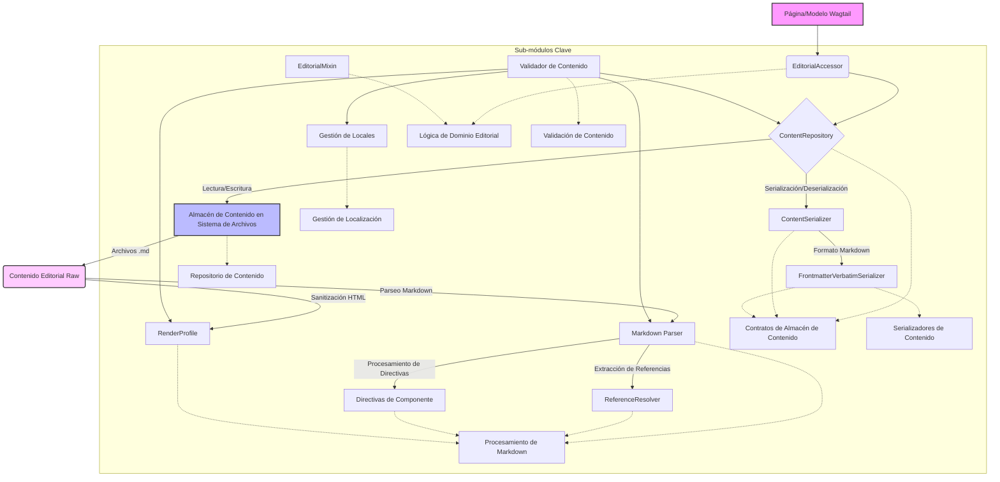

# Lógica Editorial y Almacén de Contenido

Este módulo, `Content_Store___Editorial_Logic`, es el núcleo para la gestión, almacenamiento y validación del contenido editorial dentro de la plataforma. Proporciona las interfaces y la implementación para interactuar con el contenido, asegurando su integridad y coherencia a través de diferentes formatos y locales.

## Propósito

El propósito principal de este módulo es:

*   Definir los contratos y abstracciones para el almacenamiento y serialización de contenido editorial.
*   Proveer una implementación de repositorio de contenido basado en el sistema de archivos.
*   Ofrecer mecanismos para acceder a campos editoriales de manera consistente.
*   Gestionar la localización del contenido, mapeando códigos de locales de Wagtail a segmentos de ruta de contenido.
*   Facilitar el procesamiento y la validación del contenido en formato Markdown, incluyendo el manejo de activos, directivas y referencias.
*   Garantizar la seguridad y la integridad del contenido editorial mediante perfiles de renderizado y validación exhaustiva.

## Arquitectura General

La arquitectura del módulo se centra en una clara separación de responsabilidades, con contratos bien definidos para la interacción entre componentes. Utiliza un repositorio para el almacenamiento físico del contenido y serializadores para manejar los diferentes formatos. El contenido Markdown se procesa a través de un pipeline que incluye parsing, resolución de referencias y sanitización.

## Componentes y Funcionalidades Clave

Este módulo se organiza en varios sub-módulos, cada uno con responsabilidades específicas:

*   **[Repositorio de Contenido](Content_Store___Editorial_Logic/Content_Store___Editorial_Logic_RepositorioContenido.md)**: Proporciona la implementación concreta para el almacenamiento y recuperación de contenido editorial en el sistema de archivos.
*   **[Contratos de Almacén de Contenido](Content_Store___Editorial_Logic/Content_Store___Editorial_Logic_Contratos.md)**: Define las interfaces y los objetos de valor que establecen los contratos para la interacción con el almacén de contenido editorial, independientemente de la implementación del backend.
*   **[Lógica de Dominio Editorial](Content_Store___Editorial_Logic/Content_Store___Editorial_Logic_Content_Store___Editorial_Logic_LogicaDominioEditorial.md)**: Expone una API de dominio canónica (`page.editorial.<field>`) para acceder a los campos editoriales de una página, desacoplada de la implementación del ORM.
*   **[Gestión de Localización](Content_Store___Editorial_Logic/Content_Store___Editorial_Logic_GestionLocalizacion.md)**: Centraliza la política de mapeo entre los códigos de locales de Wagtail y los segmentos de ruta de contenido en Git, asegurando la consistencia en la localización del contenido.
*   **[Procesamiento de Markdown](Content_Store___Editorial_Logic/Content_Store___Editorial_Logic_Content_Store___Editorial_Logic_ProcesamientoMarkdown.md)**: Contiene la lógica para el parsing, la extracción de referencias, el manejo de directivas y la sanitización del contenido Markdown editorial.
*   **[Serializadores de Contenido](Content_Store___Editorial_Logic/Content_Store___Editorial_Logic_SerializadoresContenido.md)**: Se encarga de la serialización y deserialización del contenido editorial, utilizando un formato YAML frontmatter y cuerpo Markdown, garantizando una representación fiel y legible por editores externos.
*   **[Validación de Contenido](Content_Store___Editorial_Logic/Content_Store___Editorial_Logic_ValidacionContenido.md)**: Implementa un validador determinista para verificar la integridad y la estructura del árbol de contenido editorial desplegado.