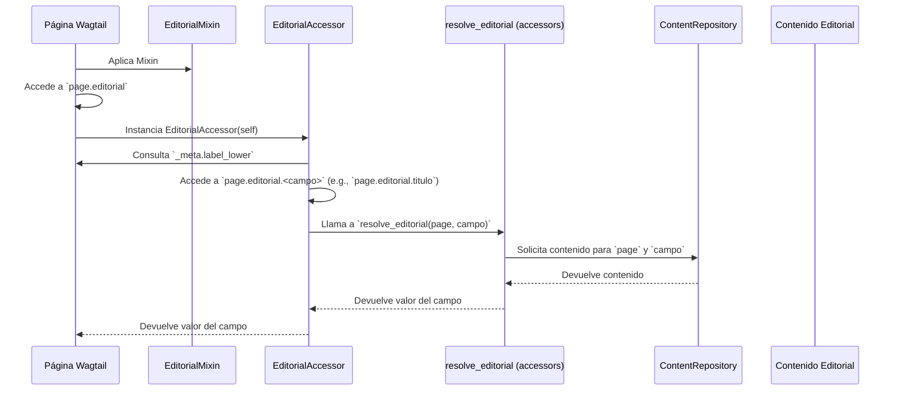

# Lógica de Dominio Editorial

Este módulo (`shopify_content/content_store/domain.py`) define la API canónica del dominio editorial, permitiendo el acceso a campos editoriales a través de `page.editorial.<campo>`. Su propósito principal es proporcionar una interfaz limpia y consistente para interactuar con el contenido editorial de las páginas en el sistema de gestión de contenido.

## Propósito y Funcionalidad Principal

El módulo `LogicaDominioEditorial` actúa como la capa de acceso principal para los datos editoriales asociados a las instancias de páginas. Abstrae la complejidad de la recuperación de contenido de un repositorio subyacente y presenta una vista sencilla y orientada al dominio para los desarrolladores.

### `EditorialAccessor`
La clase `EditorialAccessor` es un accesor de lectura que se vincula a una instancia de página específica. Cuando se intenta acceder a un atributo de `EditorialAccessor` (por ejemplo, `page.editorial.titulo`), verifica si el atributo solicitado es un campo editorial registrado para el tipo de página. Si es así, delega la resolución real del contenido a la función `resolve_editorial`. Esto asegura que el acceso a los datos editoriales sea coherente y esté validado contra los campos definidos.

### `EditorialMixin`
El `EditorialMixin` es un mixin que se puede aplicar a objetos de dominio (como los modelos de página de Wagtail) para dotarlos de la propiedad `editorial`. Esta propiedad devuelve una instancia de `EditorialAccessor`, proporcionando el punto de entrada para acceder a los campos editoriales de la página a la que se ha aplicado el mixin.

## Arquitectura y Relaciones entre Componentes

El módulo `LogicaDominioEditorial` se integra en la capa de dominio del sistema de gestión de contenido, facilitando la interacción entre los modelos de página de Wagtail y el repositorio de contenido editorial.

```mermaid
graph TD
    A[Modelo de Página Wagtail] --> B{EditorialMixin};
    B --> C[Objeto de Dominio];
    C --> D[Propiedad .editorial];
    D --> E[EditorialAccessor];
    E -- Resuelve campo --> F[resolve_editorial (desde .accessors)];
    F --> G[ContentRepository];
    G -- Recupera Contenido --> H[Contenido Editorial];

    subgraph shopify_content/content_store/domain.py
        B
        E
    end

    subgraph shopify_content/content_store/accessors.py
        F
    end

    subgraph shopify_content/content_store/contracts.py
        G
    end
```
**Descripción del Diagrama:**
*   **Modelo de Página Wagtail**: Representa cualquier modelo de página en Wagtail que necesita acceder a contenido editorial.
*   **EditorialMixin**: Se aplica a los modelos de página, inyectando la funcionalidad editorial.
*   **Objeto de Dominio**: La instancia del modelo de página después de aplicar el mixin.
*   **Propiedad .editorial**: El punto de acceso público en el objeto de dominio para la lógica editorial.
*   **EditorialAccessor**: La clase que gestiona el acceso a los campos editoriales de una página específica.
*   **resolve_editorial**: Una función externa (ubicada en `shopify_content/content_store/accessors.py`) que se encarga de la lógica de recuperación de los campos editoriales.
*   **ContentRepository**: La interfaz (definida en `shopify_content/content_store/contracts.py`) para interactuar con el almacenamiento real del contenido editorial.
*   **Contenido Editorial**: Los datos editoriales recuperados.

## Flujo de Datos y Interacción

El flujo de datos dentro de este módulo es directo y se centra en la recuperación de contenido editorial.


**Descripción del Flujo:**
1.  Una instancia de **Página Wagtail** utiliza el **EditorialMixin**.
2.  Al acceder a la propiedad `editorial` de la página, se crea una instancia de **EditorialAccessor**.
3.  Cuando se intenta leer un campo específico (ej. `page.editorial.titulo`), el **EditorialAccessor** verifica si es un campo editorial válido.
4.  Si es válido, el **EditorialAccessor** invoca a `resolve_editorial` (del módulo `accessors`).
5.  `resolve_editorial` interactúa con el **ContentRepository** para recuperar el contenido editorial solicitado.
6.  El **ContentRepository** devuelve el contenido a `resolve_editorial`.
7.  `resolve_editorial` devuelve el valor del campo a **EditorialAccessor**.
8.  Finalmente, **EditorialAccessor** devuelve el valor a la **Página Wagtail**.

## Integración en el Sistema General

El módulo `LogicaDominioEditorial` es una parte fundamental de la gestión de contenido en la plataforma, especialmente en la integración de Wagtail con un "Content Store" o repositorio de contenido editorial.

*   **Capas de Abstracción**: Proporciona una capa de abstracción sobre la forma en que se almacena y recupera el contenido editorial, desacoplando los modelos de Wagtail de los detalles de implementación del repositorio.
*   **Coherencia de Acceso**: Asegura un método uniforme y validado para acceder a los campos editoriales a través de todas las páginas de Wagtail que implementen `EditorialMixin`.
*   **Extensibilidad**: Al depender de `resolve_editorial` y `ContentRepository`, el sistema puede extenderse para admitir diferentes tipos de repositorios de contenido o lógicas de resolución sin afectar la interfaz de dominio (`page.editorial.<campo>`).

Este módulo es un componente clave de [Content_Store___Editorial_Logic](../Content_Store___Editorial_Logic.md), que a su vez forma parte de [Shopify_Content_Management](../../Shopify_Content_Management.md) y [Wagtail_Content_Management___API](../../../Wagtail_Content_Management___API.md). Para más detalles sobre la implementación del repositorio de contenido y los contratos, consulte [Contratos](Content_Store___Editorial_Logic_Contratos.md) y [RepositorioContenido](Content_Store___Editorial_Logic_RepositorioContenido.md).
