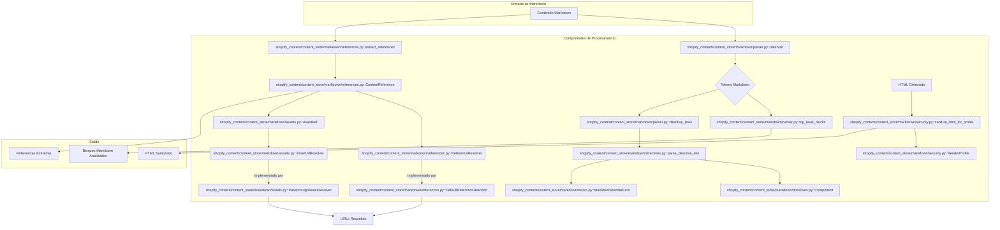

# Procesamiento Markdown en el Almacén de Contenido Editorial

Este módulo (`shopify_content/content_store/markdown`) es fundamental para el procesamiento y la interpretación del contenido Markdown dentro del sistema de gestión de contenido de Wagtail, específicamente para el manejo de la lógica editorial y la integración con Shopify. Proporciona las herramientas necesarias para analizar, validar y transformar contenido Markdown que incluye directivas editoriales y referencias a activos y otros elementos de contenido.

## Propósito y Funcionalidad Principal

El módulo Content_Store___Editorial_Logic_ProcesamientoMarkdown encapsula la lógica para manejar archivos Markdown que pueden contener referencias a productos, colecciones, páginas y activos, así como directivas editoriales personalizadas. Sus componentes clave son:

### 1. Gestión de Activos (shopify_content/content_store/markdown/assets.py)

- **`AssetRef`**: Una clase de datos inmutable que representa una referencia estable a un activo (`asset:<stable-id>`). Permite analizar cadenas de tokens para crear instancias de `AssetRef`.
- **`AssetUrlResolver`**: Un protocolo que define una interfaz para resolver una `AssetRef` a una URL concreta. Esto desacopla la referencia del mecanismo de almacenamiento o CDN.
- **`PassthroughAssetResolver`**: Una implementación por defecto de `AssetUrlResolver` que construye una URL base para los activos (e.g., `/cdn/assets/{stable_id}`).

### 2. Directivas Editoriales (shopify_content/content_store/markdown/directives.py)

- **`Component`**: Una clase de datos que representa una directiva editorial analizada, como ``, ``, `` o ``. Incluye el tipo de componente (`kind`) y sus atributos (`attrs`).
- **`parse_attrs(raw: str)`**: Función que analiza una cadena de atributos en formato `key=value` y devuelve un diccionario.
- **`parse_directive_line(stripped: str, *, line: int = 0)`**: Función que intenta analizar una línea de texto para identificar una directiva editorial y devolver un objeto `Component`.
- **`supports_ref_attribute(attrs: dict[str, str])`**: Verifica si los atributos de una directiva contienen una referencia (`ref`).

### 3. Manejo de Errores (shopify_content/content_store/markdown/errors.py)

- **`MarkdownRenderError`**: Una excepción personalizada que se lanza cuando una directiva de componente editorial en Markdown es inválida o malformada.

### 4. Análisis de Markdown (shopify_content/content_store/markdown/parser.py)

- **`MarkdownBlock`**: Una vista ligera de un bloque de nivel superior en el Markdown, útil para validación e indexación. Contiene el tipo, la etiqueta, el mapa de líneas y el contenido del bloque.
- **`tokenize(source: str)`**: Utiliza la librería `markdown-it-py` para tokenizar una cadena de Markdown, devolviendo una lista de `Token`s.
- **`top_level_blocks(source: str)`**: Extrae bloques de nivel superior del Markdown tokenizado, envolviéndolos en objetos `MarkdownBlock`.
- **`directive_lines(source: str)`**: Un generador que produce tuplas de índice de línea y línea sin espacios en blanco para todas las líneas que parecen directivas.

### 5. Referencias de Contenido (shopify_content/content_store/markdown/references.py)

- **`ContentReference`**: Una clase de datos que representa una referencia tipada estable a un elemento de contenido (producto, colección, página, activo, callout). Contiene el tipo de referencia y un identificador.
- **`ReferenceResolver`**: Un protocolo que define la interfaz para resolver una `ContentReference` a una URL de escaparate o un fragmento HTML.
- **`DefaultReferenceResolver`**: Una implementación por defecto de `ReferenceResolver` que mapea `ContentReference`s a URLs de escaparate (e.g., `/products/{handle}`, `/collections/{handle}`, `/cdn/assets/{stable_id}`).
- **`extract_references(source: str)`**: Analiza el contenido Markdown para extraer todas las `ContentReference`s presentes, tanto de directivas de componentes como de referencias de activos en imágenes.
- **`extract_reference_tokens(source: str)`**: Extrae los tokens de referencia (e.g., `product:handle`, `asset:id`) del contenido Markdown.

### 6. Seguridad en la Representación (shopify_content/content_store/markdown/security.py)

- **`RenderProfile`**: Un enumerador (`Enum`) que define perfiles de seguridad para la representación de HTML editorial. Actualmente incluye `TRUSTED_EDITORIAL` y `RESTRICTED`.
- **`sanitize_html_for_profile(html: str, profile: RenderProfile)`**: Función que sanitiza una cadena HTML basándose en el perfil de seguridad especificado. Para el perfil `RESTRICTED`, elimina etiquetas `<script>`, atributos `on*` y URLs `javascript:`.

## Arquitectura y Relaciones entre Componentes

El módulo de procesamiento de Markdown actúa como el intérprete central del contenido editorial.

**Flujo de Procesamiento:**

1.  **Análisis Inicial**: El `parser.py` toma el contenido Markdown crudo. Lo tokeniza (`tokenize`) y extrae bloques de nivel superior (`top_level_blocks`) para una representación estructurada o identifica líneas que contienen directivas (`directive_lines`).
2.  **Detección de Directivas**: Las líneas identificadas como directivas son procesadas por `directives.py` (`parse_directive_line`) para crear objetos `Component`, que tipifican las directivas editoriales. Cualquier error en el formato de la directiva resulta en una `MarkdownRenderError`.
3.  **Extracción de Referencias**: Simultáneamente, `references.py` (`extract_references`) escanea el Markdown para identificar `ContentReference`s (a productos, colecciones, páginas o activos) basándose en directivas y patrones de imágenes.
4.  **Resolución de Referencias**: Las `ContentReference`s y `AssetRef`s pueden ser resueltas a URLs a través de las interfaces `ReferenceResolver` y `AssetUrlResolver` (con sus implementaciones `DefaultReferenceResolver` y `PassthroughAssetResolver` respectivamente), permitiendo que el contenido editorial vincule a recursos externos o internos de manera dinámica.
5.  **Sanitización HTML**: Después de que el Markdown se haya renderizado a HTML (proceso externo a este módulo, pero dependiente de sus resultados), el `security.py` puede aplicar perfiles de sanitización (`sanitize_html_for_profile`) para eliminar contenido potencialmente peligroso (como scripts incrustados) del HTML final, según el `RenderProfile` configurado.

## Cómo el Módulo se Ajusta al Sistema General

Este módulo es una pieza crucial del subsistema [Almacén de Contenido Editorial](../Content_Store___Editorial_Logic.md) dentro de la [Gestión de Contenido de Shopify con Wagtail](../../Shopify_Content_Management.md).

-   **Entrada de Contenido**: El contenido editorial, a menudo escrito en Markdown por los editores en Wagtail, utiliza las convenciones de este módulo (directivas de componentes, referencias de activos) para enriquecer el texto plano con lógica de negocio y enlaces dinámicos.
-   **Publicación de Contenido**: Cuando el contenido Markdown es guardado o publicado, los componentes de este módulo se utilizan para validar su estructura, extraer referencias para indexación y asegurar que el HTML renderizado final sea seguro.
-   **Renderizado en el Escaparate**: Aunque la renderización final a HTML no es parte directa de este módulo, las estructuras de `MarkdownBlock`, `Component` y `ContentReference` son consumidas por otros servicios que transforman el Markdown en la representación web final, resolviendo las referencias a URLs de Shopify o CDN. La sanitización de seguridad es vital antes de mostrar cualquier HTML generado en el frontend.

Este módulo trabaja en conjunto con:

*   [Lógica de Dominio Editorial](Content_Store___Editorial_Logic_LogicaDominioEditorial.md): Para la abstracción y el acceso al contenido editorial.
*   [Contratos del Almacén de Contenido](Content_Store___Editorial_Logic_Contratos.md): Que definen las interfaces para el manejo de documentos de contenido y serializadores, donde este procesamiento de Markdown encaja como un mecanismo de serialización/deserialización.
*   [Validación de Contenido](Content_Store___Editorial_Logic_ValidacionContenido.md): Que utiliza el análisis de directivas y referencias para verificar la coherencia y validez del contenido editorial.

## Referencias

*   [Almacén de Contenido Editorial](../Content_Store___Editorial_Logic.md)
*   [Gestión de Contenido de Shopify con Wagtail](../../Shopify_Content_Management.md)
