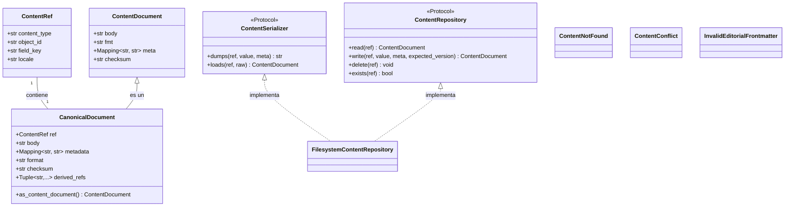

# Contratos del Almacén de Contenido y Lógica Editorial

Este módulo define los contratos (interfaces y objetos de valor) para el almacén de contenido editorial. Su objetivo principal es establecer un conjunto de abstracciones agnósticas al _backend_ que permiten la manipulación y gestión del contenido editorial de manera consistente, independientemente de la implementación subyacente del almacenamiento y la serialización.

## Propósito y Funcionalidad Principal

El módulo `Content_Store___Editorial_Logic_Contratos` actúa como la columna vertebral para la interacción con el contenido editorial, proporcionando definiciones claras para:

*   **Referencias de Contenido (`ContentRef`):** Identificadores estables y deterministas para cualquier fragmento de contenido editorial.
*   **Documentos de Contenido (`ContentDocument`, `CanonicalDocument`):** Representaciones normalizadas del contenido, incluyendo el cuerpo, formato y metadatos.
*   **Serialización de Contenido (`ContentSerializer`):** Interfaz para convertir valores de dominio a texto de archivo y viceversa.
*   **Repositorio de Contenido (`ContentRepository`):** Interfaz para operaciones CRUD (Crear, Leer, Actualizar, Eliminar) en los documentos de contenido.
*   **Manejo de Errores:** Excepciones específicas para escenarios como contenido no encontrado (`ContentNotFound`), conflictos de versión (`ContentConflict`) o formato de _frontmatter_ inválido (`InvalidEditorialFrontmatter`).

Estos contratos aseguran la coherencia y la interoperabilidad en todo el sistema de gestión de contenido, permitiendo que diferentes _backends_ (como un sistema de archivos o una base de datos) se integren sin afectar la lógica de negocio que opera sobre el contenido editorial.

## Componentes Principales y Relaciones

A continuación, se describen los componentes clave definidos en este módulo:

### `ContentRef`

Una referencia inmutable y determinista a una carga útil editorial específica. Se deriva de la identidad duradera de la base de datos (tipo de contenido, clave primaria, campo y configuración regional) y no incluye rutas físicas o _slugs_, que pueden cambiar.

### `ContentDocument`

Una representación normalizada y agnóstica del _backend_ de una carga útil editorial. Contiene el cuerpo del contenido, su formato (por ejemplo, "markdown" o "json"), metadatos y un _checksum_ para la detección de desajustes.

### `CanonicalDocument`

Una extensión de `ContentDocument` que vincula un documento de dominio a una `ContentRef`. Incluye metadatos informativos y referencias derivadas que se rellenan al analizar el cuerpo del documento. Proporciona una vista compatible con versiones anteriores como `ContentDocument`.

### `ContentNotFound`

Excepción que se lanza cuando una referencia de contenido no tiene un documento almacenado asociado.

### `ContentConflict`

Excepción que se lanza en caso de una falta de coincidencia de concurrencia optimista (por ejemplo, cuando la versión esperada no coincide con la versión actual del documento).

### `InvalidEditorialFrontmatter`

Excepción que se lanza cuando el _frontmatter_ YAML está presente pero no puede ser analizado.

### `ContentSerializer` (Protocolo)

Define la interfaz para serializar y deserializar valores de dominio a y desde texto de archivo. Las implementaciones de este protocolo son responsables de la conversión del formato.

### `ContentRepository` (Protocolo)

Define la interfaz para las operaciones de almacenamiento de contenido, como leer, escribir, eliminar y verificar la existencia de documentos de contenido. Las implementaciones de este protocolo no deben tener conocimiento de los modelos de Django.

## Arquitectura y Relaciones de Componentes

El siguiente diagrama de clases de Mermaid ilustra las relaciones entre los contratos clave definidos en este módulo:

## Flujo de Datos

Los contratos definidos aquí rigen el flujo de datos entre las capas de la aplicación y los sistemas de almacenamiento de contenido.

1.  Una solicitud de contenido se inicia con un `ContentRef`.
2.  El `ContentRepository` utiliza este `ContentRef` para buscar el `ContentDocument` correspondiente.
3.  Si el contenido se almacena en un formato serializado (por ejemplo, Markdown), el `ContentSerializer` se encarga de convertir el texto sin procesar en un `ContentDocument` (o `CanonicalDocument`) para su uso en la aplicación.
4.  Cuando el contenido se modifica, la aplicación pasa un `ContentDocument` (o `CanonicalDocument`) al `ContentRepository`, que luego utiliza el `ContentSerializer` para convertirlo en el formato de almacenamiento y persistirlo.

Las excepciones `ContentNotFound`, `ContentConflict` e `InvalidEditorialFrontmatter` son lanzadas en puntos específicos de este flujo para indicar problemas en el acceso, la concurrencia o la validez del contenido.

## Integración con el Sistema General

Este módulo se integra con el sistema general de la siguiente manera:

*   **Wagtail Content Management:** Los modelos de Wagtail (como `ArticlePage`, `BlogPage`, `HomePage`, etc., documentados en [Modelos de Contenido Base y Mixins](../Content_Base_Models___Mixins.md), [Modelos de Contenido de Blog](../Blog_Content_Models.md), etc.) interactúan con el `ContentRepository` para almacenar y recuperar su contenido editorial.
*   **Shopify Content Management:** Las operaciones de sincronización de contenido con Shopify utilizan estos contratos para manejar la representación y persistencia del contenido.
*   **Procesamiento de Markdown:** El módulo [Procesamiento Markdown](Content_Store___Editorial_Logic_ProcesamientoMarkdown.md) utiliza `ContentRef` y `ContentDocument` para analizar y renderizar contenido Markdown, extrayendo `derived_refs` para enlaces internos y activos.
*   **Validación de Contenido:** El módulo [Validación de Contenido](Content_Store___Editorial_Logic_ValidacionContenido.md) opera sobre `ContentDocument` para realizar comprobaciones de integridad y coherencia.
*   **Almacenes de Contenido Específicos:** Las implementaciones concretas del `ContentRepository`, como `FilesystemContentRepository` (documentado en [Repositorio de Contenido](Content_Store___Editorial_Logic_RepositorioContenido.md)), se basan en estos contratos para proporcionar acceso real al almacenamiento.

En resumen, los contratos definidos en `Content_Store___Editorial_Logic_Contratos` son fundamentales para la abstracción y modularidad del sistema de gestión de contenido, permitiendo un desarrollo flexible y mantenible de las funcionalidades relacionadas con el contenido editorial.
