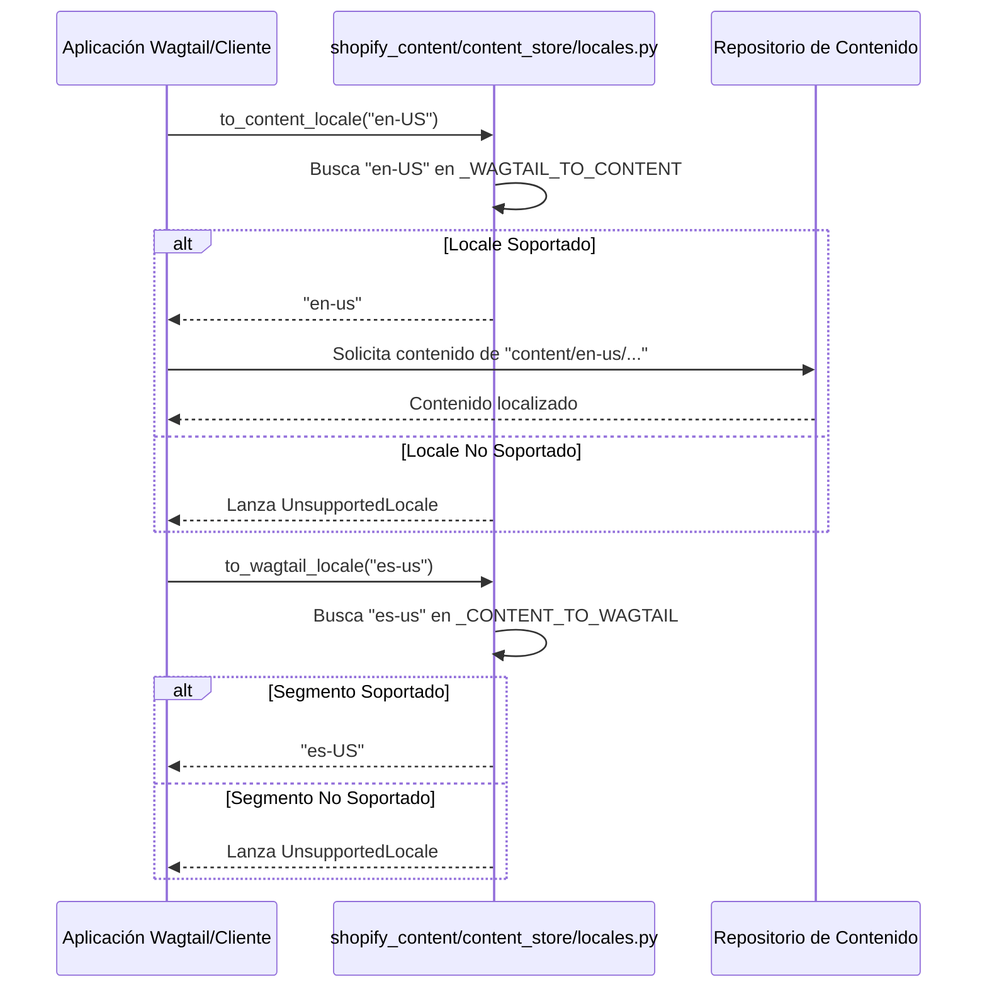

# Gestión de Localización del Contenido Editorial

Este módulo, `Content_Store___Editorial_Logic_GestionLocalizacion`, centraliza la política de mapeo entre los códigos de localización de Wagtail y los segmentos de ruta de contenido. Su propósito principal es asegurar una normalización consistente de los identificadores de localización en todo el sistema editorial, evitando la dispersión de esta lógica en múltiples ubicaciones.

## Propósito y Funcionalidad Principal

El archivo `shopify_content/content_store/locales.py` actúa como la única fuente de verdad para convertir los códigos de localización utilizados por Wagtail (por ejemplo, `en-US`) a los segmentos de ruta de contenido en minúsculas y con guiones (por ejemplo, `en-us`) que se utilizan en la topología de contenido basada en Git. Esto es crucial para la gestión y el acceso a los archivos de contenido localizados.

## Arquitectura y Componentes

### `shopify_content/content_store/locales.py`

Este archivo define los siguientes componentes clave:

*   **`UnsupportedLocale`**: Una excepción personalizada que se lanza cuando se intenta mapear un código de localización que no está configurado o soportado por el sistema.
*   **`_WAGTAIL_TO_CONTENT`**: Un diccionario interno que mapea los códigos de localización de Wagtail a sus segmentos de ruta de contenido correspondientes. Refleja las localizaciones de storefront configuradas en `config.settings.WAGTAIL_CONTENT_LANGUAGES`.
    ```python
    _WAGTAIL_TO_CONTENT = {
        "en-US": "en-us",
        "en-CA": "en-ca",
        "fr-CA": "fr-ca",
        "es-US": "es-us",
    }
    ```
*   **`_CONTENT_TO_WAGTAIL`**: Un diccionario inverso generado a partir de `_WAGTAIL_TO_CONTENT` para mapear segmentos de ruta de contenido de vuelta a códigos de localización de Wagtail.
*   **`supported_wagtail_locales()`**: Función que devuelve una tupla de todos los códigos de localización de Wagtail soportados.
*   **`supported_content_locales()`**: Función que devuelve una tupla de todos los segmentos de ruta de contenido soportados.
*   **`to_content_locale(wagtail_code: str) -> str`**: Mapea un código de localización de Wagtail a su segmento de ruta de contenido. Lanza `UnsupportedLocale` si el código no está soportado.
*   **`to_wagtail_locale(content_code: str) -> str`**: Mapea un segmento de ruta de contenido a su código de localización de Wagtail. Lanza `UnsupportedLocale` si el segmento no está soportado.

## Relaciones y Dependencias

Este módulo es fundamental para la coherencia de la localización en todo el sistema de gestión de contenido. Se integra con:

*   **Configuración del Sistema**: Los mapeos de localización se basan directamente en la configuración de `WAGTAIL_CONTENT_LANGUAGES` en `config.settings`, lo que asegura que las localizaciones gestionadas en Wagtail correspondan a las estructuras de contenido en el repositorio.
*   **[Content_Store___Editorial_Logic_RepositorioContenido](Content_Store___Editorial_Logic_RepositorioContenido.md)**: El repositorio de contenido (como `FilesystemContentRepository`) utiliza estas funciones para construir rutas de archivo localizadas y para interpretar las localizaciones de los documentos al cargarlos.
*   **[Content_Store___Editorial_Logic_ProcesamientoMarkdown](Content_Store___Editorial_Logic_ProcesamientoMarkdown.md)**: Cualquier componente que necesite resolver referencias de contenido o assets basados en la localización utilizará este módulo para estandarizar los códigos de localización.
*   **Formularios y Vistas**: Componentes de la UI o de la API que gestionan contenido localizado probablemente invocarán estas funciones para validar y normalizar las entradas de localización.

## Diagramas

### Diagrama de Componentes de Localización

```mermaid
graph TD
    A[Aplicación Wagtail] --> B{shopify_content/content_store/locales.py}
    B -- "usa Wagtail locale (ej. en-US)" --> C[Funciones de Mapeo de Locale]
    C -- "devuelve Content-Path Segment (ej. en-us)" --> D[Repositorio de Contenido Editorial]
    D -- "accede a" --> E[Archivos de Contenido Localizados (ej. content/en-us/...)]
    C -- "lanza" --> F(UnsupportedLocale)
    B -- "Configura" --> G[Dicc. _WAGTAIL_TO_CONTENT]
    B -- "Configura" --> H[Dicc. _CONTENT_TO_WAGTAIL]
    style A fill:#ECECFF,stroke:#929292,stroke-width:2px
    style D fill:#ECECFF,stroke:#929292,stroke-width:2px
    style E fill:#FFF7E0,stroke:#929292,stroke-width:2px
    style F fill:#FFE0E0,stroke:#929292,stroke-width:2px
```

### Flujo de Normalización de Localización

