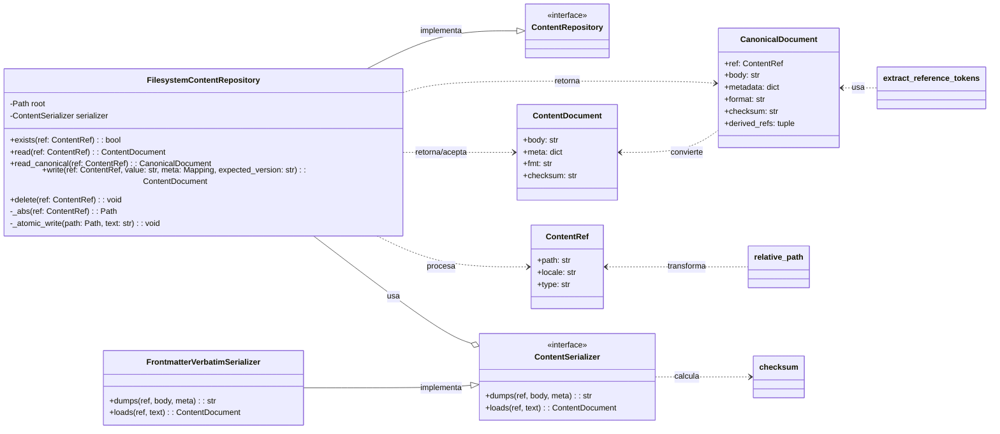
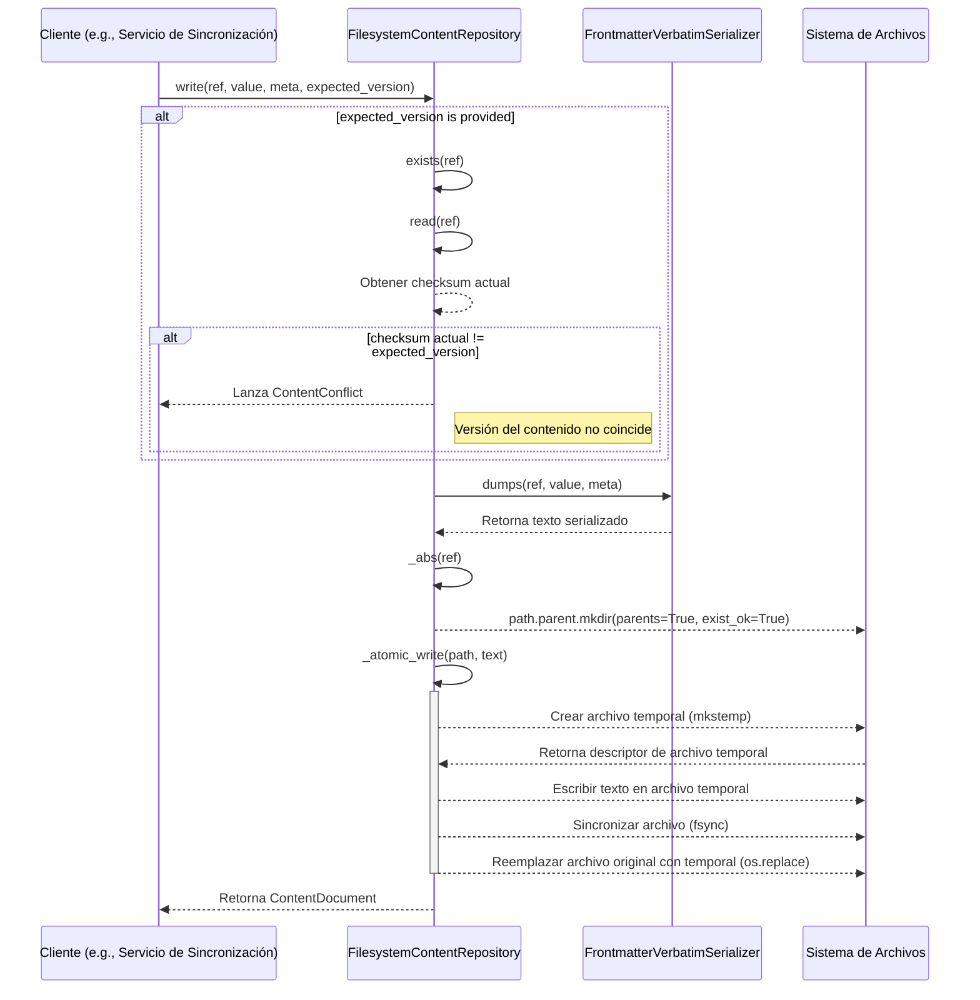
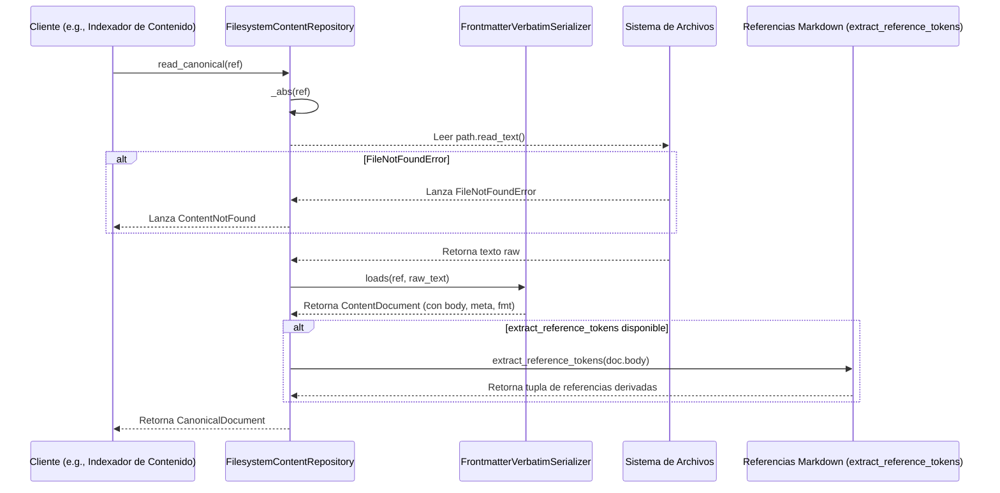

# Repositorio de Contenido Editorial (Content Store - Editorial Logic - RepositorioContenido)

Este módulo, `Content_Store___Editorial_Logic_RepositorioContenido`, es un componente fundamental para la gestión de contenido editorial, proporcionando una implementación de repositorio de contenido basado en el sistema de archivos. Su función principal es almacenar y recuperar payloads editoriales como archivos individuales, asegurando la integridad y consistencia de los datos mediante escrituras atómicas.

## Propósito y Funcionalidad Principal

El componente `FilesystemContentRepository` en `shopify_content/content_store/backends.py` actúa como una capa de persistencia para el contenido editorial. Opera con referencias de contenido (`ContentRef`) y texto serializado, sin depender directamente de los modelos de Django. Esto permite que el sistema de archivos sirva como un espejo de la fuente autoritativa de contenido (que en la Fase B es la base de datos).

Las funcionalidades clave incluyen:

*   **Almacenamiento y Recuperación:** Guarda y lee contenido editorial en el sistema de archivos.
*   **Gestión de Versiones y Conflictos:** Permite especificar una versión esperada (`expected_version`) durante la escritura para detectar y prevenir conflictos de contenido.
*   **Escritura Atómica:** Implementa un mecanismo de escritura atómica para garantizar que los archivos se actualicen de manera segura, evitando estados inconsistentes en caso de fallos.
*   **Serialización/Deserialización:** Utiliza un serializador (`FrontmatterVerbatimSerializer` por defecto) para convertir el contenido entre su representación en texto plano (con `frontmatter`) y objetos `ContentDocument` o `CanonicalDocument`.
*   **Gestión de Referencias de Contenido:** Resuelve las rutas de archivo basándose en las referencias de contenido (`ContentRef`) y extrae referencias internas (`derived_refs`) del cuerpo del contenido Markdown.
*   **Manejo de Errores:** Define y maneja excepciones específicas como `ContentNotFound` y `ContentConflict`.

## Arquitectura y Relaciones entre Componentes

El `FilesystemContentRepository` interactúa con varios contratos y utilidades definidos dentro del sistema de gestión de contenido.

### Diagrama de Clases

A continuación, se muestra un diagrama de clases que ilustra las relaciones clave entre `FilesystemContentRepository` y otros componentes del `Content Store`:

*   **`FilesystemContentRepository`**: La clase central que implementa la lógica de almacenamiento en el sistema de archivos.
*   **`ContentRepository`**: Una interfaz que define el contrato para los repositorios de contenido. `FilesystemContentRepository` implementa esta interfaz.
*   **`ContentSerializer`**: Una interfaz para serializar y deserializar el contenido.
*   **`FrontmatterVerbatimSerializer`**: Una implementación concreta de `ContentSerializer` que maneja el formato `frontmatter`.
*   **`ContentRef`**: Objeto que identifica un fragmento de contenido, incluyendo su ruta, idioma y tipo.
*   **`ContentDocument`**: Representación en memoria de un documento de contenido, con el cuerpo, metadatos, formato y checksum.
*   **`CanonicalDocument`**: Una versión enriquecida de `ContentDocument` que incluye la referencia original y referencias derivadas.

### Cómo encaja el módulo en el sistema general

El módulo `Content_Store___Editorial_Logic_RepositorioContenido` es parte del subsistema de [Wagtail_Content_Management___API/Shopify_Content_Management/Content_Store___Editorial_Logic.md](../Content_Store___Editorial_Logic.md), que a su vez forma parte del componente más grande [Wagtail_Content_Management___API/Shopify_Content_Management.md](../../Shopify_Content_Management.md). Su rol es proporcionar la infraestructura de bajo nivel para la persistencia del contenido editorial, desacoplando la lógica de negocio de los detalles de almacenamiento.

Las capas superiores de la aplicación (como los servicios de sincronización de contenido o las vistas de administración de Wagtail) interactúan con este repositorio para leer, escribir y eliminar contenido. Es crucial para el proceso de materialización y gestión del contenido editorial que se muestra en la tienda Shopify o a través de la API.

## Flujos de Proceso

### Flujo de Escritura de Contenido

El proceso de escritura de contenido en el repositorio sigue los siguientes pasos, con un enfoque en la atomicidad y la detección de conflictos:

### Flujo de Lectura de Contenido Canónico

El flujo para leer contenido canónico del repositorio, incluyendo la extracción de referencias, es el siguiente:

