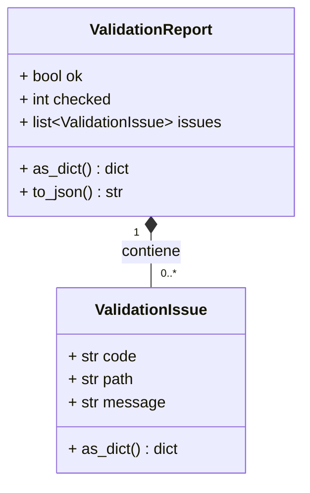
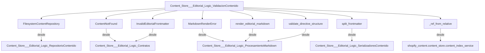

# Validación de Contenido del Almacén Editorial

## Introducción

El módulo `Content_Store___Editorial_Logic_ValidacionContenido` es un componente crítico dentro de la gestión de contenido editorial, responsable de asegurar la integridad y la coherencia del árbol de contenido desplegado. Proporciona las herramientas necesarias para realizar una validación determinista de los archivos Markdown y sus metadatos asociados, identificando posibles problemas antes de que afecten la presentación del contenido en la interfaz de usuario.

Este módulo se enfoca en la detección de errores como archivos faltantes, problemas de lectura, frontmatter inválido, inconsistencias de sumas de verificación y errores durante la renderización de Markdown, garantizando así que el contenido editorial cumpla con los estándares definidos para una correcta visualización y funcionamiento.

## Arquitectura y Componentes

El módulo `Content_Store___Editorial_Logic_ValidacionContenido` se compone principalmente de dos clases de datos para estructurar los informes de validación y una función central que orquesta el proceso de validación del árbol de contenido.

### Componentes Principales

*   **`ValidationIssue`**: Una clase de datos que representa un único problema de validación encontrado durante el escaneo del contenido. Contiene el código del error, la ruta del archivo afectado y un mensaje descriptivo.
*   **`ValidationReport`**: Una clase de datos que consolida los resultados de una ejecución de validación. Incluye un estado general de éxito (`ok`), el número de archivos revisados (`checked`) y una lista de objetos `ValidationIssue` que detallan los problemas encontrados.
*   **`validate_content_tree(root: str | Path)`**: La función principal que inicia y gestiona el proceso de validación sobre un directorio raíz de contenido.



### Relaciones con Otros Módulos

Este módulo interactúa con varios otros componentes del sistema para llevar a cabo su función de validación. Las dependencias clave incluyen:

*   **[Repositorio de Contenido](Content_Store___Editorial_Logic_RepositorioContenido.md)** (`shopify_content.content_store.backends.FilesystemContentRepository`): Utilizado para acceder y leer documentos de contenido desde el sistema de archivos.
*   **[Contratos de Contenido](Content_Store___Editorial_Logic_Contratos.md)** (`shopify_content.content_store.contracts`): Define las excepciones `ContentNotFound` y `InvalidEditorialFrontmatter`, que son manejadas durante el proceso de validación.
*   **[Procesamiento de Markdown](Content_Store___Editorial_Logic_ProcesamientoMarkdown.md)** (`shopify_content.content_store.markdown`): Proporciona funciones para la renderización (`render_editorial_markdown`) y validación de la estructura de directivas (`validate_directive_structure`) del contenido Markdown, así como la excepción `MarkdownRenderError`.
*   **[Serializadores de Contenido](Content_Store___Editorial_Logic_SerializadoresContenido.md)** (`shopify_content.content_store.serializers.split_frontmatter`): Utilizado para separar el frontmatter de los archivos Markdown y validar su formato.
*   **Servicio de Índice de Contenido** (`shopify_content.content_store.content_index_service`): Específicamente la función `_ref_from_relative` para resolver referencias canónicas de contenido, aunque esta dependencia es interna a la función `validate_content_tree`.



## Flujo de Proceso: `validate_content_tree`

La función `validate_content_tree` es el orquestador del proceso de validación del contenido. Su flujo de ejecución es el siguiente:

```mermaid
flowchart TD
    A[Inicio Validación] --> B{Ruta Raíz de Contenido Existe y es un Directorio?};
    B -- No --> C[Reportar Error: missing_root] --> Z[Fin Validación];
    B -- Sí --> D[Inicializar ValidationReport];
    D --> E[Crear FilesystemContentRepository];
    E --> F[Recorrer Recursivamente Archivos .md];
    F --> G{Leer Contenido del Archivo};
    G -- Error de Lectura --> H[Reportar Error: read_error] --> F;
    G -- Éxito --> I{Separar Frontmatter};
    I -- Frontmatter Inválido --> J[Reportar Error: invalid_frontmatter] --> F;
    I -- Éxito --> K{Ruta Coincide con Diseño Canónico (>= 5 partes)?};
    K -- No --> F;
    K -- Sí --> L[Resolver ContentRef];
    L --> M{ContentRef Resuelto y es 'body' de 'articlepage'?};
    M -- No --> F;
    M -- Sí --> N{Leer Documento Canónico del Repositorio};
    N -- ContentNotFound --> O[Reportar Error: not_found] --> F;
    N -- Éxito --> P{Verificar Checksum};
    P -- Checksum Inconsistente --> Q[Reportar Error: checksum_mismatch] --> F;
    P -- Éxito --> R[Validar Estructura de Directivas];
    R --> S[Renderizar Markdown Editorial];
    S -- MarkdownRenderError --> T[Reportar Error: render_error] --> F;
    S -- Éxito --> F;
    F --> U{Todos los Archivos .md Procesados?};
    U -- Sí --> Z;
```

## Integración en el Sistema General

El módulo `Content_Store___Editorial_Logic_ValidacionContenido` es una parte integral del subsistema de [Lógica Editorial del Almacén de Contenido](../Content_Store___Editorial_Logic.md) dentro de la gestión de contenido Wagtail. Su propósito es asegurar que el contenido editorial, almacenado principalmente como archivos Markdown, sea estructural y semánticamente válido antes de ser procesado o desplegado.

Este módulo es invocado por comandos de administración, como `content_validate.py` (ubicado en [Comandos de Validación de Contenido](../Content_Validation_Commands.md)), para realizar verificaciones periódicas o bajo demanda del estado del contenido. Un ejemplo de uso se puede encontrar en la configuración de CI/CD del repositorio, específicamente en el flujo de trabajo `.github/workflows/content-validate.yml`, que ejecuta la validación de contenido para mantener la calidad del mismo en el ciclo de desarrollo.

El informe de validación generado por este módulo es crucial para los desarrolladores y mantenedores, ya que les permite identificar y corregir rápidamente cualquier problema en el contenido, asegurando que el sistema CMS basado en Wagtail y la integración con Shopify funcionen sin problemas y presenten información precisa y bien formada a los usuarios finales.

```mermaid
graph LR
    A[Gestión de Contenido Wagtail] --> B[Almacén de Contenido]
    B --> C[Lógica Editorial]
    C --> D[Validación de Contenido]
    D --> E[Comandos de Administración]
    E --> F[content-validate.yml (CI/CD)]
    F --> G[Despliegue/Publicación]
    D -- Genera --> H[Informe de Validación]
    H --> I[Desarrolladores/Mantenedores]

    subgraph Shopify_Content_Management
        B
        C
        D
        E
    end
    subgraph Build,_CI___Configuration
        F
    end
```
