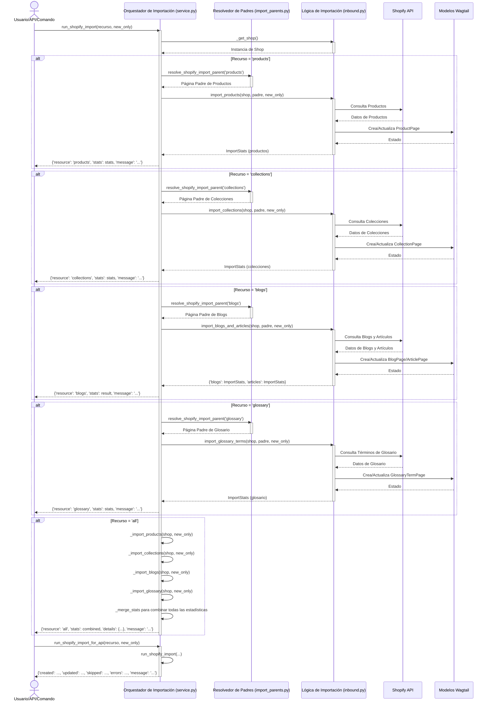

# Orquestación de Importación de Shopify

Este documento detalla el módulo `Content_Synchronization_Services_Shopify_Import_Orchestration`, que actúa como la capa de orquestación central para las importaciones entrantes desde Shopify a Wagtail.

## Propósito y Funcionalidad Principal

El módulo `shopify_content/sync/service.py` es responsable de coordinar el proceso de importación de diferentes tipos de recursos (productos, colecciones, blogs, términos de glosario) desde Shopify a la plataforma de gestión de contenido Wagtail. Proporciona una interfaz unificada para iniciar importaciones, ya sea para un tipo de recurso específico o para todos los recursos simultáneamente, y consolida las estadísticas de importación.

Las funcionalidades clave incluyen:
*   **Orquestación de Importación**: Dirige el flujo de trabajo para importar productos, colecciones, blogs (y sus artículos) y términos de glosario.
*   **Reporte de Estadísticas**: Recopila y presenta estadísticas detalladas sobre el número de elementos creados, actualizados, omitidos y con errores durante cada proceso de importación.
*   **Flexibilidad de Importación**: Permite la importación de tipos de recursos individuales o una importación masiva de todos los tipos de recursos soportados.
*   **Adaptador API**: Ofrece una función específica (`run_shopify_import_for_api`) para formatear los resultados de la importación de una manera amigable para las APIs.

## Arquitectura y Relación de Componentes

Este módulo se encuentra dentro de los [Servicios de Sincronización de Contenido](../Content_Synchronization_Services.md) y se interconecta con varios componentes para llevar a cabo su función.

### Componentes Clave

*   `shopify_content/sync/service.py::ImportStats`: Un `TypedDict` que define la estructura para las estadísticas de importación, incluyendo `created`, `updated`, `skipped` y `errors`.

### Diagrama de Arquitectura de Importación

El siguiente diagrama ilustra la arquitectura de alto nivel y las interacciones del módulo de orquestación de importación de Shopify:

```mermaid
graph TD
    A[Interfaz de Usuario de Wagtail / API REST / Comandos de Gestión] --> B{run_shopify_import(recurso)}
    B --> C{Tipo de Recurso?}
    C -- Productos --> D[_import_products]
    C -- Colecciones --> E[_import_collections]
    C -- Blogs --> F[_import_blogs]
    C -- Glosario --> G[_import_glossary]
    C -- Todos --> H[Orquestación de Múltiples Importaciones]

    D --> I[import_products (inbound.py)]
    E --> J[import_collections (inbound.py)]
    F --> K[import_blogs_and_articles (inbound.py)]
    G --> L[import_glossary_terms (inbound.py)]

    I --> M[Modelos Wagtail]
    J --> M
    K --> M
    L --> M

    D -- Resuelve Padre --> N[resolve_shopify_import_parent (import_parents.py)]
    E -- Resuelve Padre --> N
    F -- Resuelve Padre --> N
    G -- Resuelve Padre --> N

    N --> M

    I --> P[Estadísticas de Importación]
    J --> P
    K --> P
    L --> P

    H --> D
    H --> E
    H --> F
    H --> G
    H --> P[Combinación de Estadísticas]

    P --> B
    B --> Q[Reporte de Resultados / run_shopify_import_for_api]
    Q --> A
```

**Descripción del Diagrama:**

*   **A (Interfaz de Usuario de Wagtail / API REST / Comandos de Gestión)**: Los puntos de entrada para iniciar una importación. Pueden ser acciones manuales desde el panel de administración de Wagtail, llamadas a la API REST o ejecución de comandos de gestión de Django.
*   **B (`run_shopify_import(recurso)`)**: La función principal de orquestación que recibe el tipo de recurso a importar.
*   **C (Tipo de Recurso?)**: Decide qué funciones de importación específicas se deben llamar.
*   **D, E, F, G (`_import_products`, `_import_collections`, `_import_blogs`, `_import_glossary`)**: Funciones internas que preparan y ejecutan la importación para un tipo de recurso específico.
*   **N (`resolve_shopify_import_parent`)**: Una función que determina el nodo padre adecuado en la estructura de páginas de Wagtail donde se importarán los nuevos contenidos. Esto es crucial para la organización del contenido.
*   **I, J, K, L (Funciones `import_*` de `inbound.py`)**: Estas son las funciones que interactúan directamente con la API de Shopify (a través de `_get_shop()`) para obtener los datos y luego procesarlos para su creación o actualización en los [Modelos Wagtail](#modelos-wagtail).
*   **M (Modelos Wagtail)**: Representa las páginas y otros objetos de contenido en Wagtail donde se almacenan los datos importados de Shopify.
*   **H (Orquestación de Múltiples Importaciones)**: Cuando el recurso es 'all', esta sección coordina la ejecución secuencial de todas las importaciones individuales.
*   **P (Estadísticas de Importación)**: Las estadísticas generadas por cada importación específica se recogen y, en el caso de importaciones 'all', se combinan.
*   **Q (Reporte de Resultados / `run_shopify_import_for_api`)**: Los resultados finales, incluyendo las estadísticas y un mensaje resumen, se formatean y devuelven al origen de la solicitud. `run_shopify_import_for_api` proporciona un formato simplificado para el consumo de la API.

### Flujo de Proceso Detallado para `run_shopify_import`



### Modelos Wagtail Afectados

Los procesos de importación de este módulo interactúan con varios modelos de páginas de Wagtail, que incluyen, entre otros:

*   [Modelos de Contenido de Blog](../Blog_Content_Models.md) (`ArticlePage`, `BlogPage`)
*   [Modelos de Contenido de Colección](../Collection_Content_Models.md) (`CollectionPage`)
*   [Modelos de Contenido de Glosario](../Glossary_Content_Models.md) (`GlossaryTermPage`)
*   [Modelos de Contenido de Producto](../Product_Content_Models.md) (`ProductPage`)

## Cómo Encaja en el Sistema General

El módulo `Content_Synchronization_Services_Shopify_Import_Orchestration` es un componente vital en la estrategia de sincronización de contenido de Shopify a Wagtail. Sirve como el punto de control principal para todas las operaciones de importación entrantes, asegurando que los datos de Shopify se transfieran y estructuren correctamente dentro del entorno de Wagtail.

Se integra con:
*   **[Core Application - Shopify Embedded App](../../../Application_Core___Shopify_Integration_Platform/Core_Application___Shopify_Embedded_App.md)**: A través de la lógica de negocio que invoca las importaciones, a menudo iniciadas desde la interfaz de usuario de Shopify o Wagtail.
*   **[Shopify Content API](../../Shopify_Content_API.md)**: Proporciona las funciones `run_shopify_import` y `run_shopify_import_for_api` que pueden ser expuestas a través de endpoints de API para permitir la sincronización programática o bajo demanda.
*   **[Modelos de Contenido Base y Mixins](../Content_Base_Models___Mixins.md)**: Utiliza y actualiza los modelos de Wagtail definidos en estos módulos para persistir el contenido importado.
*   **[Servicios de Sincronización de Contenido](../Content_Synchronization_Services.md)**: Es el corazón de estos servicios, orquestando las sub-operaciones de importación definidas en otros archivos dentro del mismo paquete (`inbound.py`, `import_parents.py`).

Este módulo es fundamental para mantener la coherencia y la actualidad del contenido entre la tienda Shopify y el CMS Wagtail, permitiendo a los editores trabajar con contenido de Shopify dentro de la interfaz familiar de Wagtail.
