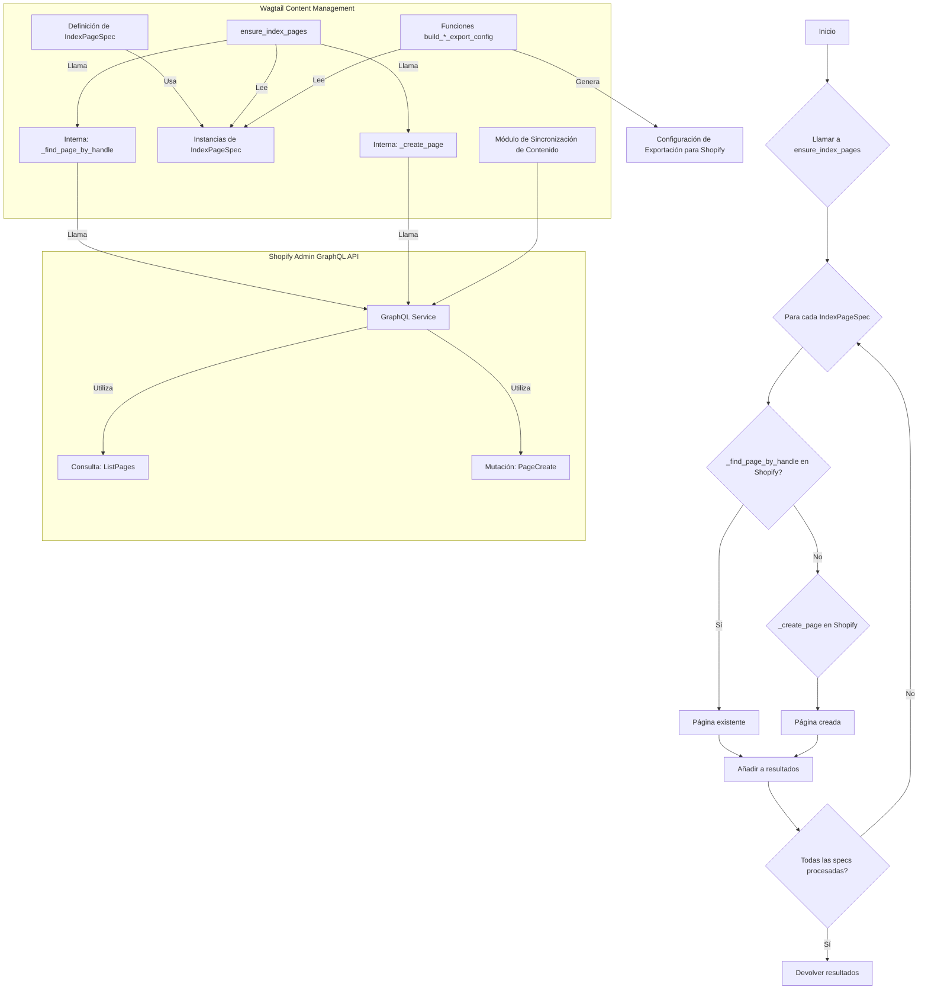
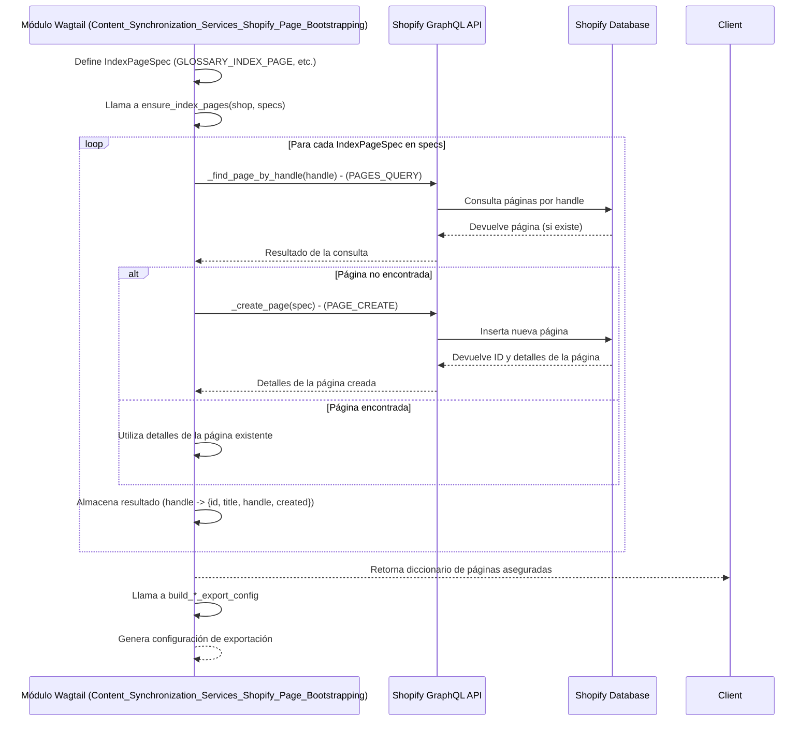

# Sincronización de Contenido - Arranque de Páginas de Shopify

Este módulo es fundamental para establecer la infraestructura base en Shopify necesaria para la gestión de contenido desde Wagtail. Su propósito principal es definir y asegurar la existencia de páginas clave en Shopify que actúan como índices o contenedores para diferentes tipos de contenido editorial, como blogs, glosarios y ubicaciones. Estas páginas se "arrancan" (bootstrap) en Shopify para servir como objetivos a los que Wagtail exportará y vinculará contenido dinámicamente a través de metafields.

## Arquitectura y Componentes Principales

El módulo `Content_Synchronization_Services_Shopify_Page_Bootstrapping` se centra en la definición de especificaciones de páginas y la interacción con la API de Shopify para gestionar la creación y verificación de estas páginas.

### `IndexPageSpec`

La clase `IndexPageSpec` es un dataclass que encapsula la información necesaria para definir una página de Shopify que se utilizará como índice.

```python
@dataclass(frozen=True)
class IndexPageSpec:
    handle: str
    title: str
    body: str
    template_suffix: str | None = None
```

*   **`handle`**: El identificador único de la página en Shopify (parte de la URL).
*   **`title`**: El título de la página visible en Shopify.
*   **`body`**: El contenido HTML inicial de la página.
*   **`template_suffix`**: Un sufijo de plantilla opcional para aplicar a la página de Shopify.

El módulo predefine varias instancias de `IndexPageSpec` para diferentes tipos de páginas de índice:

*   `GLOSSARY_INDEX_PAGE`: Página para el índice del glosario.
*   `LOCATION_INDEX_PAGE`: Página para el índice de ubicaciones.
*   `BLOG_INDEX_PAGE`: Página para el índice del blog.
*   `LEGACY_GLOSSARY_INDEX_PAGES` y `LEGACY_LOCATION_INDEX_PAGES`: Especificaciones para páginas de índice heredadas, que se pueden recrear con un flag específico.
*   `LOCATION_LEGACY_ALIAS_PAGES`: Páginas de alias heredadas para ubicaciones, utilizadas para redireccionamientos.

### Funciones de Gestión de Páginas en Shopify

El módulo incluye funciones para interactuar directamente con la API de Shopify para buscar y crear páginas.

*   `_find_page_by_handle(shop: str, handle: str) -> dict | None`: Consulta la API de Shopify para encontrar una página por su "handle". Utiliza la consulta GraphQL `PAGES_QUERY`.
*   `_create_page(shop: str, spec: IndexPageSpec) -> dict`: Crea una nueva página en Shopify utilizando la información proporcionada en un `IndexPageSpec`. Emplea la mutación GraphQL `PAGE_CREATE`.

La función central para el arranque de páginas es `ensure_index_pages`:

```python
def ensure_index_pages(
    shop: str,
    specs: tuple[IndexPageSpec, ...],
) -> dict[str, dict]:
    """Return handle -> {id, title, handle, created} for each spec."""
    # ... implementación
```

Esta función itera sobre una tupla de `IndexPageSpec` y, para cada especificación, verifica si la página ya existe en Shopify. Si no existe, la crea. Devuelve un diccionario con los detalles de las páginas (ID, título, handle) y un indicador de si fueron creadas (`True`) o ya existían (`False`).

### Funciones de Construcción de Configuración de Exportación

Estas funciones generan estructuras de configuración que se utilizan para definir cómo se exporta el contenido de Wagtail a Shopify, específicamente en relación con las páginas de índice.

*   `build_single_page_export_config(pages_by_handle: dict[str, dict], *, handle: str, config_key: str) -> dict`: Una función genérica para construir la configuración de exportación para una única página de índice.
*   `build_blog_export_config(pages_by_handle: dict[str, dict]) -> dict`: Construye la configuración de exportación para el índice del blog, utilizando `build_single_page_export_config`.
*   `build_root_index_export_config(*, config_key: str, locales: list[str], x_default_locale: str | None = None) -> dict`: Genera la forma de la configuración de exportación para familias de `RootIndexConsumer` (como glosario/ubicaciones), incluyendo información de localización.
*   `build_glossary_export_config(pages_by_handle: dict[str, dict] | None = None, *, locales: list[str] | None = None) -> dict`: Construye la configuración de exportación para el índice del glosario. Nota: `pages_by_handle` es ignorado ya que el glosario utiliza entradas de metaobjetos de página raíz.
*   `build_location_export_config(pages_by_handle: dict[str, dict] | None = None, *, locales: list[str] | None = None) -> dict`: Construye la configuración de exportación para el índice de ubicaciones. Similar al glosario, ignora `pages_by_handle` y utiliza metaobjetos de página raíz.

### Diagrama de Arquitectura



## Flujo de Datos para el Arranque de Páginas

El siguiente diagrama ilustra el flujo de datos y la interacción cuando se ejecuta el proceso de aseguramiento de páginas de índice en Shopify.



## Integración con el Sistema General

Este módulo se integra con el sistema general de gestión de contenido y la plataforma Shopify de varias maneras:

1.  **Fundamento para el Contenido Editorial**: Las páginas de índice "arrancadas" por este módulo (`/blogs`, `/glossary`, `/locations`) sirven como los puntos de entrada en el storefront de Shopify para el contenido gestionado en Wagtail. Sin estas páginas, el contenido exportado no tendría un lugar donde mostrarse correctamente en Shopify.
2.  **Sincronización de Contenido**: Trabaja en conjunto con otros componentes de [Shopify_Content_Management](../../Shopify_Content_Management.md) y [Content_Synchronization_Services](../Content_Synchronization_Services.md) para asegurar que la estructura necesaria en Shopify esté presente antes de que el contenido detallado (artículos de blog, términos de glosario, etc.) sea sincronizado y asociado a través de metafields.
3.  **Configuración de Exportación**: Las funciones `build_*_export_config` generan la configuración que utiliza el módulo [Content_Export_Configuration](../Content_Export_Configuration.md) para determinar cómo se agrupa y se presenta el contenido en Shopify, especialmente para índices que requieren un manejo de localización (`locales`).
4.  **Uso de la API de Shopify**: Depende directamente del módulo [Shopify_API_Client](../../../Application_Core___Shopify_Integration_Platform/Shopify_API_Client.md), específicamente de `shopify_requests.graphql_service` para todas las interacciones GraphQL con Shopify. Esto asegura una comunicación estandarizada y robusta con la plataforma.
5.  **Definiciones de Metafields**: Si bien este módulo no *crea* definiciones de metafields directamente, las páginas que arranca están diseñadas para consumir contenido exportado de Wagtail a través de metafields. La definición de estos metafields en Shopify es gestionada por otros comandos relacionados con [Metaobject_Definition___Setup_Commands](../Metaobject_Definition___Setup_Commands.md), como `ensure_index_metafield_definitions.py`.

En resumen, este módulo actúa como el paso inicial y crucial para preparar el entorno de Shopify, proporcionando los "contenedores" de alto nivel para el contenido que será gestionado y sincronizado desde Wagtail.
