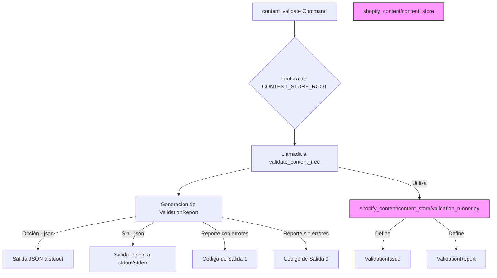

# Comandos de Validación de Contenido

El módulo `Content_Validation_Commands` es responsable de la validación del contenido editorial respaldado por Git. Proporciona una interfaz de línea de comandos para ejecutar validaciones y generar informes sobre el estado del contenido.

## Propósito y Funcionalidad Principal

El comando `content_validate` se utiliza para verificar la integridad y corrección del contenido editorial almacenado bajo un directorio raíz especificado. Es una herramienta de solo lectura, lo que significa que no realiza escrituras en Git ni en la base de datos, asegurando un proceso de validación seguro y no destructivo. Su función principal es identificar problemas en el contenido de Markdown, como referencias rotas o formatos incorrectos, basándose en las reglas de validación definidas en el sistema.

## Arquitectura y Relaciones de Componentes

El módulo `Content_Validation_Commands` se compone principalmente de la clase `Command` que extiende `django.core.management.base.BaseCommand`. Esta clase orquesta el proceso de validación utilizando la lógica definida en `shopify_content.content_store.validation_runner::validate_content_tree`.



### Componentes Clave:

*   **`shopify_content/management/commands/content_validate.py::Command`**: La implementación de Django `BaseCommand` que define la interfaz de línea de comandos para la validación de contenido.
    *   **Método `add_arguments`**: Configura los argumentos de línea de comandos, permitiendo la salida JSON (`--json`) y la anulación del directorio raíz (`--root`).
    *   **Método `handle`**: Ejecuta la lógica de validación. Recupera la ruta raíz del contenido de `settings.CONTENT_STORE_ROOT` o de la opción `--root`. Llama a `validate_content_tree` y formatea la salida según la opción `--json`. Establece un código de salida no cero si se encuentran problemas de validación.

*   **`shopify_content/content_store/validation_runner.py::validate_content_tree`**: Esta función (definida en [Content_Store___Editorial_Logic/Content_Store___Editorial_Logic_ValidacionContenido.md](Content_Store___Editorial_Logic/Content_Store___Editorial_Logic_ValidacionContenido.md)) es el núcleo de la lógica de validación. Recorre el árbol de contenido y aplica las reglas de validación. Retorna un objeto `ValidationReport` que contiene el resumen de la validación y una lista de `ValidationIssue` si se encontraron problemas.

## Cómo el Módulo Encaja en el Sistema General

El módulo `Content_Validation_Commands` juega un papel crucial en el ecosistema de gestión de contenido, especialmente en entornos de CI/CD.

### Proceso de Validación en CI/CD

El comando `content_validate` se integra en el flujo de trabajo de CI, como se evidencia en el archivo `.github/workflows/content-validate.yml`. Este flujo de trabajo se dispara en eventos `push` y `pull_request` que afectan a los archivos de contenido (`content/**`), los componentes del almacén de contenido (`shopify_content/content_store/**`), las pruebas (`shopify_content/tests/**`) y las dependencias (`requirements.txt`).

La ejecución del comando `content_validate` en el flujo de trabajo de CI garantiza que cualquier cambio propuesto en el contenido editorial sea validado automáticamente antes de la fusión, lo que ayuda a mantener la calidad y la coherencia del contenido.

```mermaid
graph TD
    A[Cambio en Contenido/Código] --> B(Push/Pull Request en GitHub);
    B --> C{Flujo de Trabajo content-validate.yml};
    C --> D[Instalar Dependencias];
    D --> E[Ejecutar Pruebas shopify_content];
    E --> F[Ejecutar Comando content_validate];
    F -- "Si existen errores de validación" --> G[Fallo en el Flujo de Trabajo];
    F -- "Sin errores de validación" --> H[Éxito en el Flujo de Trabajo];

    classDef workflow fill:#007bff,stroke:#333,stroke-width:2px,color:#fff;
    class C workflow;

    linkStyle 0 stroke:#666,stroke-width:2px;
    linkStyle 1 stroke:#666,stroke-width:2px;
    linkStyle 2 stroke:#666,stroke-width:2px;
    linkStyle 3 stroke:#666,stroke-width:2px;
    linkStyle 4 stroke:#666,stroke-width:2px;
    linkStyle 5 stroke:#666,stroke-width:2px;
    linkStyle 6 stroke:#666,stroke-width:2px;
    linkStyle 7 stroke:#666,stroke-width:2px;
```
El archivo `.github/workflows/content-validate.yml` (líneas 30-34) muestra cómo se ejecuta este comando en el entorno de CI:
```yaml
          - name: content_validate (if content tree present)
            run: |
              if [ -d content ]; then
                .venv/bin/python manage.py content_validate --json || true
              fi
            env:
              DJANGO_SETTINGS_MODULE: config.settings_test
```
Esto asegura que el contenido es validado antes de ser desplegado o integrado en el sistema principal. La opción `--json` permite que la salida sea fácilmente parseable por otras herramientas o sistemas, y el `|| true` evita que el workflow falle inmediatamente si no hay un directorio `content`, permitiendo que las pruebas posteriores se ejecuten.

### Relación con otros Módulos:

*   **[Content_Store___Editorial_Logic](Content_Store___Editorial_Logic.md)**: Este módulo proporciona la infraestructura para el almacenamiento y la validación del contenido. El comando `content_validate` depende directamente de `shopify_content/content_store/validation_runner.py` para realizar la lógica de validación.
*   **[Build,_CI___Configuration](../../Build,_CI___Configuration.md)**: Las configuraciones de CI/CD definidas en `.github/workflows/content-validate.yml` orquestan la ejecución de este comando como parte de los procesos de integración continua.

En resumen, el módulo `Content_Validation_Commands` es una herramienta esencial para mantener la calidad del contenido editorial dentro del sistema, proporcionando un mecanismo robusto para la validación automatizada y la integración con los flujos de trabajo de desarrollo.
