# Migraciones de Base de Datos

## Introducción

El módulo `Database_Migrations` dentro de `Shopify_Content_Management` gestiona los cambios esquemáticos de la base de datos para la aplicación Wagtail que se integra con Shopify. Estas migraciones de Django son esenciales para mantener la base de datos sincronizada con las definiciones del modelo de Django, permitiendo la evolución de las estructuras de datos a lo largo del tiempo sin perder la información existente.

## Propósito

El propósito principal de este módulo es aplicar incrementalmente cambios al esquema de la base de datos, soportando las características de gestión de contenido para Shopify. Esto incluye la creación de nuevas tablas, la adición de campos a tablas existentes y la modificación de la estructura de datos para soportar nuevas funcionalidades o mejoras en la integración con Shopify.

## Arquitectura y Relaciones

El módulo de `Database_Migrations` se compone de una serie de archivos de migración generados automáticamente por Django, o escritos manualmente cuando se necesita lógica más compleja. Cada archivo de migración representa un conjunto de operaciones que transforman el esquema de la base de datos de un estado a otro. Las migraciones tienen dependencias entre sí, asegurando que se apliquen en el orden correcto.

### Diagrama de Dependencias de Migraciones

A continuación se muestra un diagrama de Mermaid que ilustra las dependencias entre las migraciones clave dentro de este módulo:

```mermaid
graph TD
    subgraph shopify_content.migrations
        M0001["0001_initial.py"] --> M0002
        M0002["0002_blog_description_and_seo.py"] --> M0003
        M0003["0003_add_faq_items.py"] --> M0004
        M0004["0004_add_location_page.py"] --> M0005
        M0005["0005_alter_locationpage_shopify_locale.py"] --> M0006
        M0006["0006_product_image_urls.py"] --> M0007
        M0007["0007_shopify_sync_run.py"] --> M0008
        M0008["0008_content_index.py"] --> M0009
        M0009["0009_shopifyrootpage_operational_fields.py"] --> M0010
    end

    style M0001 fill:#f9f,stroke:#333,stroke-width:2px
    style M0002 fill:#bbf,stroke:#333,stroke-width:2px
    style M0003 fill:#fbc,stroke:#333,stroke-width:2px
    style M0004 fill:#ccf,stroke:#333,stroke-width:2px
    style M0005 fill:#cfc,stroke:#333,stroke-width:2px
    style M0006 fill:#fcf,stroke:#333,stroke-width:2px
    style M0007 fill:#9cf,stroke:#333,stroke-width:2px
    style M0008 fill:#cc9,stroke:#333,stroke-width:2px
    style M0009 fill:#ffc,stroke:#333,stroke-width:2px
    style M0010 fill:#cff,stroke:#333,stroke-width:2px
```

## Componentes Principales

Cada archivo de migración es un componente clave de este módulo. A continuación, se detalla la funcionalidad de cada uno:

### shopify_content/migrations/0001_initial.py
Para una descripción detallada, consulte [shopify_content/migrations/0001_initial.py](Database_Migrations/Database_Migrations_0001_initial.md).

### shopify_content/migrations/0002_blog_description_and_seo.py
Para una descripción detallada, consulte [shopify_content/migrations/0002_blog_description_and_seo.py](Database_Migrations/Database_Migrations_0002_blog_description_and_seo.md).

### shopify_content/migrations/0003_add_faq_items.py
Para una descripción detallada, consulte [shopify_content/migrations/0003_add_faq_items.py](Database_Migrations/Database_Migrations_0003_add_faq_items.md).

### shopify_content/migrations/0004_add_location_page.py
Para una descripción detallada, consulte [shopify_content/migrations/0004_add_location_page.py](Database_Migrations/Database_Migrations_0004_add_location_page.md).

### shopify_content/migrations/0005_alter_locationpage_shopify_locale.py
Para una descripción detallada, consulte [shopify_content/migrations/0005_alter_locationpage_shopify_locale.py](Database_Migrations/Database_Migrations_0005_alter_locationpage_shopify_locale.md).

### shopify_content/migrations/0006_product_image_urls.py
Para una descripción detallada, consulte [shopify_content/migrations/0006_product_image_urls.py](Database_Migrations/Database_Migrations_0006_product_image_urls.md).

### shopify_content/migrations/0007_shopify_sync_run.py
Para una descripción detallada, consulte [shopify_content/migrations/0007_shopify_sync_run.py](Database_Migrations/Database_Migrations_0007_shopify_sync_run.md).

### shopify_content/migrations/0008_content_index.py
Para una descripción detallada, consulte [shopify_content/migrations/0008_content_index.py](Database_Migrations/Database_Migrations_0008_content_index.md).

### shopify_content/migrations/0009_shopifyrootpage_operational_fields.py
Para una descripción detallada, consulte [shopify_content/migrations/0009_shopifyrootpage_operational_fields.py](Database_Migrations/Database_Migrations_Database_Migrations_0009_shopifyrootpage_operational_fields.md).

### shopify_content/migrations/0010_catch_up_schema.py
Para una descripción detallada, consulte [shopify_content/migrations/0010_catch_up_schema.py](Database_Migrations/Database_Migrations_0010_catch_up_schema.md).

## Integración con el Sistema General

Las migraciones de base de datos son fundamentales para la funcionalidad del `Shopify_Content_Management` y, por extensión, de `Wagtail_Content_Management___API`. Permiten que el esquema de la base de datos de Django soporte los modelos de contenido complejos y las relaciones necesarias para una integración robusta con Shopify. Sin estas migraciones, la aplicación no podría almacenar ni gestionar correctamente los datos de contenido que se sincronizan con Shopify.

Se relacionan directamente con los siguientes módulos al modificar sus esquemas de base de datos:

*   [Modelos Base de Contenido y Mixins](Content_Base_Models___Mixins.md)
*   [Modelos de Contenido del Blog](Blog_Content_Models.md)
*   [Modelos de Contenido de la Colección](Collection_Content_Models.md)
*   [Modelos de Contenido del Glosario](Glossary_Content_Models.md)
*   [Modelos de Página de Inicio](Home_Page_Models.md)
*   [Modelos de Contenido de Ubicación](Location_Content_Models.md)
*   [Modelos de Contenido del Producto](Product_Content_Models.md)
*   [Servicios de Sincronización de Contenido](Content_Synchronization_Services.md)
*   [Índice de URL de Contenido y Gestión de Enlaces](Content_URL___Link_Management.md)
*   [API de Contenido de Shopify](../Shopify_Content_API.md) (a través de los modelos `EmbeddedCommandRun`)
