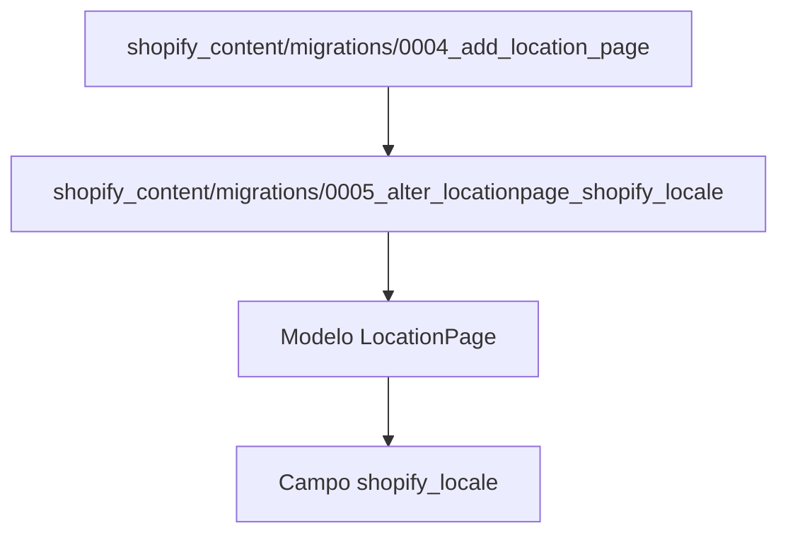

# Migración de Base de Datos 0005: Alterar shopify_locale de LocationPage

Este documento describe la migración `0005_alter_locationpage_shopify_locale` dentro del módulo `shopify_content`. Esta migración es crucial para la gestión de la internacionalización de las páginas de ubicación, asegurando que el campo `shopify_locale` del modelo `LocationPage` esté correctamente definido con un conjunto específico de opciones de locales.

## Propósito y Funcionalidad Principal

La migración `0005_alter_locationpage_shopify_locale` tiene como objetivo principal modificar el campo `shopify_locale` del modelo `LocationPage`. Su función es restringir y estandarizar los valores que este campo puede almacenar, permitiendo solo un conjunto predefinido de códigos de locales de Shopify. Esto asegura la coherencia de los datos y facilita la integración con los mecanismos de localización de Shopify.

### Componente Principal

El componente principal de este módulo es la clase `Migration`, que define la operación de alteración del campo:

```python
class Migration(migrations.Migration):
    dependencies = [
        ('shopify_content', '0004_add_location_page'),
    ]
    operations = [
        migrations.AlterField(
            model_name='locationpage',
            name='shopify_locale',
            field=models.CharField(blank=True, choices=[('en-US', 'English (United States)'), ('es-US', 'Spanish (United States)'), ('en-CA', 'English (Canada)'), ('fr-CA', 'French (Canada)')], help_text='Shopify locale code pushed to the locale field (e.g. "es", "en-CA").', max_length=20, verbose_name='Shopify Locale'),
        ),
    ]
```

La operación `migrations.AlterField` modifica el campo `shopify_locale` del modelo `LocationPage` para:
-   Establecer `blank=True`, lo que significa que el campo no es obligatorio.
-   Definir un conjunto `choices` con los locales soportados: `en-US`, `es-US`, `en-CA`, `fr-CA`.
-   Proporcionar un `help_text` claro para guiar a los usuarios.
-   Limitar la longitud máxima del campo a 20 caracteres (`max_length=20`).
-   Asignar un `verbose_name` para una mejor presentación en la interfaz de administración.

## Arquitectura y Relaciones de Componentes

Esta migración es parte de la secuencia de migraciones para el módulo `shopify_content`. Su relación principal es con la migración `0004_add_location_page`, de la cual depende. Esto significa que la tabla `LocationPage` y el campo `shopify_locale` deben haber sido creados por la migración `0004_add_location_page` antes de que esta migración intente alterarlos.

### Relación con el Modelo LocationPage

El modelo `LocationPage` (definido en [Modelos de Contenido de Ubicación](../Location_Content_Models.md)) es el objetivo directo de esta migración. El campo `shopify_locale` en este modelo es fundamental para asociar una página de ubicación específica con una configuración regional o un mercado en Shopify.

### Diagrama de Dependencias de Migración


*Descripción: Este diagrama ilustra la dependencia de la migración `0005_alter_locationpage_shopify_locale` de la migración anterior `0004_add_location_page`, y cómo ambas afectan al modelo `LocationPage` y su campo `shopify_locale`.*

## Integración en el Sistema General

Esta migración contribuye al sistema de gestión de contenido general basado en Wagtail y a la integración con Shopify de varias maneras:

1.  **Internacionalización**: Al definir explícitamente los locales permitidos, asegura que las páginas de ubicación puedan ser correctamente mapeadas a diferentes mercados o idiomas en Shopify.
2.  **Validación de Datos**: Las `choices` del campo `shopify_locale` proporcionan una validación a nivel de base de datos, evitando la inserción de códigos de locales no soportados y manteniendo la integridad de los datos.
3.  **Facilita la Sincronización**: Un `shopify_locale` bien definido es esencial para los procesos de sincronización de contenido entre Wagtail y Shopify, permitiendo que el contenido se dirija al mercado correcto.

En resumen, esta migración es un paso importante para solidificar la infraestructura de internacionalización de las páginas de ubicación, alineándose con las capacidades de gestión de locales de Shopify y mejorando la robustez del sistema de gestión de contenido.