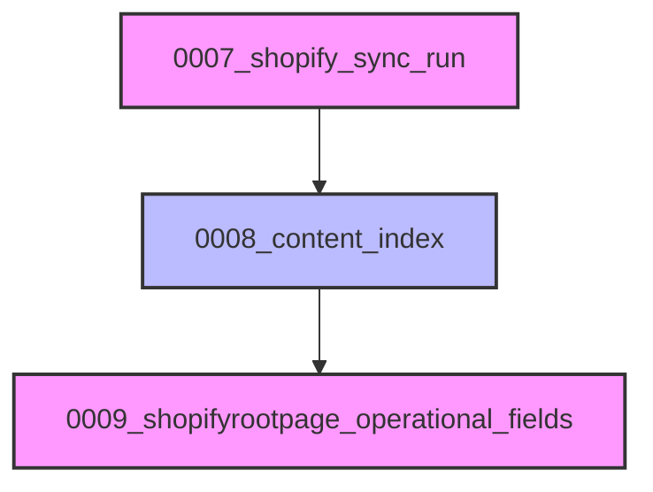

# Migración de Base de Datos 0008_content_index

Esta documentación detalla la migración de base de datos `0008_content_index.py`, la cual introduce modelos fundamentales para la indexación y gestión de referencias de contenido dentro del sistema de gestión de contenido de Shopify basado en Wagtail.

## Propósito y Funcionalidad Principal

La migración `0008_content_index` es crucial para establecer la infraestructura necesaria para un sistema robusto de indexación de contenido. Permite al sistema rastrear y gestionar eficientemente las piezas de contenido y las referencias internas dentro de ellas. Esto es vital para funcionalidades como la validación de contenido, la resolución de enlaces semánticos y la búsqueda y recuperación optimizadas de contenido.

Los componentes principales introducidos por esta migración son dos nuevos modelos de Django:

*   `ContentIndex`: Almacena metadatos sobre elementos de contenido individuales, lo que permite una búsqueda y categorización eficientes.
*   `ContentReferenceIndex`: Registra las referencias encontradas dentro de los elementos de contenido indexados, facilitando el seguimiento de las interconexiones del contenido.

## Arquitectura y Relaciones entre Componentes

La migración define la estructura de las tablas `ContentIndex` y `ContentReferenceIndex` y sus relaciones en la base de datos.

### Modelo ContentIndex

El modelo `ContentIndex` sirve como el registro principal para cada pieza de contenido que se indexa. Sus campos están diseñados para identificar de forma única y proporcionar metadatos esenciales sobre el contenido.

**Campos de `ContentIndex`:**

*   `id`: `BigAutoField`, clave primaria autoincrementada.
*   `content_type`: `CharField(max_length=128, db_index=True)`. Tipo de contenido (ej. 'blog', 'product').
*   `object_id`: `CharField(max_length=64, db_index=True)`. ID del objeto de contenido dentro de su tipo.
*   `field_key`: `CharField(max_length=64, db_index=True)`. Clave del campo específico dentro del objeto que se está indexando.
*   `locale`: `CharField(max_length=16, db_index=True)`. El idioma o configuración regional del contenido.
*   `checksum`: `CharField(max_length=64, blank=True)`. Un valor hash para detectar cambios en el contenido.
*   `reference_count`: `PositiveIntegerField(default=0)`. El número de referencias salientes que contiene este elemento de contenido.
*   `relative_path`: `CharField(max_length=512, blank=True)`. La ruta relativa al contenido.
*   `indexed_at`: `DateTimeField(auto_now=True)`. Marca de tiempo de la última indexación.

**Restricciones de `ContentIndex`:**

*   `uniq_content_index_ref`: `UniqueConstraint` en `(content_type, object_id, field_key, locale)` para asegurar la unicidad de las entradas de contenido indexadas.

### Modelo ContentReferenceIndex

El modelo `ContentReferenceIndex` está diseñado para almacenar detalles sobre las referencias que se encuentran dentro del contenido indexado. Cada entrada se vincula a un `ContentIndex` particular, lo que permite un recorrido bidireccional de las relaciones de contenido.

**Campos de `ContentReferenceIndex`:**

*   `id`: `BigAutoField`, clave primaria autoincrementada.
*   `ref_type`: `CharField(max_length=32, db_index=True)`. El tipo de referencia (ej. 'product', 'article').
*   `identifier`: `CharField(max_length=255, db_index=True)`. Un identificador único para la referencia.
*   `token`: `CharField(max_length=512)`. El token o texto original de la referencia.
*   `content_index`: `ForeignKey` a `ContentIndex` (`on_delete=django.db.models.deletion.CASCADE`, `related_name="references"`). Establece la relación con el contenido padre.

**Índices de `ContentReferenceIndex`:**

*   `content_ref_type_ident_idx`: `Index` en `(ref_type, identifier)` para optimizar las consultas de referencias.

### Diagrama de Relación de Entidades (ERD)

```mermaid
erDiagram
    ContentIndex {
        bigint id PK
        varchar(128) content_type
        varchar(64) object_id
        varchar(64) field_key
        varchar(16) locale
        varchar(64) checksum
        int reference_count
        varchar(512) relative_path
        datetime indexed_at
    }
    ContentReferenceIndex {
        bigint id PK
        varchar(32) ref_type
        varchar(255) identifier
        varchar(512) token
        bigint content_index_id FK
    }

    ContentIndex ||--o{ ContentReferenceIndex : "contiene"

    note for ContentIndex
        Restricción única: (content_type, object_id, field_key, locale)
    end
    note for ContentReferenceIndex
        Índice: (ref_type, identifier)
    end
```

### Flujo de Migración

La migración `0008_content_index.py` depende de la migración anterior `0007_shopify_sync_run.py`. Esto asegura que el esquema de la base de datos se actualice en el orden correcto, manteniendo la integridad de los datos.



## Integración en el Sistema General

Esta migración y los modelos que introduce son componentes centrales del módulo `Shopify_Content_Management` dentro de la `Wagtail_Content_Management___API`. Proporcionan la base de datos para varias características clave:

*   **Indexación de Contenido:** Los modelos `ContentIndex` y `ContentReferenceIndex` son utilizados por los comandos de gestión de contenido para construir y mantener índices actualizados de todo el contenido editorial. Esto es fundamental para la búsqueda rápida, la validación de enlaces y la identificación de contenido relacionado.
*   **Enlaces Semánticos:** Almacenar referencias de contenido permite al sistema comprender las relaciones entre diferentes páginas, productos o artículos. Esto habilita funcionalidades como la sugerencia de enlaces internos relevantes o la identificación de contenido huérfano.
*   **Validación de Contenido:** Los índices pueden ser utilizados para validar la integridad de las referencias dentro del contenido, ayudando a identificar enlaces rotos o inconsistencias.
*   **API de Contenido:** Estos modelos subyacen a las capacidades de la API para consultar y manipular contenido de manera programática, especialmente en lo que respecta a sus relaciones y enlaces internos. Para más detalles sobre la API, consulte [Shopify_Content_API](../../Shopify_Content_API.md).
*   **Sincronización de Contenido:** Los campos como `checksum` y `indexed_at` en `ContentIndex` son vitales para determinar cuándo el contenido ha cambiado y necesita ser resincronizado o reindexado. Puede encontrar más información sobre la sincronización en [Content_Synchronization_Services](../Content_Synchronization_Services.md).

En resumen, la migración `0008_content_index` establece los cimientos para un sistema de gestión de contenido conectado e inteligente, donde las relaciones y la indexación del contenido son de primera clase. Este módulo se relaciona estrechamente con:

*   [Modelos de Indexación de Contenido](../Content_Base_Models___Mixins/Content_Base_Models___Mixins_ModelosIndexacionContenido.md) para la definición de los modelos.
*   [Comandos de Indexación de Contenido y Enlaces Semánticos](../Content_Indexing___Semantic_Link_Commands.md) para las operaciones que utilizan estos modelos. 
*   [Manejo de URL de Contenido y Enlaces](../Content_URL___Link_Management.md) para la resolución y gestión de enlaces.