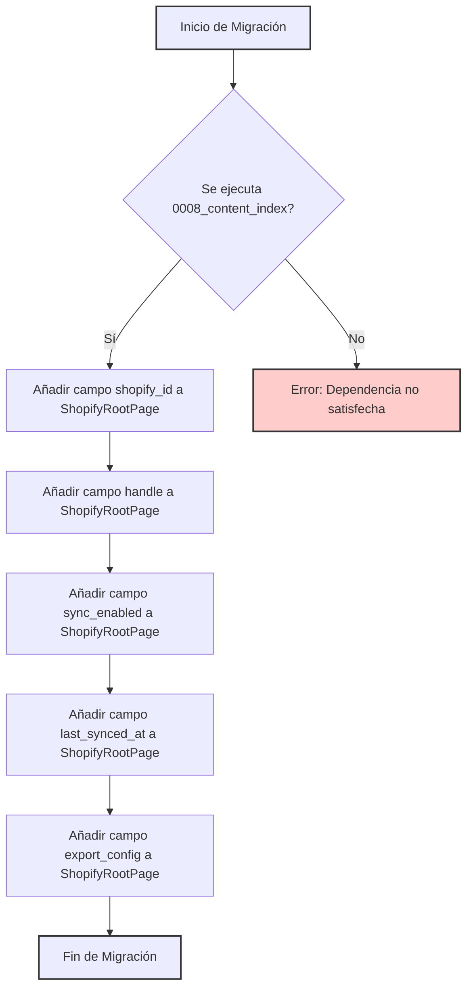

# Migración de Base de Datos 0009: Campos Operacionales de ShopifyRootPage

Este documento detalla la migración `0009_shopifyrootpage_operational_fields.py`, que añade campos operacionales cruciales al modelo `ShopifyRootPage` para mejorar su integración y funcionalidad con Shopify.

## Propósito y Funcionalidad Principal

La migración `0009_shopifyrootpage_operational_fields` tiene como objetivo actualizar el modelo `ShopifyRootPage` ([ShopifyRootPage_Modelo](../Content_Base_Models___Mixins/Content_Base_Models___Mixins_ShopifyRootPage_Modelo.md)) añadiendo varios campos necesarios para gestionar la sincronización y la información operativa de las páginas raíz de Shopify dentro de Wagtail. Estos campos son fundamentales para la identificación de metaobjetos, el seguimiento del estado de sincronización y la configuración de exportación.

## Arquitectura y Relaciones de Componentes

Esta migración se aplica directamente al modelo `ShopifyRootPage`. Su ejecución es una parte estándar del proceso de migración de la base de datos de Django, asegurando que el esquema de la base de datos esté alineado con la definición del modelo. Depende de la migración `0008_content_index`, lo que significa que el índice de contenido ya debe existir antes de que se apliquen estos cambios a `ShopifyRootPage`.

Los campos añadidos son:

*   **`shopify_id`**: Un `CharField` que almacena el GID (Global ID) del metaobjeto de Shopify asociado. Se indexa para búsquedas eficientes.
*   **`handle`**: Un `SlugField` que guarda el "handle" del metaobjeto de Shopify, que por defecto es el "slug" de Wagtail, facilitando URLs amigables y referencias internas.
*   **`sync_enabled`**: Un `BooleanField` que indica si la sincronización de esta `ShopifyRootPage` con Shopify está habilitada. Por defecto, está habilitada.
*   **`last_synced_at`**: Un `DateTimeField` que registra la última vez que la página fue sincronizada con Shopify, útil para el seguimiento y depuración.
*   **`export_config`**: Un `JSONField` que permite almacenar configuraciones de exportación específicas para esta `ShopifyRootPage`, ofreciendo flexibilidad en cómo se serializa y se envía el contenido a Shopify.

### Diagrama de Flujo de la Migración

### Relación con el Sistema General

Esta migración es parte de las [Migraciones de Base de Datos](../Database_Migrations.md) dentro del módulo de [Gestión de Contenido de Shopify](../../Shopify_Content_Management.md). Asegura que el modelo `ShopifyRootPage` tenga todos los campos necesarios para su funcionamiento completo dentro del ecosistema de Shopify, permitiendo que la plataforma de Wagtail actúe como una fuente de verdad rica en contenido para los metaobjetos de Shopify.

Los campos `shopify_id`, `handle`, `sync_enabled`, `last_synced_at` y `export_config` son esenciales para que la lógica de sincronización y las operaciones de API con Shopify funcionen correctamente. Sin ellos, funcionalidades como la importación/exportación de contenido y la gestión de URLs del escaparate (`StorefrontUrlsPanel`) no serían completamente funcionales.

Para una comprensión más profunda del modelo `ShopifyRootPage` y su uso, consulte la documentación del módulo [Content_Base_Models___Mixins/ShopifyRootPage_Modelo](../Content_Base_Models___Mixins/Content_Base_Models___Mixins_ShopifyRootPage_Modelo.md).

También es relevante el contexto de las operaciones de sincronización, que se pueden encontrar en [Content_Synchronization_Services](../Content_Synchronization_Services.md).
