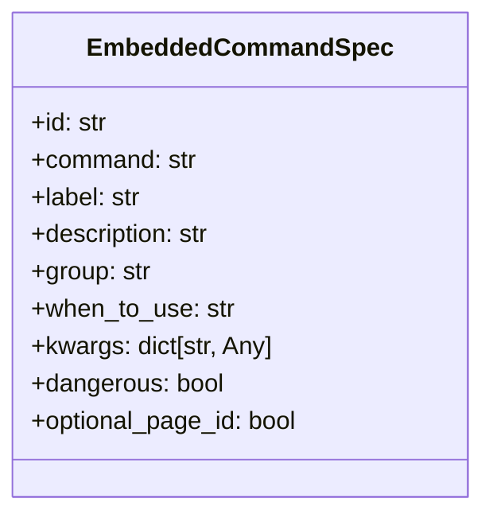

# Registro de Comandos Embebidos

El módulo `Embedded_Commands_Registry` gestiona el registro y la exposición de comandos de gestión específicos dentro de la aplicación Shopify integrada. Estos comandos permiten a los administradores ejecutar tareas predefinidas directamente desde la interfaz de la aplicación, facilitando la configuración, sincronización y mantenimiento del contenido.

## Propósito y Funcionalidad Principal

El objetivo principal de este módulo es centralizar la definición de comandos que pueden ser ejecutados a través de la aplicación Shopify. Proporciona una estructura para describir cada comando, incluyendo su identificador único, el comando real de Django que ejecuta, una etiqueta amigable, una descripción detallada, el grupo al que pertenece y condiciones de uso. Esto asegura una interfaz consistente y segura para la interacción con las funcionalidades administrativas del backend.

### Componentes Clave

*   `EmbeddedCommandSpec`: Una clase de datos que define la estructura para cada comando embebido, incluyendo metadatos importantes para su presentación y ejecución.
*   `COMMAND_GROUPS`: Un diccionario que organiza los comandos en categorías lógicas, mejorando la navegabilidad en la UI.
*   `EMBEDDED_COMMANDS`: Una tupla que contiene todas las instancias de `EmbeddedCommandSpec` predefinidas y disponibles.
*   Funciones de utilidad: `get_command_by_id` para recuperar especificaciones de comando por su ID y `get_commands_by_group` para obtener comandos organizados por grupo.

## Arquitectura y Relaciones entre Componentes

### Clase EmbeddedCommandSpec

La clase `EmbeddedCommandSpec` es el núcleo de este módulo. Es una dataclass inmutable que encapsula todos los detalles necesarios para un comando embebido.



*   `id`: Identificador único del comando.
*   `command`: Nombre del comando de gestión de Django a ejecutar.
*   `label`: Etiqueta descriptiva para la interfaz de usuario.
*   `description`: Descripción detallada de lo que hace el comando.
*   `group`: Categoría lógica a la que pertenece el comando (ej. 'setup', 'indexes').
*   `when_to_use`: Directrices sobre cuándo y cómo usar el comando.
*   `kwargs`: Argumentos de palabra clave adicionales para pasar al comando de Django.
*   `dangerous`: Booleano que indica si el comando tiene implicaciones de datos significativas.
*   `optional_page_id`: Booleano que indica si el comando puede aceptar un ID de página opcional.

### Relación con otros componentes

El módulo `Embedded_Commands_Registry` define los comandos, pero su ejecución y gestión se realizan a través de otros componentes del sistema.

*   **Ejecución de Comandos**: La vista `EmbeddedCommandDispatchView` (ubicada en [Core_Application___Shopify_Embedded_App_vistas_autenticacion.md](../../Application_Core___Shopify_Integration_Platform/Core_Application___Shopify_Embedded_App/Core_Application___Shopify_Embedded_App_vistas_autenticacion.md)) es la responsable de recibir las solicitudes para ejecutar estos comandos. Utiliza `get_command_by_id` para recuperar la especificación del comando y luego lo invoca.
*   **Registro de Ejecuciones**: El modelo `EmbeddedCommandRun` (definido en [Content_Base_Models___Mixins_ModeloEjecucionComandoEmbebido.md](Content_Base_Models___Mixins/Content_Base_Models___Mixins_ModeloEjecucionComandoEmbebido.md)) registra cada ejecución de un comando embebido, proporcionando un historial y trazabilidad. El `EmbeddedCommandRunAdmin` (en [Admin___Wagtail_UI_Integration_administracion_modelos.md](Admin___Wagtail_UI_Integration/Admin___Wagtail_UI_Integration_administracion_modelos.md)) gestiona la visualización de estos registros en el panel de administración de Wagtail.
*   **Comandos de Importación**: Los comandos de importación de contenido (como `import_shopify_products`, `import_shopify_collections`, etc.) no están incluidos directamente en `EMBEDDED_COMMANDS` pero son reconocidos por `ALL_MANAGEMENT_COMMAND_NAMES` y son expuestos a través de `EmbeddedShopifySyncView` (en [Admin___Wagtail_UI_Integration_vistas_sincronizacion_shopify.md](Admin___Wagtail_UI_Integration/Admin___Wagtail_UI_Integration_vistas_sincronizacion_shopify.md)).

```mermaid
C4Context
    title Diagrama de Relaciones de Comandos Embebidos

    Person(admin, "Administrador de Shopify", "Usuario que interactúa con la aplicación embebida.")

    System(shopify_app, "Aplicación Embebida de Shopify", "Interfaz de usuario en Shopify Admin.")
    System_Ext(django_admin, "Django Admin", "Interfaz de administración de Django.")

    Container(embedded_command_registry, "Registro de Comandos Embebidos", "Define y cataloga los comandos disponibles.", $link="Embedded_Commands_Registry.md")
    Container(embedded_command_dispatcher, "Despachador de Comandos Embebidos", "Vistas que procesan y ejecutan los comandos.", $link="../../Application_Core___Shopify_Integration_Platform/Core_Application___Shopify_Embedded_App/Core_Application___Shopify_Embedded_App_vistas_autenticacion.md")
    Container(command_run_model, "Modelo de Ejecución de Comandos", "Registra las ejecuciones de comandos.", $link="../Shopify_Content_Management/Content_Base_Models___Mixins/Content_Base_Models___Mixins_ModeloEjecucionComandoEmbebido.md")
    Container(admin_ui, "UI de Administración Wagtail", "Componentes de administración para visualizar y gestionar registros.", $link="../Shopify_Content_Management/Admin___Wagtail_UI_Integration.md")
    Container(management_commands, "Comandos de Gestión de Django", "Lógica de negocio subyacente ejecutada por los comandos embebidos.", $link="../Shopify_Content_Management/Content_Import___Materialization_Commands.md")

    Rel(admin, shopify_app, "Ejecuta comandos a través de")
    Rel(shopify_app, embedded_command_dispatcher, "Envía solicitud de ejecución a")
    Rel(embedded_command_dispatcher, embedded_command_registry, "Consulta especificación de comando")
    Rel(embedded_command_dispatcher, management_commands, "Invoca comando de gestión")
    Rel(management_commands, command_run_model, "Registra ejecución de comando")
    Rel(admin, django_admin, "Visualiza registros de comandos en")
    Rel(django_admin, admin_ui, "Utiliza componentes de")
    Rel(admin_ui, command_run_model, "Accede a datos de")
    Rel(embedded_command_registry, command_run_model, "Se relaciona con el registro de las ejecuciones de comandos.")

    UpdateLayout(Default, "TopToBottom")
```

## Integración en el Sistema General

El `Embedded_Commands_Registry` se integra en la plataforma de gestión de contenido de Shopify basada en Wagtail, sirviendo como un catálogo programático de acciones administrativas. Permite a la aplicación embebida exponer funcionalidades complejas del backend de Django a la interfaz de usuario de Shopify de una manera controlada y segura.

Su rol es fundamental para:

*   **Inicialización y Configuración**: Facilita la configuración inicial de locales, metaobjetos y tareas programadas de Celery, que son cruciales para el funcionamiento multilingüe y la sincronización de contenido.
*   **Mantenimiento de Contenido**: Proporciona herramientas para reconstruir índices, generar enlaces semánticos y realizar migraciones o reparaciones de datos, asegurando la integridad y la coherencia del contenido a lo largo del tiempo.
*   **Experiencia del Usuario**: Mejora la experiencia del administrador al ofrecer acceso directo a estas funciones sin necesidad de acceder a la línea de comandos del servidor, lo que es especialmente útil en entornos de aplicación embebida.

Los comandos registrados aquí abarcan funcionalidades de varios módulos relacionados con la gestión de contenido, como:

*   [Comandos de Importación y Materialización de Contenido](Content_Import___Materialization_Commands.md)
*   [Comandos de Indexación y Enlaces Semánticos](Content_Indexing___Semantic_Link_Commands.md)
*   [Comandos de Definición y Configuración de Metaobjetos](Metaobject_Definition___Setup_Commands.md)
*   [Comandos de Migración y Reparación de Contenido](Content_Migration___Fix_Commands.md)
*   [Comandos de Validación de Contenido](Content_Validation_Commands.md)

En resumen, este módulo actúa como un puente entre las operaciones de administración de Django y la interfaz de usuario de la aplicación embebida de Shopify, haciendo que las tareas complejas sean accesibles y gestionables para los usuarios finales.