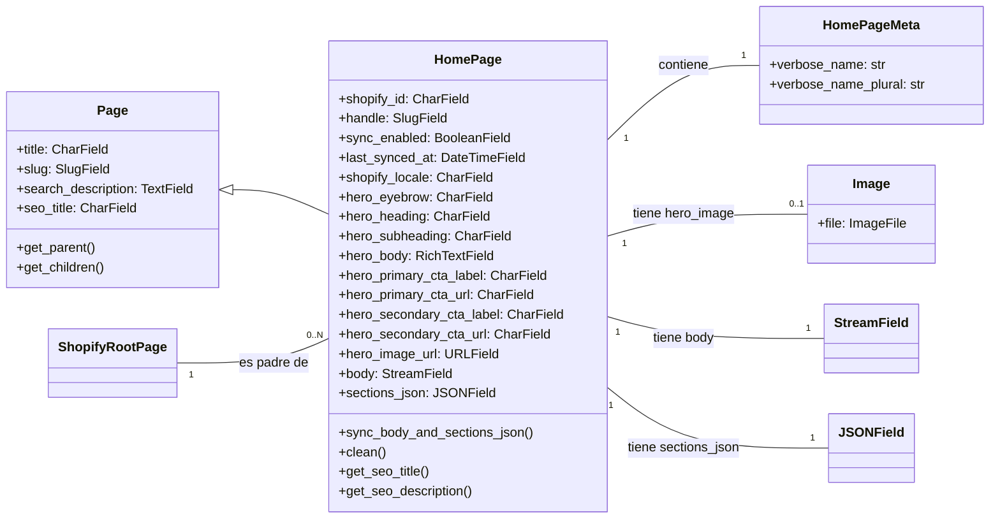

# Modelos de Página de Inicio

El módulo `Home_Page_Models` es responsable de definir el modelo `HomePage` dentro del sistema de gestión de contenido Wagtail. Este modelo está diseñado específicamente para gestionar el contenido de la página de inicio que se sincroniza con los metaobjetos de Shopify. Facilita la creación, edición y sincronización de contenido de la página de inicio para diferentes configuraciones regionales (locales).

## 1. Propósito y Funcionalidad Principal

El objetivo principal de este módulo es proporcionar una estructura de datos robusta y una interfaz de administración para las páginas de inicio, asegurando que el contenido sea compatible con el sistema de metaobjetos de Shopify. La clase `HomePage` es un modelo Wagtail `Page` que representa una página de inicio individual, con un enfoque en la localización y la sincronización bidireccional entre Wagtail y Shopify.

### Componentes Clave

*   `HomePage`: Un modelo de página de Wagtail que gestiona el contenido de la página de inicio. Permite la definición de secciones hero, bloques de contenido dinámicos a través de `StreamField`, y campos específicos para la sincronización con Shopify, como `shopify_id`, `handle` y `shopify_locale`.
*   `HomePage.Meta`: Define metadatos para el modelo `HomePage`, como los nombres legibles por humanos (`verbose_name` y `verbose_name_plural`).

### Características Principales:

*   **Integración con Shopify**: Mapea campos de contenido directamente a los metaobjetos de Shopify, facilitando la exportación del contenido de la página de inicio al escaparate de Shopify.
*   **Localización**: Soporta múltiples configuraciones regionales (`shopify_locale`) para la página de inicio, permitiendo contenido específico para cada mercado.
*   **Contenido Estructurado con StreamField**: Utiliza `StreamField` para el cuerpo principal del contenido (`body`), lo que permite a los editores construir páginas complejas utilizando una variedad de bloques de contenido predefinidos.
*   **Sincronización Bidireccional**: Los métodos internos aseguran que el `StreamField` del cuerpo y un campo `JSONField` (`sections_json`) permanezcan sincronizados, facilitando la transformación de datos para la exportación a Shopify.
*   **Validación de Datos**: Incluye lógica de validación para asegurar que solo una `HomePage` exista por cada configuración regional bajo el nodo raíz `ShopifyRootPage`, y valida la estructura del JSON de secciones.
*   **SEO Integrado**: Proporciona campos y métodos para gestionar el SEO de la página de inicio, incluyendo títulos y descripciones que pueden derivarse del contenido hero.

## 2. Arquitectura y Relaciones de Componentes

El modelo `HomePage` se integra dentro del ecosistema de Wagtail y extiende su funcionalidad para interactuar con Shopify.

### Diagrama de Clases



*   **`HomePage` hereda de `wagtail.models.Page`**: Esto le otorga todas las características fundamentales de una página Wagtail, incluyendo la gestión de URL, la estructura de árbol de contenido y la integración con el CMS.
*   **`HomePage` contiene `StreamField` y `JSONField`**: El campo `body` (StreamField) es la representación editable en el CMS, mientras que `sections_json` es la representación canónica en JSON, utilizada para la sincronización con Shopify. Las funciones de serialización y deserialización (`streamfield_to_sections_json`, `sections_json_to_stream_data`) son cruciales para mantener estos dos campos sincronizados.
*   **`HomePage` se relaciona con `wagtailimages.Image`**: El campo `hero_image` es una clave foránea a un modelo de imagen de Wagtail, lo que permite a los editores seleccionar imágenes existentes en el CMS.
*   **`HomePage` se relaciona con `shopify_content.ShopifyRootPage`**: Las páginas `HomePage` deben ser hijas de `ShopifyRootPage`, que actúa como el punto de entrada principal para el contenido de Shopify en Wagtail.
*   **Dependencias de bloques de StreamField**: El `StreamField` `body` utiliza `HOME_BODY_BLOCKS` (definidos en `shopify_content/blocks/home.py` y `shopify_content/blocks/__init__.py`), que son los bloques de contenido disponibles para la página de inicio. Puede encontrar más detalles en [Bloques de StreamField de Wagtail](Wagtail_StreamField_Blocks.md).
*   **Dependencias de validación y utilidades**:
    *   `shopify_content/home_locale_validation.py::validate_sections_json_locale`: Utilizado en el método `clean` para validar la coherencia de la configuración regional en el `sections_json`.
    *   `shopify_content/home_sections_normalization.py::normalize_sections_json`: Asegura que la estructura del JSON de secciones sea consistente.
    *   `shopify_content/home_serialization.py`: Contiene funciones para convertir datos entre `StreamField` y `sections_json`.
    *   `shopify_content/home_slug.py::home_page_handle`: Genera el slug y el handle canónicos para la página de inicio.

### Diagrama de Flujo de Datos (Sincronización `body` y `sections_json`)

```mermaid
graph TD
    A[Editor modifica HomePage en Wagtail Admin] --> B{HomePage.clean() llamado};
    B --> C[home_page_handle() setea slug y handle];
    B --> D[HomePage.sync_body_and_sections_json() llamado];
    D --> E{_stream_has_blocks(self.body)};
    E -- Sí --> F[streamfield_to_sections_json(self.body)];
    E -- No --> G[sections_json = normalize_sections_json(sections_json)];
    F --> H[self.sections_json actualizado];
    G --> H;
    H --> I[self.body = sections_json_to_stream_data(self.sections_json)];
    I --> J[HomePage.clean() continúa];
    J --> K[validate_sections_json_locale(self) valida locale];
    K -- Errores de validación --> L[Lanza ValidationError];
    K -- Sin errores --> M[Verifica unicidad de HomePage por locale bajo ShopifyRootPage];
    M -- Duplicado --> N[Lanza ValidationError];
    M -- Único --> O[Guarda HomePage];
```

## 3. Cómo el Módulo Encaja en el Sistema General

El módulo `Home_Page_Models` es una parte fundamental de la integración de Wagtail con Shopify para la gestión de contenido.

*   **Gestión de Contenido de Shopify**: Se encarga de definir cómo se estructura y se gestiona el contenido de la página de inicio dentro de Wagtail antes de ser exportado a Shopify como un metaobjeto. Es un componente clave en la estrategia de "contenido como datos" donde Wagtail actúa como el CMS editorial y Shopify como la plataforma de comercio electrónico.
*   **API de Contenido de Shopify**: El `sections_json` generado por este modelo es el formato canónico que la [API de Contenido de Shopify](../Shopify_Content_API.md) consumirá para interactuar con los metaobjetos de Shopify. El esquema `api/schemas/home.py::HomeIn` y `api/schemas/home_sections.py` están directamente relacionados con la estructura de `sections_json`.
*   **Ecosistema Wagtail**: Se basa en la funcionalidad central de Wagtail para la creación de páginas, la edición en la interfaz de usuario del CMS y la búsqueda.
*   **Procesos de Sincronización**: Los comandos de gestión (`management/commands/bootstrap_home_pages.py`, `management/commands/migrate_home_pages.py`, etc.) interactúan con este modelo para inicializar, migrar y sincronizar las páginas de inicio con Shopify.
*   **Validación de Localización**: Trabaja en conjunto con `shopify_content/home_locale_validation.py` para asegurar que las reglas de localización sean aplicadas correctamente antes de la sincronización.

Este módulo proporciona la capa de modelo para la creación y gestión de las páginas de inicio ricas en contenido y multi-locale, que luego se utilizan para impulsar el front-end de Shopify.
