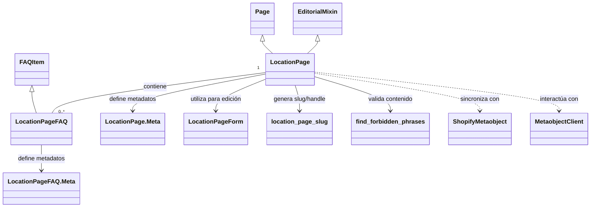

# Modelos de Contenido de Ubicación

El módulo `Location_Content_Models` es una parte fundamental del sistema de gestión de contenido de Shopify basado en Wagtail. Su propósito principal es definir la estructura y el comportamiento de las páginas de ubicación dentro de Wagtail, permitiendo la creación, edición y sincronización de contenido relacionado con ubicaciones geográficas con metaobjetos de Shopify.

Este módulo facilita la gestión de contenido rico para ubicaciones específicas, integrándose con el ecosistema de Shopify para presentar información localizada a los usuarios finales.

## 1. Arquitectura y Componentes Principales

El módulo `Location_Content_Models` se centra en la definición de dos modelos clave: `LocationPage` y `LocationPageFAQ`, que trabajan en conjunto para estructurar el contenido de las páginas de ubicación en Wagtail y prepararlo para la sincronización con Shopify.

### Componentes Core

*   **`LocationPage`**: Representa una página de ubicación en Wagtail. Hereda de `wagtail.models.Page` y `EditorialMixin`, lo que le otorga funcionalidades de gestión de contenido web y propiedades editoriales. Está diseñada para sincronizarse con un metaobjeto de Shopify de tipo `local_page`.
*   **`LocationPage.Meta`**: Clase interna que define metadatos para el modelo `LocationPage`, como nombres legibles (`verbose_name` y `verbose_name_plural`) para la interfaz de administración de Wagtail.
*   **`LocationPageFAQ`**: Un modelo de preguntas frecuentes asociado a una `LocationPage`. Hereda de `FAQItem`, lo que le permite reutilizar la estructura básica de una pregunta y respuesta.
*   **`LocationPageFAQ.Meta`**: Clase interna que hereda los metadatos de `FAQItem.Meta`, asegurando la consistencia en la gestión de FAQs.

### Relaciones de Componentes

El siguiente diagrama de clases ilustra la relación entre los componentes principales de este módulo y sus dependencias directas:



**`LocationPage`** encapsula toda la información editable de una página de ubicación, incluyendo detalles geográficos (país, estado, ciudad), secciones de contenido ricas en texto, títulos, subtítulos, y contenido de marca y mapa. También incluye campos específicos para la sincronización con Shopify, como `shopify_id`, `handle`, `sync_enabled` y `last_synced_at`.

La validación del contenido es crucial, utilizando el método `clean()` para asegurar que la página no contenga frases prohibidas y para generar automáticamente el `slug` y el `handle` basados en la información de ubicación y la configuración regional de Shopify.

## 2. Integración en el Sistema General

El módulo `Location_Content_Models` se inserta en la arquitectura general de la siguiente manera:

### Gestión de Contenido de Wagtail

Como parte de [Shopify Content Management](../Shopify_Content_Management.md), `LocationPage` extiende las capacidades de Wagtail, permitiendo a los editores gestionar contenido de ubicación con una interfaz de usuario familiar y robusta.

*   **Administración de Wagtail**: Los paneles de contenido (`content_panels`), promoción (`promote_panels`) y configuración (`settings_panels`) definidos en `LocationPage` configuran la experiencia de edición en el panel de administración de Wagtail, utilizando componentes como `StorefrontUrlsPanel` para la gestión de URLs.
*   **Formularios**: `LocationPageForm` (definido en [Content Forms](Content_Forms.md)) es la base para la edición de las páginas de ubicación, asegurando la consistencia y validación de datos.
*   **Mixins y Utilidades**: `EditorialMixin` (de [Content Store - Editorial Logic](Content_Store___Editorial_Logic.md)) proporciona funcionalidades editoriales, mientras que `FAQItem` (de [Content Base Models - Mixins](Content_Base_Models___Mixins.md)) permite la inclusión de secciones de preguntas frecuentes de manera modular.

### Sincronización con Shopify

La funcionalidad central de `LocationPage` es su capacidad de sincronizarse con Shopify.

*   **Metaobjetos de Shopify**: Cada `LocationPage` se mapea directamente a un metaobjeto de Shopify de tipo `local_page`. La definición de este metaobjeto es asegurada y verificada en tiempo de ejecución por `MetaobjectClient` (parte de [Shopify Metaobjects Integration](../../Application_Core___Shopify_Integration_Platform/Shopify_Metaobjects_Integration.md)).
*   **Proceso de Sincronización**: Al publicar una `LocationPage` en Wagtail, el contenido es enviado a Shopify, actualizando o creando el metaobjeto correspondiente. Los campos `shopify_id` y `handle` son cruciales para mantener el vínculo entre Wagtail y Shopify. Este proceso se gestiona a través de comandos de administración, como se detalla en [Metaobject Definition & Setup Commands](Metaobject_Definition___Setup_Commands.md).
*   **Configuración Regional**: El campo `shopify_locale` permite a los editores especificar una configuración regional de Shopify, lo que es esencial para la localización del contenido. `ALLOWED_LOCALE_CODES` (de `config.settings`) restringe los valores permitidos, asegurando la compatibilidad.

### Flujo de Datos y Proceso de Publicación

El siguiente diagrama de flujo describe el ciclo de vida de una `LocationPage` desde su creación/edición en Wagtail hasta su sincronización con Shopify.

```mermaid
graph TD
    A[Editor crea/edita LocationPage en Wagtail Admin] --> B{Validación de Wagtail};
    B --> C{Método clean() de LocationPage};
    C -- Genera slug/handle y valida contenido --> D{Contenido Válido?};
    D -- No --> E[Error de Validación];
    D -- Sí --> F[Página publicada en Wagtail];
    F --> G[Activación de sincronización con Shopify];
    G --> H[MetaobjectClient.sync() es llamado];
    H --> I[Shopify Metaobject 'local_page' actualizado/creado];
    I --> J[Página de Ubicación disponible en Shopify];
```

## 3. Comandos de Gestión y Tareas Relacionadas

El módulo `Location_Content_Models` se apoya en varios comandos de gestión de Django para su configuración y mantenimiento:

*   **`ensure_metaobject_definitions`**: Este comando (detallado en [Metaobject Definition & Setup Commands](Metaobject_Definition___Setup_Commands.md)) es fundamental para garantizar que la definición del metaobjeto `local_page` exista y esté correctamente configurada en Shopify.
*   **`rebuild_location_index`**: Un comando de administración (en [Content Indexing & Semantic Link Commands](Content_Indexing___Semantic_Link_Commands.md)) que se utiliza para reconstruir el índice de URLs de contenido, asegurando que las páginas de ubicación sean correctamente descubribles y enlazables.
*   **`fix_location_richtext`**: Este comando (parte de [Content Migration & Fix Commands](Content_Migration___Fix_Commands.md)) se encarga de corregir posibles problemas o inconsistencias en los campos `RichTextField` de las páginas de ubicación, garantizando la integridad del contenido.
*   **`seed_location_city`**: Permite la inicialización de páginas de ubicación con datos predefinidos, lo que es útil para entornos de desarrollo o demostración (referenciado en [Metaobject Definition & Setup Commands](Metaobject_Definition___Setup_Commands.md)).

Estos comandos aseguran la robustez y facilidad de gestión de las páginas de ubicación dentro del ecosistema de Wagtail y Shopify.
