# Comandos de Definición de Metaobjetos y Metafields

Este módulo (`Metaobject_Definition___Setup_Commands_Metaobject_Definition___Setup_Commands_Metaobject_Metafield_Definition_Commands`) contiene una colección de comandos de gestión de Django diseñados para configurar y verificar las definiciones de metaobjetos y metafields en una tienda Shopify. Estos comandos son cruciales para asegurar que la estructura de contenido definida en Wagtail se alinee correctamente con las capacidades de almacenamiento de datos personalizados de Shopify.

## Propósito y Funcionalidad Principal

El propósito principal de este módulo es automatizar la creación y actualización de las definiciones de metaobjetos y metafields de Shopify que son necesarias para la correcta sincronización y gestión del contenido desde Wagtail. Esto incluye:
*   Definición de metafields para índices de blogs y localizaciones de artículos.
*   Definición de metafields para páginas de índice del CMS.
*   Definición de metaobjetos personalizados para diferentes tipos de páginas de Wagtail (página de inicio, página raíz, página de ubicación, términos de glosario).
*   Definición de metafields de página generales para la sincronización de índices.

### Componentes de Comandos de Gestión

#### `shopify_content/management/commands/ensure_blog_metafield_definitions.py::Command`

Este comando se encarga de crear o verificar las definiciones de metafields de Shopify para las listas de índices de blogs (tipo `PAGE`) y las localizaciones disponibles en los recursos `BLOG` y `ARTICLE`. Es esencial para asegurar que los blogs y artículos gestionados en Wagtail puedan almacenar y mostrar correctamente la información de localización en Shopify.

**Uso:**

```bash
python manage.py ensure_blog_metafield_definitions
```

**Flujo del Comando:**
1.  Obtiene la configuración de la tienda Shopify (`ShopConfig`).
2.  Invoca a `ensure_blog_metafield_definitions` del servicio de sincronización para realizar la operación.
3.  Reporta las estadísticas de creación y omisión, y los errores encontrados.

#### `shopify_content/management/commands/ensure_index_metafield_definitions.py::Command`

Este comando asegura las definiciones de metafields de Shopify para las páginas de índice del CMS (`custom.index_listings` en `PAGE`) y las definiciones de `available_locales` para los recursos `BLOG` y `ARTICLE`. Ofrece una opción `legacy` para incluir definiciones de metafields de índice por localización ya obsoletas.

**Uso:**

```bash
python manage.py ensure_index_metafield_definitions
python manage.py ensure_index_metafield_definitions --legacy
```

**Argumentos:**
*   `--legacy`: También asegura las definiciones de metafields de índice por localización deprecadas.

**Flujo del Comando:**
1.  Obtiene la configuración de la tienda Shopify (`ShopConfig`).
2.  Invoca a `ensure_index_metafield_definitions` para el índice y las definiciones de blog/artículo.
3.  Si se usa `--legacy`, invoca a `ensure_page_metafield_definitions` con las especificaciones `LEGACY_PAGE_INDEX_METAFIELD_DEFINITIONS`.
4.  Reporta las estadísticas para cada ámbito.

#### `shopify_content/management/commands/ensure_metaobject_definitions.py::Command`

Este comando es responsable de arrancar o verificar las definiciones de metaobjetos propiedad del comerciante en Shopify. Se debe ejecutar después de instalar la aplicación en una nueva tienda o si una definición se elimina accidentalmente del Admin de Shopify. Es seguro ejecutarlo varias veces, ya que crea las definiciones faltantes y añade cualquier `fieldDefinitions` que falten a los tipos existentes a través de `metaobjectDefinitionUpdate`.

**Uso:**

```bash
python manage.py ensure_metaobject_definitions
```

**Metaobjetos Definidos:**
*   `local_page`
*   `root_page`
*   `home_page`
*   `glossary_term`

**Flujo del Comando:**
1.  Obtiene la configuración de la tienda Shopify (`ShopConfig`).
2.  Inicializa un `MetaobjectClient` para interactuar con la API de Shopify.
3.  Itera sobre las definiciones de metaobjetos predefinidas (`_location_page_definition`, `_root_page_definition`, `_home_page_definition`) y llama a `client.ensure_definition` para cada una.
4.  Asegura la definición del metaobjeto `glossary_term` utilizando `ensure_glossary_term_definition`.
5.  Reporta el estado de cada operación (éxito o fracaso).

#### `shopify_content/management/commands/ensure_page_metafield_definitions.py::Command`

Este comando crea o verifica las definiciones de metafields de Shopify para las páginas (`PAGE`) específicamente para `custom.index_listings`. Es un subconjunto de `ensure_index_metafield_definitions`.

**Uso:**

```bash
python manage.py ensure_page_metafield_definitions
python manage.py ensure_page_metafield_definitions --list-only
```

**Argumentos:**
*   `--list-only`: Solo lista las definiciones de metafields de `PAGE` existentes; no crea nuevas.

**Flujo del Comando:**
1.  Obtiene la configuración de la tienda Shopify (`ShopConfig`).
2.  Si se usa `--list-only`, muestra las definiciones de metafields de página existentes.
3.  Itera sobre las especificaciones de `PAGE_INDEX_METAFIELD_DEFINITIONS`.
4.  Invoca a `ensure_page_metafield_definitions` para crear/verificar las definiciones.
5.  Reporta las definiciones creadas, omitidas y con errores.

## Arquitectura y Relaciones de Componentes

Este módulo se integra con varios componentes clave de la aplicación y la API de Shopify para gestionar las definiciones de metaobjetos y metafields.

### Diagrama de Componentes

```mermaid
graph TD
    subgraph Comandos de Gestión
        A[ensure_blog_metafield_definitions.py::Command] --> B{Obtener ShopConfig}
        C[ensure_index_metafield_definitions.py::Command] --> B
        D[ensure_metaobject_definitions.py::Command] --> B
        E[ensure_page_metafield_definitions.py::Command] --> B
    end

    subgraph Configuración de la Tienda
        B --> F[core.models::ShopConfig]
    end

    subgraph Servicios de Sincronización
        G[shopify_content.sync.resource_metafield_definitions::ensure_blog_metafield_definitions]
        H[shopify_content.sync.page_metafield_definitions::ensure_page_metafield_definitions]
        I[shopify_content.sync.resource_metafield_definitions::ensure_index_metafield_definitions]
    end

    subgraph Cliente de Metaobjetos Shopify
        J[metaobjects.shopify_metaobjects.client::MetaobjectClient]
    end

    A --> G
    C --> I
    C -- "si --legacy" --> H
    D --> J
    E --> H

    G --> K(API de Shopify: Definiciones de Metafields)
    H --> K
    I --> K
    J --> L(API de Shopify: Definiciones de Metaobjetos)

    style A fill:#f9f,stroke:#333,stroke-width:2px
    style C fill:#f9f,stroke:#333,stroke-width:2px
    style D fill:#f9f,stroke:#333,stroke-width:2px
    style E fill:#f9f,stroke:#333,stroke-width:2px
    style F fill:#ccf,stroke:#333,stroke-width:2px
    style G fill:#ccf,stroke:#333,stroke-width:2px
    style H fill:#ccf,stroke:#333,stroke-width:2px
    style I fill:#ccf,stroke:#333,stroke-width:2px
    style J fill:#ccf,stroke:#333,stroke-width:2px
    style K fill:#bbf,stroke:#333,stroke-width:2px
    style L fill:#bbf,stroke:#333,stroke-width:2px
```



**Explicación de las Relaciones:**
*   Todos los comandos de gestión (`ensure_blog_metafield_definitions`, `ensure_index_metafield_definitions`, `ensure_metaobject_definitions`, `ensure_page_metafield_definitions`) dependen de `core.models.ShopConfig` para obtener los detalles de la tienda Shopify actual, que es fundamental para autenticar y dirigir las operaciones a la tienda correcta.
*   `ensure_blog_metafield_definitions.py::Command` se comunica con `shopify_content.sync.resource_metafield_definitions.ensure_blog_metafield_definitions` para manejar las definiciones de metafields de blogs y artículos.
*   `ensure_index_metafield_definitions.py::Command` utiliza `shopify_content.sync.resource_metafield_definitions.ensure_index_metafield_definitions` para las definiciones de índice y también puede invocar a `shopify_content.sync.page_metafield_definitions.ensure_page_metafield_definitions` si se requiere el soporte `legacy`.
*   `ensure_metaobject_definitions.py::Command` interactúa directamente con `metaobjects.shopify_metaobjects.client.MetaobjectClient` para la creación y verificación de definiciones de metaobjetos personalizados. Este cliente a su vez encapsula la lógica para comunicarse con la API GraphQL de Shopify.
*   `ensure_page_metafield_definitions.py::Command` utiliza `shopify_content.sync.page_metafield_definitions.ensure_page_metafield_definitions` para las definiciones de metafields de página.

Estos servicios de sincronización y el cliente de metaobjetos son los puentes entre los comandos de gestión y la API de Shopify, traduciendo las especificaciones de definición en llamadas de API reales para crear o actualizar metafields y metaobjetos en la plataforma Shopify.

## Cómo el Módulo Encaja en el Sistema General

Este módulo es una parte integral del subsistema de [Wagtail Content Management](../../Shopify_Content_Management.md), específicamente dentro de los [Comandos de Configuración de Definición de Metaobjetos](../Metaobject_Definition___Setup_Commands.md). Su rol es asegurar que la infraestructura de datos personalizados en Shopify esté configurada correctamente para soportar el contenido rico y estructurado gestionado en Wagtail.

Al definir los metaobjetos y metafields necesarios en Shopify, este módulo permite que el sistema:
*   **Almacene contenido estructurado**: Páginas de Wagtail como blogs, artículos, colecciones, productos, páginas de inicio y páginas de ubicación pueden tener datos adicionales almacenados como metaobjetos o metafields en Shopify.
*   **Sincronice datos de localización**: Los metafields de `available_locales` permiten que el contenido sea multilingüe y que Shopify reconozca las diferentes versiones de idiomas.
*   **Facilite la integración**: Proporciona la base de datos subyacente en Shopify para que otras partes de la aplicación, como la [Shopify Metaobjects Integration](../../../Application_Core___Shopify_Integration_Platform/Shopify_Metaobjects_Integration.md) y la [Shopify Content API](../../Shopify_Content_API.md), puedan leer y escribir datos personalizados de forma coherente.

En resumen, este módulo actúa como el paso inicial y fundamental para preparar la tienda Shopify para la gestión avanzada de contenido a través de Wagtail, garantizando que el modelo de datos subyacente en Shopify esté correctamente definido para un ecosistema de contenido dinámico.
