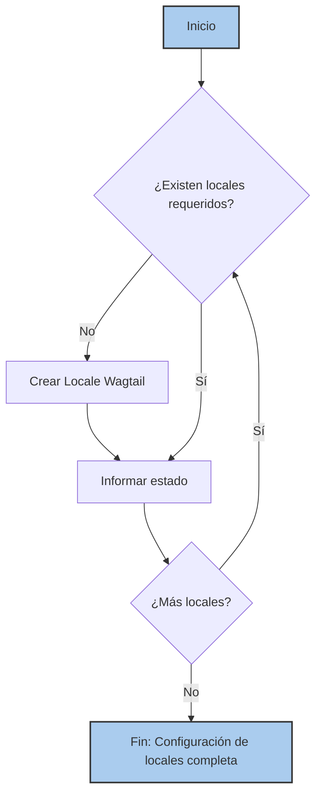

# Comandos de Configuración del Sistema

Este módulo `Metaobject_Definition___Setup_Commands_System_Setup_Commands` contiene comandos de gestión de Django utilizados para la configuración inicial y la automatización de tareas esenciales para el sistema de gestión de contenido Shopify con Wagtail. Estos comandos son fundamentales para establecer las bases del funcionamiento multilingüe y la sincronización programada de contenido.

## Propósito y Funcionalidad Principal

El módulo agrupa comandos de Django que facilitan la configuración de elementos clave del sistema, como la creación de locales de Wagtail necesarios para el soporte multilingüe y la configuración de tareas periódicas de Celery Beat para la sincronización de contenido y el mantenimiento de enlaces semánticos.

### Componentes de Comandos

A continuación se detallan los comandos de gestión que forman parte de este módulo:

#### `setup_celery_beat_schedules.py::Command`

Este comando se encarga de crear o actualizar las tareas periódicas predeterminadas de Celery Beat que son cruciales para la sincronización de contenido de Shopify.

*   **Descripción**: Configura dos tareas periódicas:
    1.  **Importación de contenido nuevo**: Programa la importación diaria de contenido nuevo desde Shopify. Por defecto, esta tarea está deshabilitada y debe ser activada manualmente en el administrador de Django.
    2.  **Relleno de enlaces semánticos**: Programa la tarea de rellenar los enlaces internos semánticos. Su activación depende de las configuraciones `SEMANTIC_LINKS_ENABLED` y `SEMANTIC_LINKS_BACKFILL_SCHEDULE_ENABLED` en los ajustes de Django.
*   **Uso**: Se ejecuta mediante `python manage.py setup_celery_beat_schedules`.
*   **Configuración**: La programación de las tareas se define mediante objetos `CrontabSchedule` y las tareas periódicas se gestionan a través del modelo `PeriodicTask` de `django-celery-beat`. El comando interactúa con las [Configuraciones del Proyecto](../../../Build,_CI___Configuration/Build,_CI___Configuration_configuracion_proyecto.md) de Django, específicamente con `settings.TIME_ZONE` y las variables `SEMANTIC_LINKS_ENABLED` y `SEMANTIC_LINKS_BACKFILL_SCHEDULE_ENABLED`.

#### `setup_locales.py::Command`

Este comando garantiza que los objetos `Locale` de Wagtail requeridos para el soporte de `hreflang` estén presentes en la base de datos.

*   **Descripción**: Crea o verifica la existencia de los locales esenciales: `en-US`, `es-US`, `en-CA` y `fr-CA`. Estos locales son fundamentales para la gestión de contenido multilingüe y para generar correctamente los atributos `hreflang` en el frontend, mejorando el SEO.
*   **Uso**: Se ejecuta mediante `python manage.py setup_locales`.
*   **Dependencia**: Interactúa directamente con el modelo `Locale` de Wagtail. Para más detalles sobre cómo se utilizan estos locales en el sistema, consulte la sección de [Gestión de Localización](../Content_Store___Editorial_Logic/Content_Store___Editorial_Logic_GestionLocalizacion.md) del Content Store.

## Arquitectura y Relaciones de Componentes

### Diagrama de Componentes de Configuración del Sistema

```mermaid
graph TD
    subgraph Comandos de Gestión de Django
        A[setup_celery_beat_schedules.py::Command]
        B[setup_locales.py::Command]
    end

    subgraph Django
        C[settings]
        D[Modelos de django-celery-beat]
        E[Modelos de Wagtail Locale]
        F[shopify_content.tasks.scheduled_import_new_content]
        G[shopify_content.tasks.backfill_semantic_links_task]
    end

    A --> D: Crea/Actualiza PeriodicTask y CrontabSchedule
    A --> C: Lee TIME_ZONE, SEMANTIC_LINKS_ENABLED, SEMANTIC_LINKS_BACKFILL_SCHEDULE_ENABLED
    D --> F: Referencia la tarea de importación
    D --> G: Referencia la tarea de relleno de enlaces semánticos
    B --> E: Crea/Verifica objetos Locale

    style A fill:#f9f,stroke:#333,stroke-width:2px
    style B fill:#f9f,stroke:#333,stroke-width:2px
```
*Pie de figura: Diagrama de componentes mostrando la interacción de los comandos de configuración del sistema con los modelos de Django y Wagtail.*

## Flujo de Proceso de Configuración de Locales


*Pie de figura: Flujo de proceso para el comando `setup_locales`.*

## Flujo de Proceso de Configuración de Tareas de Celery Beat

```mermaid
graph TD
    StartCelery[Inicio] --> CreateImportSchedule{Crear/Obtener CrontabSchedule para importación}
    CreateImportSchedule --> UpdateImportTask{Crear/Actualizar PeriodicTask para importación}
    UpdateImportTask --> ReportImportStatus[Informar estado de tarea de importación]

    ReportImportStatus --> CreateBackfillSchedule{Crear/Obtener CrontabSchedule para relleno de enlaces}
    CreateBackfillSchedule --> CheckBackfillEnabled{Verificar si el relleno de enlaces está habilitado}
    CheckBackfillEnabled -- Sí --> UpdateBackfillTask[Crear/Actualizar PeriodicTask para relleno de enlaces (habilitada)]
    CheckBackfillEnabled -- No --> UpdateBackfillTaskDisabled[Crear/Actualizar PeriodicTask para relleno de enlaces (deshabilitada)]

    UpdateBackfillTask --> ReportBackfillStatus[Informar estado de tarea de relleno]
    UpdateBackfillTaskDisabled --> ReportBackfillStatus
    ReportBackfillStatus --> EndCelery[Fin: Configuración de Celery Beat completa]

    style StartCelery fill:#ace,stroke:#333,stroke-width:2px
    style EndCelery fill:#ace,stroke:#333,stroke-width:2px
```
*Pie de figura: Flujo de proceso para el comando `setup_celery_beat_schedules`.*

## Cómo encaja el módulo en el sistema general

Los comandos en `Metaobject_Definition___Setup_Commands_System_Setup_Commands` son parte integral del proceso de inicialización y mantenimiento del sistema de gestión de contenido de Shopify.

*   **Soporte Multilingüe**: El comando `setup_locales` es el primer paso para habilitar las capacidades multilingües en Wagtail, asegurando que los idiomas requeridos estén definidos para la creación y gestión de contenido localizado. Esto se vincula directamente con la capacidad del sistema para servir contenido en diferentes mercados.

*   **Automatización de Sincronización**: El comando `setup_celery_beat_schedules` establece la automatización para la importación continua de contenido desde Shopify y la gestión de enlaces semánticos. Esto es esencial para mantener el contenido del CMS actualizado con la información de Shopify y para asegurar una navegación coherente y optimizada para SEO a través de enlaces internos.

Estos comandos trabajan en conjunto con otros módulos dentro de [Shopify Content Management](../../Shopify_Content_Management.md) para garantizar una plataforma robusta y bien configurada. Por ejemplo, las tareas programadas dependen de los servicios de sincronización definidos en [Content Synchronization Services](../Content_Synchronization_Services.md).
