# Comandos de Inicialización de Páginas Wagtail

Este módulo proporciona comandos de gestión de Django para inicializar y configurar varias páginas de Wagtail relacionadas con la gestión de contenido de Shopify. Estos comandos son esenciales para establecer la estructura de contenido inicial y poblarla con datos predeterminados o de plantilla.

## Propósito y Funcionalidad Principal

El módulo `Metaobject_Definition___Setup_Commands_Wagtail_Page_Initialization_Commands` agrupa una serie de comandos de Django diseñados para automatizar la configuración de páginas clave en el sistema de gestión de contenido Wagtail, que interactúan directamente con Shopify. Sus funciones principales incluyen:

1.  **Inicialización de Páginas Raíz y de Inicio (`bootstrap_home_pages`):** Asegura la existencia de la página raíz `ShopifyRootPage` (`cms-home`) y crea instancias de `HomePage` para cada localización permitida, proporcionando la base para el contenido de la página de inicio multilingüe.
2.  **Inicialización de Páginas de Índice (`bootstrap_index_pages`):** Configura los destinos de índice de Shopify, como la creación de una página de índice de blog en Shopify y la aplicación de la configuración de exportación para el glosario, las localizaciones y el blog. También garantiza que las definiciones de metafields necesarias estén en su lugar.
3.  **Siembra de Contenido Editorial (`seed_home_editorial_en_us`):** Popula la `HomePage` específica de la localización `en-US` con contenido editorial predefinido, incluyendo diversas secciones como barras de confianza, pasarelas de promoción y colecciones destacadas.
4.  **Siembra de Páginas de Localización (`seed_location_city`):** Crea o actualiza una `LocationPage` individual utilizando una plantilla de contenido de ciudad (`en-US`), lo que permite una creación rápida y estandarizada de páginas de localización.

Estos comandos son fundamentales para la configuración inicial del entorno de Wagtail y para mantener la coherencia del contenido sincronizado con Shopify.

## Arquitectura y Relaciones entre Componentes

Los comandos de este módulo interactúan principalmente con los modelos de página de Wagtail, específicamente `ShopifyRootPage`, `HomePage` y `LocationPage`, e indirectamente con la plataforma Shopify para la sincronización de contenido.

### Desglose de Componentes:

*   **`Command` (de `shopify_content/management/commands/bootstrap_home_pages.py`):**
    *   **Propósito:** Garantiza la existencia de la `ShopifyRootPage` con el slug `cms-home` y crea instancias de `HomePage` para cada localización definida en `settings.ALLOWED_LOCALE_CODES` si aún no existen.
    *   **Funcionalidad:**
        *   Crea la `ShopifyRootPage` si es necesario, actuando como padre para las `HomePage`.
        *   Itera sobre las localizaciones permitidas y crea una `HomePage` para cada una, asignando un título predeterminado y el objeto de localización correspondiente.
        *   Normaliza las secciones JSON y las convierte a datos de StreamField para el cuerpo de la página.
        *   Permite la publicación opcional de las páginas creadas, lo que puede activar la sincronización con Shopify si está configurada.
    *   **Dependencias:** `ShopifyRootPage`, `HomePage` (modelos Wagtail), `Locale` (modelo Wagtail), `settings.ALLOWED_LOCALE_CODES`.
*   **`Command` (de `shopify_content/management/commands/bootstrap_index_pages.py`):**
    *   **Propósito:** Inicializa los objetivos de índice de Shopify. Crea la página de índice de blog en Shopify y se encarga de imprimir/aplicar la configuración de exportación para el glosario, las localizaciones y el blog.
    *   **Funcionalidad:**
        *   Verifica la existencia de `ShopConfig` para obtener la tienda Shopify actual.
        *   Opcionalmente, ejecuta el comando para asegurar las definiciones de metafields de índice (ver [Metaobject_Definition___Setup_Commands_Metaobject_Metafield_Definition_Commands.md](Metaobject_Definition___Setup_Commands_Metaobject_Metafield_Definition_Commands.md)).
        *   Asegura la creación de páginas de índice en Shopify para el blog y, opcionalmente, para páginas de glosario/localización obsoletas.
        *   Construye la configuración de exportación para glosario, localización y blog.
        *   Permite aplicar esta configuración directamente al campo `export_config` de las `ShopifyRootPage` correspondientes en la base de datos de Wagtail.
    *   **Dependencias:** `ShopConfig` (de `core.models`), `ShopifyRootPage` (modelo Wagtail), funciones de sincronización de índices.
*   **`Command` (de `shopify_content/management/commands/seed_home_editorial_en_us.py`):**
    *   **Propósito:** Siembra contenido editorial predefinido para la `HomePage` de `en-US`.
    *   **Funcionalidad:**
        *   Localiza la `HomePage` para la localización `en-US` (creada idealmente por `bootstrap_home_pages`).
        *   Actualiza campos clave de héroe (título, subtítulo, CTA) y secciones JSON con un payload de contenido editorial rico.
        *   Normaliza y serializa el contenido de las secciones para el StreamField del cuerpo de la página.
        *   Guarda y publica la página.
        *   Permite opcionalmente "empujar" (push) el contenido actualizado a Shopify mediante `sync_home_page`, lo que resalta la integración con [Shopify_Metaobjects_Integration](../../../Application_Core___Shopify_Integration_Platform/Shopify_Metaobjects_Integration.md) y los servicios de sincronización.
    *   **Dependencias:** `HomePage`, `CollectionPage` (modelos Wagtail), `ShopConfig` (de `core.models`), `Locale` (modelo Wagtail), funciones de normalización y serialización de secciones, `sync_home_page` (de `shopify_content.sync.outbound`).
*   **`Command` (de `shopify_content/management/commands/seed_location_city.py`):**
    *   **Propósito:** Crea o actualiza una `LocationPage` individual utilizando una plantilla de contenido de ciudad para `en-US`.
    *   **Funcionalidad:**
        *   Toma como argumentos el nombre de la ciudad y el estado.
        *   Construye un payload de datos de localización a partir de una plantilla (`location_city_en_us.py`).
        *   Valida el contenido del payload para detectar frases prohibidas.
        *   Localiza o crea la `ShopifyRootPage` para `local-us` si no existe.
        *   Busca una `LocationPage` existente por ciudad y estado; si no la encuentra, crea una nueva.
        *   Rellena los campos de la `LocationPage` con los datos del payload, incluyendo la sanitización del HTML de rich text.
        *   Genera el slug y el handle de la página de localización de forma canónica.
        *   Asocia las FAQs del payload a la `LocationPage`.
        *   Guarda y publica la página (opcionalmente).
        *   Permite opcionalmente "empujar" (push) la página a Shopify a través de `sync_location_page`.
    *   **Dependencias:** `LocationPage`, `LocationPageFAQ`, `ShopifyRootPage`, `Locale` (modelos Wagtail), `build_location_payload`, `find_forbidden_phrases` (de `shopify_content.content_templates.location_city_en_us`), `sanitize_richtext_html`, `location_page_slug`, `sync_location_page` (de `shopify_content.sync.outbound`).

### Diagrama de Arquitectura de Comandos

```mermaid
graph TD
    subgraph Comandos de Inicialización de Páginas Wagtail
        A[bootstrap_home_pages]
        B[bootstrap_index_pages]
        C[seed_home_editorial_en_us]
        D[seed_location_city]
    end

    subgraph Modelos Wagtail
        SR[ShopifyRootPage]
        HP[HomePage]
        LP[LocationPage]
        CP[CollectionPage]
        L[Locale]
    end

    subgraph Modelos Core
        SC[ShopConfig]
    end

    subgraph Shopify Platform
        SP[Páginas de Shopify]
        SM[Metaobjects de Shopify]
        SMD[Definiciones de Metafields]
    end

    subgraph Servicios y Utilidades
        HNL[shopify_content.home_sections_normalization]
        HS[shopify_content.home_serialization]
        SRIP[shopify_content.sync.import_parents]
        RSMD[shopify_content.sync.resource_metafield_definitions]
        IPS[shopify_content.sync.index_pages_bootstrap]
        SO[shopify_content.sync.outbound]
        LCTE[shopify_content.content_templates.location_city_en_us]
        LS[shopify_content.location_slug]
        SRH[shopify_content.richtext_sanitize]
    end

    A -- Crea/Actualiza --> SR
    A -- Crea/Actualiza --> HP
    A -- Usa --> L
    A -- Usa --> HNL
    A -- Usa --> HS
    A -- Usa --> SRIP

    B -- Lee --> SC
    B -- Actualiza --> SR
    B -- Asegura --> SMD
    B -- Usa --> IPS
    B -- Usa --> RSMD
    B -- Crea/Actualiza --> SP

    C -- Lee/Actualiza --> HP
    C -- Lee --> L
    C -- Usa --> CP
    C -- Usa --> HNL
    C -- Usa --> HS
    C -- Sincroniza --> SP
    C -- Sincroniza --> SM
    C -- Usa --> SO

    D -- Crea/Actualiza --> LP
    D -- Lee --> L
    D -- Crea/Actualiza --> SR
    D -- Usa --> LCTE
    D -- Usa --> LS
    D -- Usa --> SRH
    D -- Sincroniza --> SP
    D -- Sincroniza --> SM
    D -- Usa --> SO

    SR --> HP
    SR --> LP
    SC --> B
    SC --> C

    SO --> SM
    SO --> SP
```



## Cómo Encaja el Módulo en el Sistema General

Este módulo es una parte crítica del sistema de gestión de contenido de Wagtail, específicamente dentro del dominio de [Shopify_Content_Management](../../Shopify_Content_Management.md). Proporciona el andamiaje inicial y la siembra de contenido necesarios para que la instancia de Wagtail gestione el contenido relacionado con Shopify.

*   **Fundamento para el Contenido:** Comandos como `bootstrap_home_pages` y `bootstrap_index_pages` establecen las estructuras fundamentales de páginas de Wagtail (`ShopifyRootPage`, `HomePage`, páginas de índice) que son necesarias para que la aplicación funcione correctamente como un sistema de gestión de contenido para Shopify.
*   **Población de Contenido Inicial:** `seed_home_editorial_en_us` y `seed_location_city` facilitan el despliegue rápido de contenido con plantilla, reduciendo el esfuerzo de configuración manual y asegurando la coherencia en diferentes entornos o despliegues iniciales.
*   **Integración con Shopify:** Los comandos a menudo incluyen opciones para `publicar` y `empujar` contenido a Shopify, vinculando directamente el contenido de Wagtail con el escaparate de Shopify y asegurando que el contenido gestionado en Wagtail se refleje en la plataforma de comercio electrónico. Esto resalta la estrecha integración con la [Application_Core___Shopify_Integration_Platform](../../../Application_Core___Shopify_Integration_Platform.md) y, específicamente, con la [Shopify_Metaobjects_Integration](../../../Application_Core___Shopify_Integration_Platform/Shopify_Metaobjects_Integration.md) para metafields y metaobjects.
*   **Dependencia de las Definiciones de Metafields:** El comando `bootstrap_index_pages` asegura explícitamente las definiciones de metafields, lo que indica una dependencia del módulo [Metaobject_Definition___Setup_Commands_Metaobject_Metafield_Definition_Commands.md](Metaobject_Definition___Setup_Commands_Metaobject_Metafield_Definition_Commands.md) para definir correctamente la estructura de los datos que se sincronizarán con Shopify.
*   **Gestión de Localizaciones:** El uso de `settings.ALLOWED_LOCALE_CODES` y `wagtail.models.Locale` en `bootstrap_home_pages` demuestra el papel del módulo en el soporte de la gestión de contenido multilingüe dentro de Wagtail, alineándose con las estrategias de contenido globalizadas.

### Diagrama de Flujo de Proceso de Inicialización

```mermaid
graph TD
    A[Inicio: Ejecutar Comandos de Inicialización] --> B{Comando: bootstrap_home_pages};
    B --> C{1. Verificar/Crear ShopifyRootPage 'cms-home'};
    C --> D{2. Para cada Locale Permitido (settings.ALLOWED_LOCALE_CODES)};
    D -- No existe HomePage para Locale --> E[3. Crear HomePage para Locale];
    E -- &nbsp; --> F{4. Normalizar Secciones JSON y Serializar a StreamField};
    F --> G{5. Guardar Revisión de HomePage};
    G -- Opción --publish --> H{6. Publicar HomePage};
    H -- Si se publica y sync_enabled=true --> I[7. Encolar Sincronización a Shopify];
    H -- No --> J[Página guardada como borrador];
    D -- Existe HomePage para Locale --> K[Omitir: HomePage ya existe];
    K --> D;
    J --> D;
    I --> D;

    D -- Todas las locales procesadas --> L{Comando: bootstrap_index_pages};
    L --> M{1. Verificar ShopConfig};
    M --> N{2. Opcional: Asegurar Definiciones de Metafields de Índice (Ver [Metaobject_Definition___Setup_Commands_Metaobject_Metafield_Definition_Commands.md](Metaobject_Definition___Setup_Commands/Metaobject_Definition___Setup_Commands_Metaobject_Metafield_Definition_Commands.md))};
    N --> O{3. Asegurar Páginas de Índice en Shopify (e.g., Blog)};
    O --> P{4. Construir Configuraciones de Exportación (Glosario, Ubicación, Blog)};
    P -- Opción --apply-export-config --> Q{5. Aplicar Configuraciones a ShopifyRootPage.export_config en Wagtail DB};
    Q --> R[Configuración de Índices Completa];
    P -- No aplicar --> R;

    R --> S{Comando: seed_home_editorial_en_us};
    S --> T{1. Obtener HomePage para 'en-US'};
    T --> U{2. Actualizar Campos de Héroe y 'sections_json'};
    U --> V{3. Normalizar y Serializar 'sections_json' a StreamField};
    V --> W{4. Guardar y Publicar HomePage};
    W -- Opción --push --> X[5. Sincronizar HomePage a Metaobject de Shopify];
    X --> Y[Contenido Editorial de Home Sembrado];
    W -- No push --> Y;

    Y --> Z{Comando: seed_location_city};
    Z --> AA{1. Construir Payload de LocationPage desde Plantilla};
    AA --> BB{2. Validar Payload (frases prohibidas)};
    BB --> CC{3. Verificar/Crear ShopifyRootPage 'local-us'};
    CC --> DD{4. Buscar/Crear LocationPage por Ciudad y Estado};
    DD --> EE{5. Rellenar Campos y Sanitizar Rich Text};
    EE --> FF{6. Añadir/Actualizar FAQs};
    FF -- No Opción --no-publish --> GG{7. Guardar Revisión y Publicar LocationPage};
    FF -- Opción --no-publish --> HH[Página guardada como borrador];
    GG -- Opción --push --> II[8. Sincronizar LocationPage a Metaobject de Shopify];
    II --> JJ[Página de Localización Sembrada];
    GG -- No push --> JJ;
    HH --> JJ;

    JJ --> KKE[Fin];

    subgraph Wagtail Database Operations
        C,E,G,H,K,Q,T,U,W,CC,DD,EE,FF,GG,HH
    end

    subgraph Shopify API Interactions
        I,X,II,O
    end

    subgraph Archivos de Configuración/Plantillas
        settings.ALLOWED_LOCALE_CODES
        shopify_content.content_templates.location_city_en_us
    end
