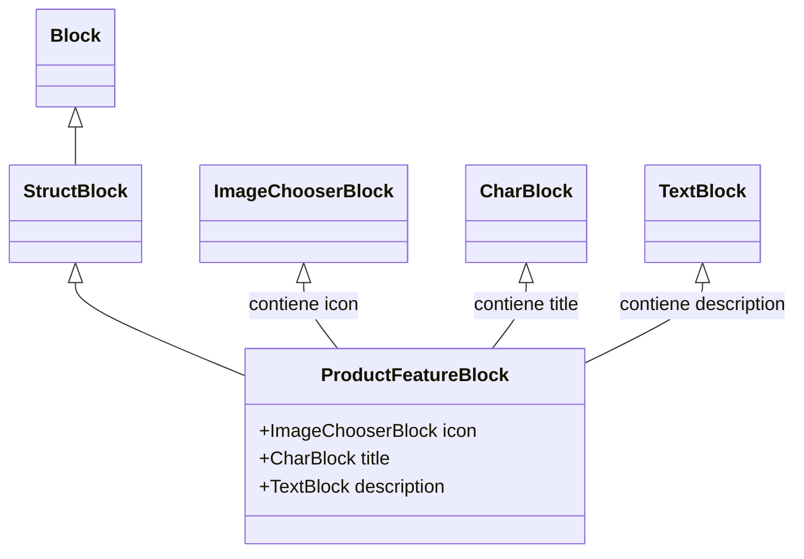

# Bloques de Características de Producto para StreamField de Wagtail

Este módulo define `ProductFeatureBlock`, un bloque de StreamField de Wagtail utilizado para estructurar las características destacadas de un producto dentro de las páginas de contenido de producto. Permite a los editores de contenido crear secciones con un icono, título y descripción para resaltar los puntos clave de venta de un producto.

## Funcionalidad Principal

El componente principal de este módulo es:

### `ProductFeatureBlock`

El `ProductFeatureBlock` es un `StructBlock` de Wagtail que agrupa tres tipos de contenido para representar una característica de producto:

*   **`icon`**: Un `ImageChooserBlock` opcional que permite seleccionar una imagen (SVG o PNG) para servir como icono representativo de la característica.
*   **`title`**: Un `CharBlock` obligatorio con una longitud máxima de 100 caracteres para el título de la característica.
*   **`description`**: Un `TextBlock` obligatorio para una descripción detallada de la característica.

La clase `Meta` asociada a `ProductFeatureBlock` define un icono para la interfaz de administración de Wagtail (`list-ul`), una etiqueta legible (`Product Feature`) y especifica la plantilla HTML (`shopify_content/blocks/product_feature_block.html`) utilizada para renderizar este bloque en el frontend.

## Arquitectura y Relaciones de Componentes

`ProductFeatureBlock` es un componente de bloque reutilizable dentro del sistema de gestión de contenido de Wagtail. Se basa en los bloques fundamentales de Wagtail para construir una estructura de datos más compleja y semántica.

### Diagrama de Clases

## Integración con el Sistema General

Este bloque está diseñado para ser utilizado dentro de otros StreamFields, específicamente en contextos donde se necesita presentar información estructurada sobre las características de un producto. Su uso principal es dentro del StreamField `ProductBodyStreamBlock` (definido en [shopify_content/blocks/__init__.py](../Wagtail_StreamField_Blocks.md)), que a su vez es parte de la estructura de la página de producto, como la [ProductPage](../Product_Content_Models.md).

Permite a los editores de contenido enriquecer las páginas de producto en Wagtail con secciones visuales y de texto que detallan los beneficios y características de los artículos, mejorando la experiencia del usuario y la capacidad de SEO de las páginas de producto en la plataforma Shopify.