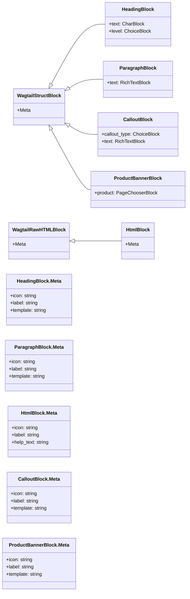

# Bloques de Contenido General de Wagtail StreamField

Este módulo, `Wagtail_StreamField_Blocks_BloquesContenidoGeneral`, define un conjunto de bloques de contenido versátiles para [Wagtail StreamField](../Wagtail_StreamField_Blocks.md), diseñados para la gestión de contenido editorial en el contexto de la integración con Shopify. Estos bloques proporcionan elementos básicos para la creación de contenido estructurado, garantizando la compatibilidad y una representación adecuada en el frontend de Shopify.

## Propósito y Funcionalidad Principal

El objetivo principal de este módulo es ofrecer bloques de contenido fundamentales que los editores pueden utilizar para construir páginas ricas y dinámicas dentro del CMS de Wagtail. Cada bloque está diseñado con una funcionalidad específica y se renderiza de una manera compatible con Shopify, lo que facilita la sincronización y la visualización del contenido en la tienda Shopify.

### Componentes de Bloque de Contenido

A continuación, se describen los bloques de contenido general definidos en `shopify_content/blocks/content.py`:

*   **`HeadingBlock`**:
    *   **Descripción**: Permite a los editores crear encabezados de sección con diferentes niveles de jerarquía (H2, H3, H4). Estos se utilizan para estructurar el contenido y mejorar la legibilidad.
    *   **Funcionalidad**: Define un campo de texto para el contenido del encabezado y un campo de selección para elegir el nivel del encabezado.
    *   **Renderizado**: Se renderiza como etiquetas `<h2>`, `<h3>` o `<h4>` en la salida HTML para Shopify.

*   **`ParagraphBlock`**:
    *   **Descripción**: Proporciona un bloque de texto enriquecido para párrafos estándar. Las características de formato están limitadas para asegurar la compatibilidad con Shopify.
    *   **Funcionalidad**: Permite formato básico como negrita, cursiva, enlaces, listas ordenadas y no ordenadas, y líneas horizontales.
    *   **Renderizado**: El texto enriquecido se convierte a HTML compatible con Shopify.

*   **`HtmlBlock`**:
    *   **Descripción**: Un bloque de paso de HTML sin procesar. Es crucial para mantener el HTML existente de Shopify durante la importación y para enviar HTML complejo directamente a Shopify sin modificaciones por parte de Wagtail.
    *   **Funcionalidad**: Acepta y almacena contenido HTML puro.
    *   **Uso**: Ideal para incrustar fragmentos de código, widgets o diseños complejos que no pueden ser construidos con los bloques estándar.

*   **`CalloutBlock`**:
    *   **Descripción**: Un bloque diseñado para mostrar información destacada o advertencias en un cuadro estilizado.
    *   **Funcionalidad**: Permite seleccionar un tipo de "llamada" (información, advertencia, consejo, nota) y un campo de texto enriquecido para el mensaje.
    *   **Renderizado**: Se renderiza como un `
` estilizado en la salida HTML de Shopify.

*   **`ProductBannerBlock`**:
    *   **Descripción**: Este bloque permite mostrar un producto específico de Shopify en un formato de banner.
    *   **Funcionalidad**: Requiere la selección de una página de producto (`shopify_content.ProductPage`) a través de un `PageChooserBlock`.
    *   **Renderizado**: Genera el HTML necesario para mostrar un banner de producto en Shopify.

## Arquitectura y Relaciones entre Componentes

Los bloques de contenido general son componentes fundamentales de la arquitectura de StreamField de Wagtail, que permite a los editores construir páginas de forma flexible utilizando una colección de bloques definidos. Cada bloque hereda de `wagtail.blocks.StructBlock` o `wagtail.blocks.RawHTMLBlock`, lo que les proporciona la estructura necesaria para gestionar sus campos y renderizar sus plantillas.

Estos bloques se utilizan como elementos constituyentes dentro de bloques de StreamField más grandes, como [ArticleBodyStreamBlock, CollectionBodyStreamBlock, HomeBodyStreamBlock y ProductBodyStreamBlock](../Wagtail_StreamField_Blocks.md#bloques-de-streamfield-compuestos), los cuales a su vez son parte de los modelos de página Wagtail como `ArticlePage`, `CollectionPage`, `HomePage` y `ProductPage` definidos en los módulos de modelos de contenido ([Blog_Content_Models.md](../Blog_Content_Models.md), [Collection_Content_Models.md](../Collection_Content_Models.md), [Home_Page_Models.md](../Home_Page_Models.md), [Product_Content_Models.md](../Product_Content_Models.md)).

### Diagrama de Clases de Bloques de Contenido General

## Integración en el Sistema General

Estos bloques de contenido forman la columna vertebral del contenido editorial gestionado a través de Wagtail y sincronizado con Shopify.

1.  **Creación de Contenido en Wagtail**: Los editores utilizan la interfaz de administración de Wagtail para componer páginas utilizando una combinación de estos bloques. La flexibilidad de StreamField permite una disposición de contenido rica y personalizada sin necesidad de intervención de desarrollo.
2.  **Generación de HTML compatible con Shopify**: Cada bloque tiene una plantilla (`template`) asociada que define cómo se renderizará el bloque en HTML. Estas plantillas están diseñadas para generar una salida HTML que sea directamente consumible y mostrable en el frontend de Shopify.
3.  **Sincronización con Shopify**: El contenido creado con estos bloques se serializa y, a menudo, se materializa en formato Markdown o HTML antes de ser enviado a Shopify. El [`HtmlBlock`](#componentes-de-bloque-de-contenido) es particularmente importante en este proceso, ya que permite la preservación de HTML preexistente o complejo de Shopify.
4.  **Coherencia de la Marca y el Estilo**: Al utilizar bloques predefinidos con plantillas específicas, se asegura que el contenido mantenga una coherencia visual y funcional en todo el sitio de Shopify.

En resumen, los bloques de contenido general actúan como los componentes básicos para la construcción de la mayoría del contenido editorial, asegurando una experiencia de edición rica en Wagtail y una representación de contenido coherente y eficiente en Shopify.
