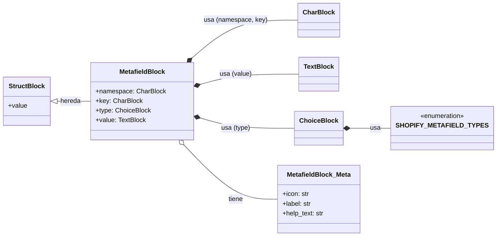

# Bloques de Metafields de Wagtail StreamField

El módulo `Wagtail_StreamField_Blocks_BloquesMetafield` se centra en la definición y gestión de bloques de metafields dentro de los `StreamField` de Wagtail para la integración de contenido de Shopify. Proporciona un bloque específico para incrustar metafields directamente en el cuerpo de una página, permitiendo a los editores de contenido añadir datos personalizados de Shopify de forma flexible.

## Propósito y Funcionalidad Principal

El componente principal de este módulo es `MetafieldBlock`, que permite la inclusión de metafields de Shopify directamente en los `StreamField` de Wagtail.

### MetafieldBlock

El `MetafieldBlock` es un `StructBlock` de Wagtail diseñado para representar un metafield de Shopify. Permite a los editores especificar el `namespace`, la `key`, el `type` y el `value` del metafield.

**Características Clave:**

*   **`namespace`**: Un `CharBlock` para el espacio de nombres del metafield (por defecto 'custom').
*   **`key`**: Un `CharBlock` para la clave del metafield.
*   **`type`**: Un `ChoiceBlock` que restringe el tipo de dato del metafield a una lista predefinida de tipos de metafield de Shopify (`SHOPIFY_METAFIELD_TYPES`). Esto asegura la compatibilidad y la coherencia con los tipos de datos de Shopify.
*   **`value`**: Un `TextBlock` para el valor del metafield.

**`MetafieldBlock.Meta`**: Define metadatos para el bloque, incluyendo un ícono (`tag`), una etiqueta (`Metafield`) y un texto de ayuda que sugiere priorizar los paneles de Metafields dedicados para una gestión más estructurada.

```python
SHOPIFY_METAFIELD_TYPES = [
    ('single_line_text_field', 'Single Line Text'),
    ('rich_text_field', 'Multi Line Text'),
    ('json', 'JSON'),
    ('number_integer', 'Integer'),
    ('number_decimal', 'Decimal'),
    ('boolean', 'Boolean'),
    ('color', 'Color'),
    ('date', 'Date'),
    ('date_time', 'Date & Time'),
    ('url', 'URL'),
    ('rich_text_field', 'Rich Text (HTML)'),
    ('file_reference', 'File Reference'),
    ('page_reference', 'Page Reference'),
    ('product_reference', 'Product Reference'),
    ('collection_reference', 'Collection Reference'),
    ('variant_reference', 'Variant Reference'),
    ('metaobject_reference', 'Metaobject Reference'),
]


class MetafieldBlock(StructBlock):
    namespace = CharBlock(default='custom', required=True, max_length=255)
    key = CharBlock(required=True, max_length=64)
    type = ChoiceBlock(
        choices=SHOPIFY_METAFIELD_TYPES,
        default='single_line_text_field',
    )
    value = TextBlock(required=True)

    class Meta:
        icon = 'tag'
        label = 'Metafield'
        help_text = 'Prefer the Metafields panel below the editor for bulk metafield management.'
```

## Arquitectura y Relaciones de Componentes

El `MetafieldBlock` es un bloque fundamental dentro del sistema de gestión de contenido de Wagtail, específicamente diseñado para interactuar con los metafields de Shopify. Se integra en los `StreamField` de las páginas de Wagtail, lo que permite a los editores de contenido incrustar metafields directamente en el flujo de contenido de una página.

### Diagrama de Clases

El siguiente diagrama de clases ilustra la estructura del `MetafieldBlock` y sus relaciones.



### Contexto del Módulo

Este módulo forma parte de la gestión de bloques de `StreamField` de Wagtail. Se relaciona estrechamente con otros bloques definidos en [Wagtail_StreamField_Blocks.md](../Wagtail_StreamField_Blocks.md).

Para una gestión más estructurada y en bloque de los metafields asociados a entidades de Shopify (como productos o artículos), el sistema prioriza el uso de `InlinePanel`s en los modelos de página correspondientes (ej. `ProductPageMetafield`, `ArticlePageMetafield`). Estos modelos se encuentran definidos en módulos como [Content_Base_Models___Mixins.md](../Content_Base_Models___Mixins.md) que incluye el mixin `ShopifyMetafield`, y los modelos específicos de contenido como [Product_Content_Models.md](../Product_Content_Models.md) y [Blog_Content_Models.md](../Blog_Content_Models.md).

### Diagrama C4: Componentes de Gestión de Contenido de Shopify

```mermaid
C4Context
    title Diagrama de Contexto del Sistema de Gestión de Contenido de Shopify

    Person(editor, "Editor de Contenido", "Gestiona el contenido de las páginas a través de la interfaz de Wagtail.")
    System(wagtail, "Wagtail CMS", "Sistema de Gestión de Contenido que proporciona la interfaz de edición y la estructura de datos.")
    System(shopify, "Shopify Store", "Plataforma de comercio electrónico que almacena productos, colecciones y metafields.")

    Rel(editor, wagtail, "Usa para editar contenido")
    Rel(wagtail, shopify, "Sincroniza y consume datos de", "API de Shopify")

C4Container
    title Contenedores de Gestión de Contenido de Shopify

    System_Boundary(wagtail_app, "Aplicación Wagtail") {
        Container(wagtail_admin, "Interfaz de Administración de Wagtail", "Aplicación Web", "Permite a los editores crear y gestionar páginas y bloques de contenido.")
        Container(shopify_content_app, "Aplicación de Contenido de Shopify", "Aplicación Django", "Gestiona la integración de contenido de Shopify con Wagtail, incluyendo modelos de página, bloques y lógica de sincronización.")
        Container(wagtail_db, "Base de Datos de Wagtail", "Base de Datos PostgreSQL", "Almacena todas las páginas de Wagtail, StreamFields y metadatos asociados.")
    }

    System_Boundary(shopify_platform, "Plataforma Shopify") {
        Container(shopify_admin, "Interfaz de Administración de Shopify", "Aplicación Web", "Permite la gestión de productos, colecciones, metafields directamente en Shopify.")
        Container(shopify_api, "API de Shopify", "API REST/GraphQL", "Proporciona acceso programático a los datos de la tienda Shopify.")
        Container(shopify_db, "Base de Datos de Shopify", "Base de Datos", "Almacena todos los datos de la tienda Shopify.")
    }

    Rel(editor, wagtail_admin, "Usa para editar contenido", "HTTPS")
    Rel(wagtail_admin, shopify_content_app, "Interactúa con")
    Rel(shopify_content_app, wagtail_db, "Lee y escribe datos de contenido", "SQL")
    Rel(shopify_content_app, shopify_api, "Consume y sincroniza datos de", "HTTPS")
    Rel(shopify_api, shopify_db, "Lee y escribe datos de la tienda")
    Rel(shopify_admin, shopify_api, "Usa para gestionar datos")

C4Component
    title Componentes del Módulo Wagtail_StreamField_Blocks_BloquesMetafield

    Container_Boundary(shopify_content_app, "Aplicación de Contenido de Shopify") {
        Component(metafield_block_module, "shopify_content/blocks/metafield.py", "Módulo Python", "Define el MetafieldBlock para incrustar metafields en StreamFields.")
        Component(streamfield, "StreamField de Wagtail", "Componente Wagtail", "Contenedor flexible para bloques de contenido en las páginas de Wagtail.")
        Component(page_models, "Modelos de Páginas de Contenido", "Modelos Django/Wagtail", "Modelos como ArticlePage, ProductPage, que utilizan StreamFields y paneles de metafields.")
        Component(metafield_inline_panels, "Paneles Inline de Metafields", "Componente Wagtail", "Proporciona una interfaz de usuario para la gestión estructurada de metafields asociados a páginas específicas.")

        Rel(metafield_block_module, streamfield, "Se usa dentro de")
        Rel(streamfield, page_models, "Es parte de la estructura de")
        Rel(page_models, metafield_inline_panels, "Define la gestión estructurada de metafields a través de")
        Rel(metafield_inline_panels, wagtail_db, "Persiste datos de metafields en")
        Rel(metafield_block_module, wagtail_db, "Persiste datos de metafields de StreamField en")

        Component(shopify_metaobject_integration, "Integración de Metaobjects de Shopify", "Módulo Python", "Gestiona la creación y actualización de definiciones de metaobjects en Shopify.")
        Rel(metafield_block_module, shopify_metaobject_integration, "El tipo de metafield 'metaobject_reference' se refiere a la funcionalidad de")
    }
```

## Encaje en el Sistema General

El módulo `Wagtail_StreamField_Blocks_BloquesMetafield` desempeña un papel crucial en la flexibilidad del sistema de gestión de contenido al permitir la inclusión de datos personalizados de Shopify directamente dentro del flujo editorial de las páginas de Wagtail.

Aunque el bloque `MetafieldBlock` ofrece la capacidad de incrustar metafields de forma individual, la documentación y la estructura del proyecto sugieren una preferencia por la gestión de metafields a través de paneles `InlinePanel` dedicados en los modelos de página. Esta estrategia busca proporcionar una experiencia de edición más limpia y un ordenamiento fiable para los metafields estructurados que están directamente asociados a productos, artículos, colecciones u otras entidades de Shopify.

Esto significa que el `MetafieldBlock` es útil para escenarios específicos donde un metafield ad-hoc necesita ser insertado en el cuerpo del contenido, mientras que los paneles de metafields (como los utilizados en `ProductPageMetafield` o `ArticlePageMetafield`, que se pueden encontrar en [Product_Content_Models.md](../Product_Content_Models.md) y [Blog_Content_Models.md](../Blog_Content_Models.md)) son la solución preferida para la gestión integral de conjuntos de metafields relacionados con una página.

En resumen, este módulo contribuye a un sistema híbrido donde los editores tienen la flexibilidad de añadir metafields directamente en el contenido (a través de `StreamField` y `MetafieldBlock`) o gestionarlos de manera más estructurada a través de la interfaz de administración de Wagtail, lo que a su vez se sincroniza con Shopify.
