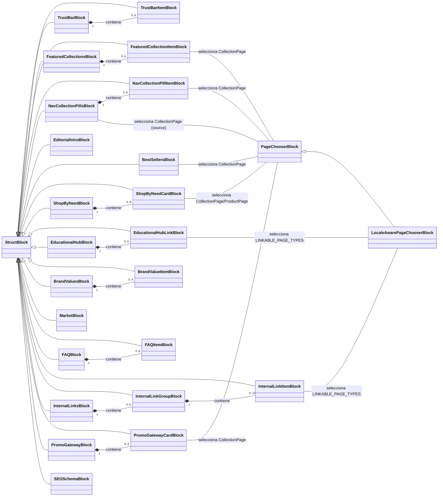

# Bloques StreamField para la Página de Inicio de Wagtail

Este módulo, `Wagtail_StreamField_Blocks_BloquesPaginaInicio`, define una colección de bloques `StreamField` de Wagtail diseñados específicamente para la construcción y gestión del contenido de las páginas de inicio dentro del sistema de gestión de contenido de Shopify. Estos bloques permiten a los editores construir páginas de inicio ricas y dinámicas con una variedad de componentes predefinidos, como secciones de productos destacados, valores de marca, preguntas frecuentes, enlaces internos y promociones.

## Arquitectura y Componentes

El módulo `shopify_content/blocks/home.py` encapsula la lógica para una variedad de `StructBlock` de Wagtail, que son bloques compuestos que agrupan otros bloques o campos individuales.

### `LocaleAwarePageChooserBlock`

Este es un `PageChooserBlock` especializado que filtra las `GlossaryTermPage` (páginas de términos del glosario) según la configuración regional de la página actual o de la sesión del usuario. Esto asegura la coherencia cultural en el contenido vinculado.

### Bloques de Contenido de la Página de Inicio

Los siguientes diagramas ilustran la estructura y las relaciones entre los distintos bloques definidos en este módulo.

### Descripción Detallada de los Bloques

*   **`TrustBarItemBlock`**: Representa un ítem individual dentro de una barra de confianza, con un icono, título y descripción.
*   **`TrustBarBlock`**: Un bloque que contiene una lista de hasta 6 `TrustBarItemBlock` para mostrar elementos de confianza en la página.
*   **`FeaturedCollectionItemBlock`**: Define un elemento de una colección destacada, con un selector de página para una `CollectionPage` y opciones para anular el título y la etiqueta.
*   **`FeaturedCollectionsBlock`**: Un bloque para mostrar varias colecciones destacadas, incluyendo una insignia, título, introducción y una lista de hasta 6 `FeaturedCollectionItemBlock`.
*   **`NavCollectionPillItemBlock`**: Representa un elemento de "píldora" de navegación de colección, vinculado a una `CollectionPage`.
*   **`NavCollectionPillsBlock`**: Contiene una lista de hasta 8 `NavCollectionPillItemBlock`. Sirve para enlaces rápidos en el encabezado. También puede sembrar las píldoras a partir de las colecciones relacionadas de una colección de origen.
*   **`EditorialIntroBlock`**: Un bloque para una sección de introducción editorial, con un encabezado, cuerpo de texto enriquecido y opciones de alineación.
*   **`BestSellersBlock`**: Muestra una sección de los productos más vendidos, vinculada a una `CollectionPage`, con un límite de productos, insignia y opciones de fondo.
*   **`ShopByNeedCardBlock`**: Una tarjeta individual para la sección "Comprar por necesidad", con título, descripción, una página de destino (producto o colección), etiqueta CTA, URL CTA e imagen.
*   **`ShopByNeedBlock`**: Contiene una lista de hasta 8 `ShopByNeedCardBlock` para agrupar productos por necesidad.
*   **`EducationalHubLinkBlock`**: Un enlace individual para el "Centro Educativo", utilizando `LocaleAwarePageChooserBlock` para páginas vinculables.
*   **`EducationalHubBlock`**: Una sección de centro educativo con título, introducción y una lista de hasta 6 `EducationalHubLinkBlock`.
*   **`BrandValueItemBlock`**: Un ítem individual que representa un valor de marca, con icono, título y descripción.
*   **`BrandValuesBlock`**: Muestra los valores de la marca con un encabezado, texto, imagen, posición de los medios y hasta 4 `BrandValueItemBlock`.
*   **`MarketBlock`**: Un bloque para información de mercado, con encabezado, cuerpo de texto enriquecido, puntos destacados, CTA y un código de mercado (ej. US, CA).
*   **`FAQItemBlock`**: Representa una pregunta frecuente individual con una pregunta y una respuesta de texto enriquecido.
*   **`FAQBlock`**: Un bloque que agrupa hasta 6 `FAQItemBlock` para una sección de preguntas frecuentes.
*   **`InternalLinkItemBlock`**: Un enlace interno individual, utilizando `LocaleAwarePageChooserBlock` para páginas vinculables.
*   **`InternalLinkGroupBlock`**: Agrupa una lista de hasta 12 `InternalLinkItemBlock` bajo un título.
*   **`InternalLinksBlock`**: Contiene una lista de hasta 6 `InternalLinkGroupBlock` para organizar enlaces internos.
*   **`PromoGatewayCardBlock`**: Una tarjeta de promoción para el "Promo Gateway", con título, insignia, fuente multimedia (productos de colección o lista de colecciones), colecciones primarias y de categoría, CTA y expansión de columna.
*   **`PromoGatewayBlock`**: Contiene una lista de hasta 4 `PromoGatewayCardBlock` para mostrar promociones.
*   **`SEOSchemaBlock`**: Un bloque para controlar la inclusión de esquemas SEO (FAQ y organización) en la página.

## Relación con el Sistema General

Estos bloques son componentes fundamentales de la gestión de contenido de Wagtail para las páginas de inicio de Shopify. Se utilizan dentro de la definición de `StreamField` en el modelo `HomePage` ([Home_Page_Models](../Home_Page_Models.md)), lo que permite a los editores de contenido arrastrar y soltar estos bloques para construir el diseño y el contenido de cualquier página de inicio.

La integración con el sistema más amplio se da a través de:

*   **Modelos de Página**: Estos bloques se incorporan en la estructura de `HomePage` para permitir la creación de contenido dinámico.
*   **Gestión de Colecciones y Productos**: Muchos bloques interactúan con `CollectionPage` y `ProductPage` (definidos en [Collection_Content_Models](../Collection_Content_Models.md) y [Product_Content_Models](../Product_Content_Models.md) respectivamente) para mostrar productos y colecciones de Shopify.
*   **Localización**: El `LocaleAwarePageChooserBlock` es crucial para mantener la coherencia de localización en los enlaces internos, asegurando que el contenido se vincule correctamente a las páginas específicas de cada configuración regional.
*   **API de Contenido**: La estructura definida por estos bloques se refleja en los esquemas de la API de contenido (como `HomeIn`, `HomeOut`, `HomePatch`, y `HomeSectionFields` en `api/schemas/home_sections.py` dentro de [Shopify_Content_API](../../Shopify_Content_API.md)), lo que permite que el contenido creado con estos bloques sea expuesto y consumido programáticamente.

En resumen, este módulo proporciona las herramientas esenciales para diseñar y poblar las páginas de inicio en el entorno de Wagtail/Shopify, ofreciendo flexibilidad y control granular sobre el contenido presentado a los usuarios finales.
