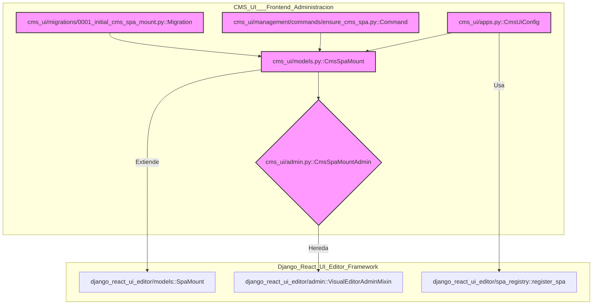
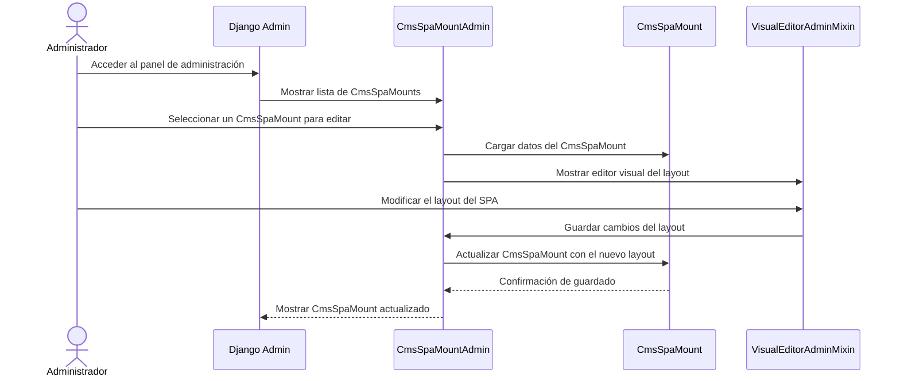

# Administración del Frontend de la UI del CMS

Este documento describe el módulo `CMS_UI___Frontend_Administracion`, que es fundamental para la configuración y gestión del editor de contenido del CMS (Sistema de Gestión de Contenidos) basado en una aplicación de una sola página (SPA) para comerciantes. Proporciona la infraestructura de backend para que la interfaz de usuario del CMS funcione correctamente, integrándose con el marco de administración de Django y el editor visual.

## Propósito y Funcionalidad Principal

El módulo `CMS_UI___Frontend_Administracion` se encarga de:

*   **Definir el punto de montaje del SPA del CMS**: Establece la URL base y la configuración inicial para la aplicación de una sola página del CMS.
*   **Integración con el panel de administración de Django**: Permite a los administradores gestionar las configuraciones del SPA del CMS a través del panel de administración de Django.
*   **Configuración de la aplicación Django**: Registra la aplicación `cms_ui` y sus componentes SPA dentro del sistema.
*   **Gestión de migraciones de base de datos**: Maneja la creación y actualización de la estructura de la base de datos para el modelo `CmsSpaMount`.
*   **Comandos de gestión para inicialización**: Proporciona un comando para asegurar que el punto de montaje del SPA del CMS y los grupos de permisos necesarios existan al iniciar o actualizar el sistema.

## Arquitectura y Relaciones entre Componentes

El módulo `CMS_UI___Frontend_Administracion` se construye sobre el marco `Django_React_UI_Editor_Framework` para proporcionar la funcionalidad de SPA. Los componentes clave dentro de este módulo trabajan en conjunto para ofrecer una experiencia de administración robusta.

### CmsSpaMount

El modelo `CmsSpaMount` (`cms_ui/models.py::CmsSpaMount`, `cms_ui/models.py::CmsSpaMount.Meta`) es el corazón de este módulo. Extiende de `SpaMount` (del módulo [Django_React_UI_Editor_Framework](../Django_React_UI_Editor_Framework.md)) y define cómo se comporta el SPA del CMS. Almacena información crucial como el slug, el título, el prefijo de la URL, la aplicación del editor y el diseño (layout) de las páginas del SPA. También sobreescribe el método `get_bootstrap` para inyectar datos de configuración específicos del CMS, como rutas de API y recursos gestionables (glosario, productos, colecciones, blogs, artículos, ubicaciones) que el frontend utilizará.

### CmsSpaMountAdmin

La clase `CmsSpaMountAdmin` (`cms_ui/admin.py::CmsSpaMountAdmin`) se registra en el panel de administración de Django para el modelo `CmsSpaMount`. Hereda de `VisualEditorAdminMixin` (también de [Django_React_UI_Editor_Framework](../Django_React_UI_Editor_Framework.md)), lo que permite la gestión del diseño del SPA a través de una interfaz de editor visual integrada en el panel de administración. Define qué campos se muestran en la lista, los filtros, los campos de búsqueda y los campos editables y de solo lectura para las instancias de `CmsSpaMount`.

### CmsUiConfig

La clase `CmsUiConfig` (`cms_ui/apps.py::CmsUiConfig`) es la configuración de la aplicación Django para `cms_ui`. En su método `ready()`, registra el SPA del CMS con el `spa_registry` del `Django_React_UI_Editor_Framework`. Esto vincula el prefijo de la URL del SPA (`/cms/`) con la aplicación frontend correspondiente y el modelo `CmsSpaMount` que gestiona su configuración.

### Comando `ensure_cms_spa`

El comando de gestión `Command` (`cms_ui/management/commands/ensure_cms_spa.py::Command`) es una utilidad para garantizar la configuración inicial del SPA del CMS. Crea o verifica la existencia de una instancia de `CmsSpaMount` con el slug "cms" y un diseño predeterminado. Además, crea un grupo de usuarios llamado `cms_editors` y le asigna los permisos necesarios para ver y modificar los objetos `CmsSpaMount`, lo que facilita la configuración de roles para los editores de contenido.

### Migración Inicial

La migración `Migration` (`cms_ui/migrations/0001_initial_cms_spa_mount.py::Migration`) define la estructura inicial de la tabla `CmsSpaMount` en la base de datos. Esto incluye campos como `slug`, `title`, `url_prefix`, `editor_app`, `layout`, `is_active`, `created_at` y `updated_at`.

### Diagrama de Componentes



### Diagrama de Interacción: Administración del SPA del CMS



### Flujo de Proceso: Inicialización del SPA del CMS

```mermaid
graph TD
    A[Inicio del Proyecto Django] --> B{cms_ui/apps.py::CmsUiConfig.ready()}
    B --> C[django_react_ui_editor/spa_registry::register_spa]
    C -- Registra SPA "cms" --> D[Sistema de SPA Registrado]

    subgraph Comando de Gestión
        E[Ejecutar python manage.py ensure_cms_spa] --> F{cms_ui/management/commands/ensure_cms_spa.py::Command.handle()}
        F --> G{CmsSpaMount.objects.get_or_create}
        G -- Crea/Obtiene --> H[Instancia de CmsSpaMount ("cms")]
        F --> I{Group.objects.get_or_create(name="cms_editors")}
        I -- Crea/Obtiene --> J[Grupo "cms_editors"]
        F --> K[Asigna permisos de CmsSpaMount a "cms_editors"]
    end

    D -- Configuración de SPA --> H
```

## Cómo encaja el módulo en el sistema general

El módulo `CMS_UI___Frontend_Administracion` es un pilar fundamental dentro de la arquitectura general del sistema, sirviendo como el puente entre el backend de Django y la interfaz de usuario de administración del CMS basada en React. Su función principal es proporcionar un punto de control y configuración para la SPA del CMS, que a su vez gestiona los distintos tipos de contenido del sistema.

*   **Proveedor de Interfaz de Administración**: Actúa como el proveedor de la interfaz de administración para el contenido de Shopify. A través de la `CmsSpaMountAdmin`, los usuarios pueden configurar aspectos clave del SPA, como su ruta base y su diseño visual.
*   **Integración Frontend-Backend**: Facilita la comunicación entre el frontend de React (definido en [CMS_UI___Frontend_Aplicacion_Frontend](CMS_UI___Frontend_Aplicacion_Frontend.md)) y el backend de Django, pasando configuraciones esenciales para el funcionamiento del SPA a través del método `get_bootstrap`.
*   **Gestión de Contenido Centralizada**: Aunque este módulo se enfoca en la administración de la interfaz, el SPA que configura es el punto central donde los editores interactúan con varios modelos de contenido gestionados por el módulo [Shopify_Content_Management](../Shopify_Content_Management.md), como artículos, productos, colecciones y glosarios.
*   **Control de Acceso**: La creación del grupo `cms_editors` por el comando `ensure_cms_spa` es crucial para establecer un control de acceso basado en roles para la administración del contenido, asegurando que solo los usuarios autorizados puedan realizar modificaciones en el CMS.
*   **Escalabilidad y Flexibilidad**: Al utilizar el `Django_React_UI_Editor_Framework`, este módulo permite una gestión flexible del layout del SPA, lo que significa que la estructura y la apariencia del editor de contenido pueden adaptarse y evolucionar sin requerir cambios significativos en el código del backend. Esto es vital para un CMS que necesita adaptarse a diversas necesidades de comerciantes.

En resumen, este módulo orquesta la disponibilidad y configurabilidad del entorno administrativo del CMS, permitiendo que los otros módulos de contenido y la interfaz de usuario frontend funcionen como una solución de gestión de contenido coherente y administrable.