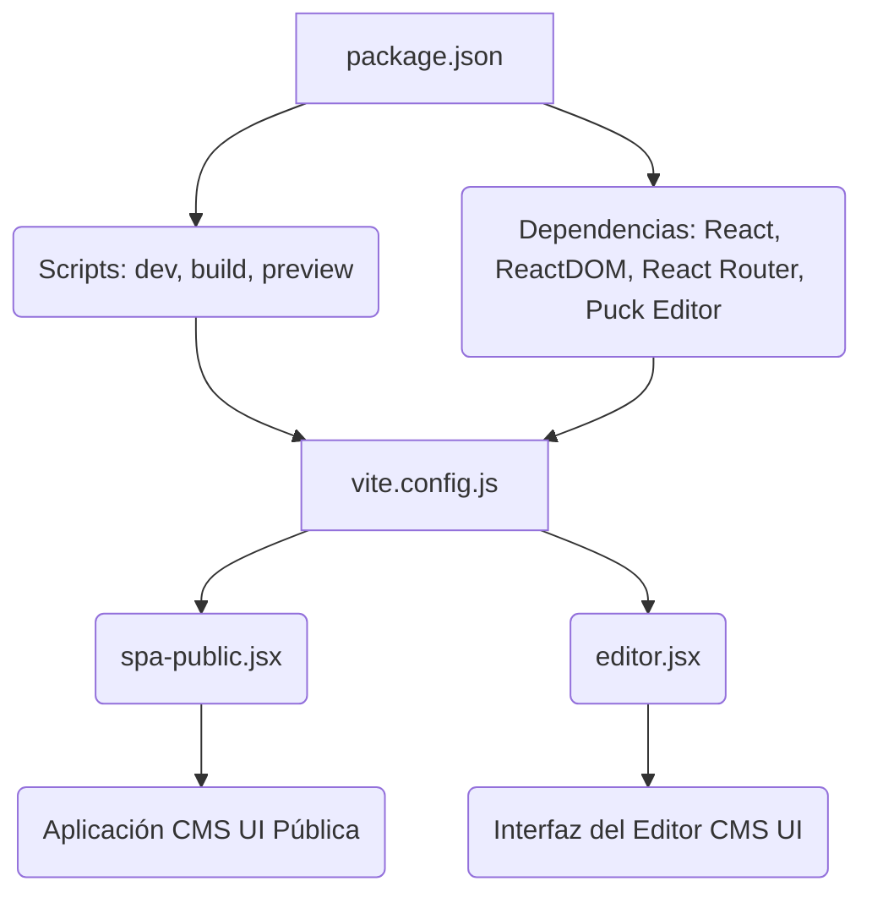
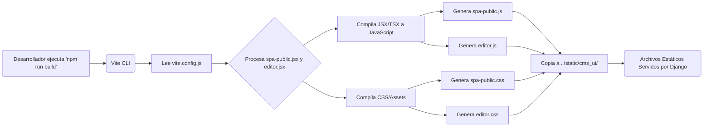

# Aplicación Frontend del CMS UI

Una descripción general del módulo `CMS_UI___Frontend_Aplicacion_Frontend`, que detalla su propósito, funcionalidad, arquitectura y cómo se integra en el sistema general del CMS.

## Propósito y Funcionalidad Principal

El módulo `CMS_UI___Frontend_Aplicacion_Frontend` engloba la aplicación de interfaz de usuario (UI) frontend del sistema de gestión de contenidos (CMS). Es una Aplicación de Una Sola Página (SPA) desarrollada con React y Vite, diseñada para ofrecer tanto una interfaz pública para la visualización de contenido como un entorno de edición para la gestión de dicho contenido.

Sus funcionalidades clave incluyen:
*   **Desarrollo Local:** Permite a los desarrolladores ejecutar la aplicación en modo de desarrollo con recarga en caliente a través del script `dev`.
*   **Construcción de Producción:** Compila y optimiza la aplicación para su despliegue en producción mediante el script `build`.
*   **Previsualización:** Facilita la previsualización de la versión construida de la aplicación con el script `preview`.
*   **Gestión de Contenido:** Proporciona una interfaz para editar y gestionar el contenido del CMS, probablemente utilizando el editor `@puckeditor/core`.
*   **Visualización Pública:** Sirve el contenido final a los usuarios a través de la SPA pública.

## Arquitectura y Relaciones entre Componentes

La aplicación frontend se organiza en torno a los siguientes componentes principales:

### `package.json`

Este archivo define los metadatos del proyecto, las dependencias y los scripts operativos.

*   **`name`**: `cms-ui-spa`
*   **`version`**: `0.1.0`
*   **`type`**: `module`
*   **`scripts`**:
    *   `dev`: Ejecuta el servidor de desarrollo de Vite.
    *   `build`: Compila la aplicación para producción utilizando Vite.
    *   `preview`: Sirve la aplicación construida para previsualización.
*   **`dependencies`**: Incluye librerías esenciales como `react`, `react-dom`, `react-router-dom` y `@puckeditor/core` para las capacidades del editor.
*   **`devDependencies`**: Herramientas de desarrollo como `@vitejs/plugin-react` y `vite`.

### `vite.config.js`

Este archivo de configuración de Vite gestiona el proceso de construcción del frontend.

*   **`plugins`**: Utiliza `@vitejs/plugin-react` para la compatibilidad con React.
*   **`build`**: Configura la salida de la construcción:
    *   **`outDir`**: Los archivos construidos se guardan en `../static/cms_ui`, lo que indica que estos activos estáticos son servidos por el backend de Django.
    *   **`emptyOutDir`**: Asegura que el directorio de salida se vacíe antes de cada construcción.
    *   **`input`**: Define los puntos de entrada principales de la aplicación:
        *   `spa-public.jsx`: El punto de entrada para la aplicación de cara al público.
        *   `editor.jsx`: El punto de entrada para la interfaz del editor del CMS.
    *   **`output`**: Personaliza los nombres de los archivos de salida, asegurando una separación clara entre los activos públicos y los del editor.

### Diagrama de Relaciones de Componentes

### Flujo del Proceso de Construcción

## Cómo Encaja el Módulo en el Sistema General

El módulo `CMS_UI___Frontend_Aplicacion_Frontend` es el cliente web que interactúa directamente con los usuarios y los editores de contenido.

*   **Integración con el Backend:** Los archivos estáticos generados por este módulo (JavaScript, CSS) se despliegan en el directorio `static/cms_ui` del proyecto, lo que permite que el backend de Django los sirva. Esto es fundamental para que la aplicación esté disponible en el navegador.
*   **Consumo de la API del CMS:** La aplicación frontend (tanto la parte pública como el editor) consume datos y servicios proporcionados por la API del CMS, que probablemente se gestiona en otros módulos del sistema (e.g., [Shopify_API___Schemas.md](../Shopify_API___Schemas.md)).
*   **Administración del CMS:** La interfaz del editor (`editor.jsx`) proporciona a los administradores una herramienta visual para gestionar el contenido del CMS, interactuando con las funcionalidades de administración definidas en módulos como [CMS_UI___Frontend/CMS_UI___Frontend_Administracion.md](CMS_UI___Frontend_Administracion.md).
*   **Experiencia del Usuario Final:** La `spa-public.jsx` es la responsable de renderizar el contenido final para los visitantes del sitio web, ofreciendo una experiencia de usuario rica y dinámica.

Este módulo es un componente crítico para la interacción del usuario y la gestión visual del contenido en el ecosistema del CMS.