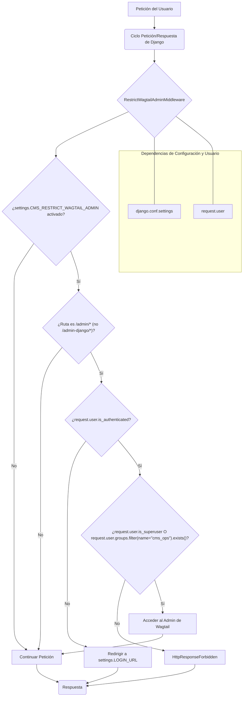
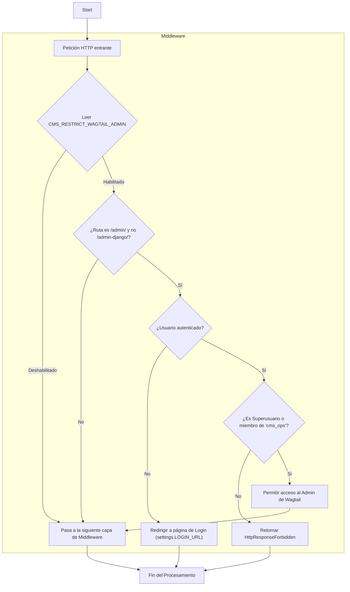

# Middleware del Frontend de CMS_UI

Este documento describe el módulo `CMS_UI___Frontend_Middleware`, que contiene el middleware `RestrictWagtailAdminMiddleware`. Este middleware es crucial para la seguridad y el control de acceso a la interfaz de administración de Wagtail.

## Propósito y Funcionalidad Principal

El middleware `RestrictWagtailAdminMiddleware` está diseñado para restringir el acceso a la interfaz de administración de Wagtail (`/admin/`) a usuarios autorizados. Si la configuración `CMS_RESTRICT_WAGTAIL_ADMIN` está activada en `django.conf.settings`, solo los superusuarios o los usuarios que pertenecen al grupo "cms_ops" pueden acceder a esta interfaz.

Cuando una petición llega al middleware:
1. Verifica si `CMS_RESTRICT_WAGTAIL_ADMIN` está habilitado en las configuraciones de Django.
2. Si está habilitado, comprueba si la ruta de la petición comienza con `/admin/` (excluyendo `/admin-django/`).
3. Si la ruta coincide con el patrón del administrador de Wagtail:
    *   Si el usuario no está autenticado, se le redirige a la página de inicio de sesión configurada por `settings.LOGIN_URL`.
    *   Si el usuario está autenticado pero no es un superusuario ni pertenece al grupo "cms_ops", se le deniega el acceso con un `HttpResponseForbidden`.
4. Si las condiciones anteriores no se cumplen, la petición se pasa al siguiente middleware en la cadena.

## Arquitectura y Relaciones entre Componentes

El `RestrictWagtailAdminMiddleware` se integra en el ciclo de petición/respuesta de Django y depende de varios componentes clave del sistema:

*   **`RestrictWagtailAdminMiddleware`**: La clase del middleware que intercepta las peticiones HTTP.
*   **Ciclo de Petición/Respuesta de Django**: El marco en el que opera el middleware, permitiéndole preprocesar las peticiones y postprocesar las respuestas.
*   **`django.conf.settings`**: Fuente de configuración para determinar si la restricción está activa (`CMS_RESTRICT_WAGTAIL_ADMIN`) y la URL de inicio de sesión (`LOGIN_URL`).
*   **`request.user`**: El objeto de usuario proporcionado por Django, utilizado para verificar el estado de autenticación y los permisos (superusuario o pertenencia a grupos).
*   **Sistema de Autenticación de Django**: Utilizado implícitamente a través de `request.user.is_authenticated` y explícitamente con `redirect_to_login`.
*   **Interfaz de Administración de Wagtail**: El recurso protegido por este middleware, accesible a través de URLs que comienzan con `/admin/`.

## Flujo de Proceso

El siguiente diagrama ilustra el flujo de una petición a través del `RestrictWagtailAdminMiddleware`:

## Cómo Encaja en el Sistema General

Este middleware es una capa de seguridad fundamental para el componente de [CMS_UI___Frontend.md](../CMS_UI___Frontend.md) al controlar el acceso a la interfaz de administración de Wagtail. Asegura que solo el personal operativo o con permisos elevados pueda realizar cambios en el contenido del CMS a través de esta interfaz. Esto ayuda a mantener la integridad y la seguridad del contenido, delegando la edición de contenido a interfaces más específicas si las hay para usuarios sin estos permisos. Su configuración a través de las configuraciones de Django permite una gestión flexible y adaptada a los requisitos de seguridad de cada entorno de despliegue.
