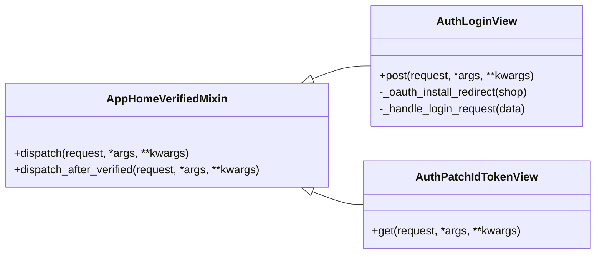
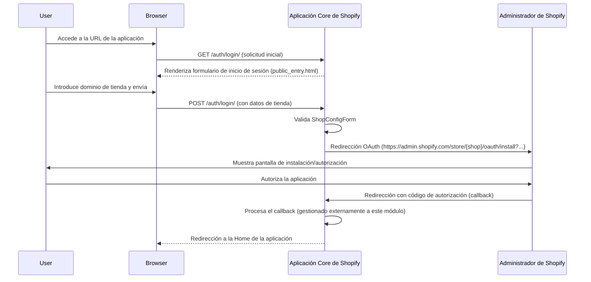
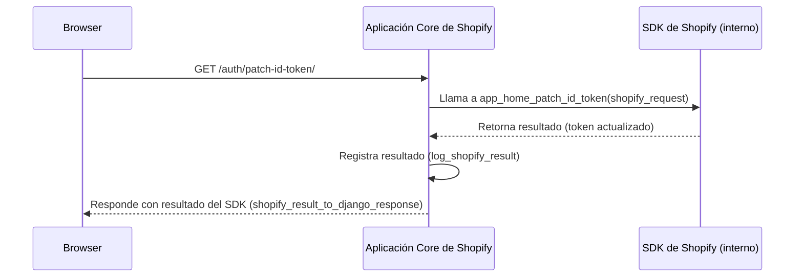

# Autenticación de la Aplicación Core de Shopify

Este módulo (`Core_Shopify_App_Autenticacion`) es el pilar de la gestión de autenticación dentro de la aplicación central de Shopify. Se encarga de la verificación de solicitudes, el inicio de sesión del usuario y el mantenimiento del ciclo de vida del token de acceso, garantizando una interacción segura y fluida con la plataforma Shopify.

## Funcionalidad Principal

El módulo se centra en las siguientes funcionalidades clave:

*   **Inicio de Sesión de Usuarios (AuthLoginView)**: Facilita el proceso de inicio de sesión de los usuarios de Shopify, redirigiéndolos para la instalación de OAuth cuando es necesario.
*   **Gestión del Token ID (AuthPatchIdTokenView)**: Maneja las solicitudes para actualizar el token ID, que es crucial para mantener sesiones autenticadas.
*   **Verificación de Solicitudes (AppHomeVerifiedMixin)**: Proporciona un mecanismo robusto para verificar que todas las solicitudes que llegan a las vistas protegidas provienen de una fuente auténtica y verificada por Shopify.

## Arquitectura y Relaciones entre Componentes

El módulo `Core_Shopify_App_Autenticacion` está diseñado para ser la primera línea de defensa en la seguridad y autenticación de la aplicación.

### `core/mixins.py::AppHomeVerifiedMixin`

Este mixin es fundamental para garantizar que solo las solicitudes verificadas por Shopify App Home sean procesadas por las vistas.

*   **Propósito**: Verifica las solicitudes entrantes utilizando el SDK de la aplicación Shopify.
*   **Uso**: Las vistas que requieren autenticación y verificación de Shopify heredan de este mixin. Implementan el método `dispatch_after_verified()` para la lógica de negocio que se ejecuta después de una verificación exitosa.
*   **Dependencias**:
    *   `get_shopify_app()`: Obtiene la instancia de la aplicación Shopify configurada.
    *   `request_to_shopify_req()`: Convierte una solicitud de Django en un objeto de solicitud compatible con el SDK de Shopify.
    *   `log_shopify_result()`: Registra los resultados de las operaciones del SDK de Shopify.
    *   `shopify_result_to_django_response()`: Convierte los resultados del SDK de Shopify en respuestas de Django.

### `core/views.py::AuthLoginView`

Esta vista maneja el proceso inicial de inicio de sesión y la redirección para la instalación de OAuth.

*   **Propósito**: Recibe los datos de la tienda (`shop`) del usuario, valida el formulario y redirige al usuario a la página de instalación de OAuth de Shopify si la aplicación aún no está instalada o requiere reautorización.
*   **Flujo de Trabajo**:
    1.  El usuario envía el dominio de su tienda.
    2.  Se valida el formulario `ShopConfigForm`.
    3.  Si es válido, se construye una URL de instalación de OAuth de Shopify y se redirige al usuario.
*   **Dependencias**:
    *   `ShopConfigForm`: Formulario para capturar el dominio de la tienda.
    *   `urlencode`: Para construir la cadena de consulta de la URL de redirección de OAuth.
    *   `settings.SHOPIFY_API_KEY`: Utiliza la clave de API de Shopify configurada.

### `core/views.py::AuthPatchIdTokenView`

Esta vista es un endpoint para que el frontend de Shopify "parchee" el token ID, asegurando que la sesión permanezca válida.

*   **Propósito**: Responde a las solicitudes de actualización del token ID, lo que es parte del ciclo de vida de la autenticación de la aplicación incrustada.
*   **Flujo de Trabajo**:
    1.  Recibe una solicitud del cliente (generalmente el iframe de Shopify).
    2.  Llama al método `app_home_patch_id_token` del objeto de la aplicación Shopify para procesar la solicitud.
    3.  Registra el resultado y devuelve la respuesta generada por el SDK de Shopify.
*   **Dependencias**:
    *   `get_shopify_app()`: Obtiene la instancia de la aplicación Shopify.
    *   `request_to_shopify_req()`: Convierte la solicitud.
    *   `log_shopify_result()`: Registra los resultados.
    *   `shopify_result_to_django_response()`: Convierte el resultado en una respuesta.

### Diagramas

#### Diagrama de Clases

#### Flujo de Autenticación (AuthLoginView)

#### Flujo de Actualización de Token ID (AuthPatchIdTokenView)

## Encaje en el Sistema General

El módulo `Core_Shopify_App_Autenticacion` es una parte vital de la [Aplicación Core de Shopify](Core_Shopify_App.md). Sin él, las otras funcionalidades de la aplicación no podrían interactuar de forma segura con la API de Shopify o verificar la identidad del usuario y la validez de la sesión incrustada.

Se relaciona estrechamente con:

*   **[Core_Shopify_App_Configuracion](Core_Shopify_App/Core_Shopify_App_Configuracion.md)**: Utiliza `ShopConfigForm` para la entrada del dominio de la tienda y potencialmente interactúa con `ShopConfig` para almacenar la configuración de la tienda y los tokens.
*   **[Shopify_API___Schemas_Core_Auth](../Shopify_API___Schemas/Shopify_API___Schemas_Core_Auth.md)**: Define los esquemas de autenticación y los modelos de `ApiKey` que podrían ser utilizados para métodos alternativos de autenticación o para gestionar las claves de API de la aplicación. Aunque `Core_Shopify_App_Autenticacion` se centra en OAuth, estos esquemas son parte del ecosistema de seguridad general.
*   **[`shopify_requests` (Cliente API de Shopify)](../Shopify_API_Client.md)**: Depende indirectamente de este cliente para las interacciones subyacentes con la API de Shopify a través del SDK de la aplicación.
