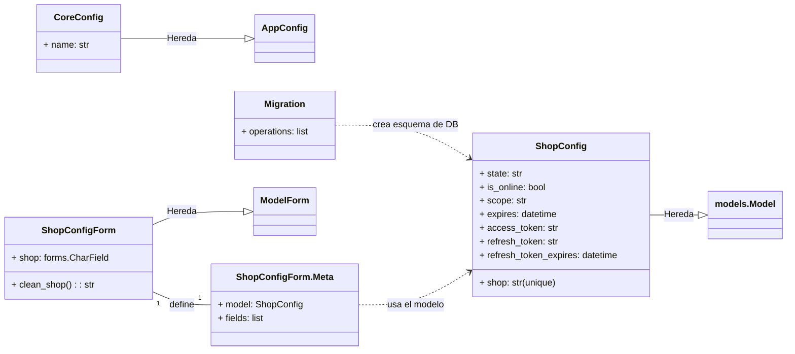

# Configuración de la Aplicación Core de Shopify

Este módulo, `Core_Shopify_App_Configuracion`, es responsable de gestionar la configuración central de la aplicación de Shopify, centrándose en el almacenamiento y la validación de la información de las tiendas conectadas. Establece los cimientos para la interacción de la aplicación con las tiendas Shopify individuales, manejando detalles cruciales como los tokens de acceso y la información del dominio de la tienda.

## Funcionalidad y Componentes Principales

El módulo `Core_Shopify_App_Configuracion` comprende los siguientes componentes clave:

### CoreConfig
- **Fichero:** `core/apps.py`
- **Descripción:** `CoreConfig` es una clase estándar de configuración de aplicación de Django que define el nombre de la aplicación (`'core'`). Su función principal es registrar la aplicación `core` dentro del proyecto Django, asegurando que sus modelos, vistas y otras funcionalidades sean reconocidos y cargados correctamente por el framework.

### ShopConfig
- **Fichero:** `core/models.py`
- **Descripción:** Este modelo de Django es el corazón de la configuración de la tienda. `ShopConfig` almacena toda la información persistente necesaria para interactuar con una tienda Shopify específica. Incluye campos para:
    - `shop`: El dominio único de la tienda Shopify (ej. `my-store.myshopify.com`).
    - `state`: El estado de la instalación u operación de la tienda.
    - `is_online`: Un indicador booleano que señala si la tienda está actualmente conectada o autenticada.
    - `scope`: Los permisos OAuth concedidos por la tienda.
    - `expires`: La fecha y hora de vencimiento de la sesión o token.
    - `access_token`: El token de acceso OAuth utilizado para realizar llamadas a la API de Shopify.
    - `refresh_token`: El token de refresco OAuth, si aplica, para obtener nuevos tokens de acceso.
    - `refresh_token_expires`: La fecha y hora de vencimiento del token de refresco.

### ShopConfigForm y ShopConfigForm.Meta
- **Fichero:** `core/forms.py`
- **Descripción:** `ShopConfigForm` es un `ModelForm` de Django asociado con el modelo `ShopConfig`. Se utiliza principalmente para validar la entrada del dominio de la tienda (`shop`) en la interfaz de usuario. Incluye una expresión regular (`SHOP_DOMAIN_RE`) para asegurar que el dominio de la tienda cumple con el formato `*.myshopify.com`, previniendo entradas inválidas antes de su almacenamiento.
    - `ShopConfigForm.Meta`: Define que este formulario está vinculado al modelo `ShopConfig` y que solo manejará el campo `shop`.

### Migración Inicial (0001_initial.py)
- **Fichero:** `core/migrations/0001_initial.py`
- **Descripción:** Esta migración de Django es responsable de establecer el esquema inicial de la base de datos para el modelo `ShopConfig`. Crea la tabla necesaria en la base de datos con todos los campos definidos en `ShopConfig`, asegurando que la aplicación pueda almacenar y recuperar la configuración de la tienda de manera persistente.

## Arquitectura y Relaciones entre Componentes

El siguiente diagrama de clases de Mermaid ilustra la arquitectura y las relaciones entre los componentes principales del módulo `Core_Shopify_App_Configuracion`:

**Explicación del Diagrama:**
- `CoreConfig` hereda de `AppConfig` de Django, un estándar para la configuración de aplicaciones.
- `ShopConfig` hereda de `models.Model`, siendo el modelo de base de datos para la configuración de la tienda.
- `ShopConfigForm` hereda de `ModelForm` y está estrechamente acoplado con `ShopConfig` a través de su clase `Meta` anidada, que especifica el modelo y los campos que debe manejar.
- La `Migration` inicial actúa sobre el modelo `ShopConfig` para establecer su estructura en la base de datos.

## Integración en el Sistema General

El módulo `Core_Shopify_App_Configuracion` es un pilar fundamental para el funcionamiento de la aplicación Shopify.

- **Autenticación y Sesiones:** Juega un papel crítico en el proceso de autenticación de Shopify. Cuando una tienda instala la aplicación y otorga los permisos necesarios, la información de `ShopConfig` se crea o actualiza, almacenando el `access_token` y otros datos de la sesión. Esto es manejado por el módulo [Core_Shopify_App_Autenticacion](../Core_Shopify_App_Autenticacion.md), que depende directamente de la capacidad de `ShopConfig` para persistir esta información.

- **Acceso a la API de Shopify:** Los `access_token` almacenados en `ShopConfig` son esenciales para que otras partes de la aplicación realicen llamadas autenticadas a la API de Shopify. Cualquier funcionalidad que requiera interactuar con los datos de la tienda Shopify (productos, pedidos, etc.) utilizará los tokens de esta configuración. Esto se relaciona con los módulos de [Shopify_API___Schemas](../Shopify_API___Schemas.md) y [Shopify_API_Client](../../Shopify_API_Client.md) para construir y ejecutar solicitudes.

- **Gestión de Contenido:** Para módulos como [Shopify_Content_Management](../../Shopify_Content_Management.md), que sincronizan o gestionan contenido entre la aplicación y Shopify, la información en `ShopConfig` es vital para identificar la tienda y sus credenciales.

- **Vistas y Formularios:** Las vistas que permiten a los administradores o usuarios configurar la aplicación para su tienda Shopify utilizarán `ShopConfigForm` para asegurar que los datos de entrada sean válidos antes de ser almacenados en una instancia de `ShopConfig`. Esto incluye las [Vistas Principales de la Aplicación Core de Shopify](../Core_Shopify_App_Vistas_Principales.md).

En resumen, `Core_Shopify_App_Configuracion` proporciona la capa de persistencia y validación para la información vital de la tienda Shopify, permitiendo que el resto de la aplicación funcione correctamente y de forma segura.
